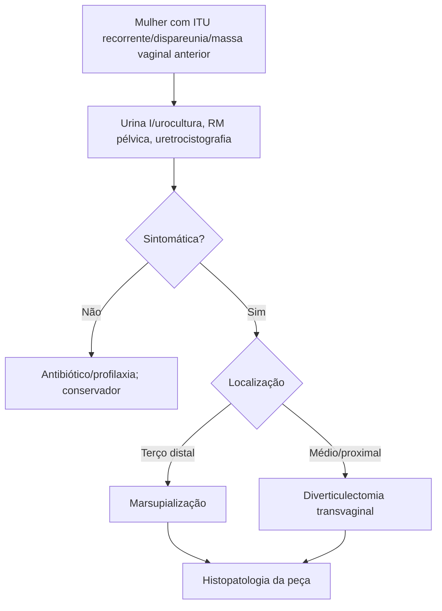

# Divertículo Uretral

> Resumo em palavras próprias do Whitebook (Condutas Cirúrgicas > Cirurgia Urológica), sem fisiopatologia, autoria e referências. Confira detalhes e doses na fonte: https://whitebook.pebmed.com.br/conteudo/?id=46336&categoryId=207&subcategoryId=214

**Definição:** exteriorização do tecido uretral para o espaço uretrovaginal; achado relativamente comum em mulheres com condições geniturinárias crônicas (ITU recorrente, gotejamento pós-miccional, dispareunia). Etiologia incerta: obstrução e infecção repetida das glândulas parauretrais → cisto → abscesso → herniação.

## Clínica
Disúria, polaciúria, hiperemia peridiverticular, dor pélvica, dispareunia, piúria, massa suburetral palpável, hematúria, ITU de repetição, incontinência de esforço, sintomas urinários baixos. Exame: massa na parede vaginal anterior, mais evidente com Valsalva; à compressão pode sair secreção purulenta pela uretra. Suspeitar em mulheres com distúrbios urinários/pélvicos incomuns.

## Diagnóstico
- Urina I e urocultura (infecção, hematúria). **RM de pelve** auxilia no pré-operatório. **Uretrocistografia** (mais usada; se negativa e suspeita forte, com pressão positiva). **Uretroscopia** (no ato cirúrgico: número de óstios, tamanho e localização). Urodinâmica diferencia incontinência genuína de gotejamento pós-miccional por urina residual no divertículo.
- **Diferenciais:** neoplasia vaginal/uretral (leiomioma, cisto de inclusão, cisto de Gartner, câncer), prolapso de parede anterior, fibrose periuretral, ureterocele ectópica, abscesso de glândula de Skene.

## Tratamento
- Antibiótico e profilaxia de ITU; sem outros sintomas, conduta conservadora.
- Sintomático: cirurgia. Dilatação uretral não é resolutiva. **Diverticulectomia transvaginal** é o tratamento definitivo; técnica depende da localização: **marsupialização** (alternativa; adequada no terço distal); terço médio/proximal: excisão total ou ablação parcial por incisão vaginal (vertical, transversal ou mediana).
- Associado a malignidade: ótimo tratamento não definido; diagnóstico prévio → uretrectomia + radioterapia; achado após diverticulectomia → radioterapia pós-operatória ou exenteração anterior com derivação. **Sempre enviar a peça para histopatologia.**

## Fluxograma (refeito, a partir do texto; o original não traz algoritmo)

