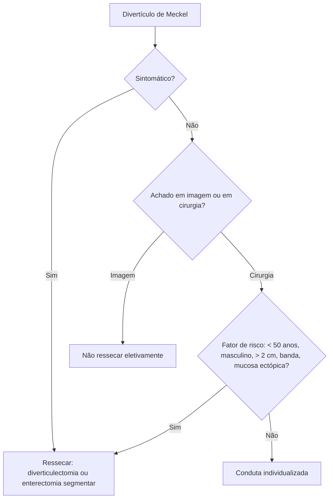

# Divertículo de Meckel

> Resumo em palavras próprias do Whitebook (Condutas Cirúrgicas > Cirurgia Pediátrica), sem fisiopatologia detalhada, autoria e referências. Confira detalhes e doses na fonte: https://whitebook.pebmed.com.br/conteudo/?id=22372&categoryId=207&subcategoryId=826

**Definição:** anomalia congênita mais comum do trato gastrointestinal; divertículo verdadeiro (todas as camadas) do íleo, por obliteração incompleta do ducto onfalomesentérico (vitelino). Fica na borda antimesentérica do íleo, a ~40–100 cm da válvula ileocecal; pode ter banda fibrosa até o umbigo, irrigação pela artéria mesentérica superior e tecido ectópico (gástrico principalmente; também pancreático, colônico, carcinoide). Mucosa ectópica aumenta as complicações.

## Epidemiologia
Presente em ~**2%** da população, mais em homens (1,5–4:1); em geral assintomático. Principal complicação em crianças: **sangramento**; em adultos: diverticulite ou obstrução. Complicação ao longo da vida em assintomáticos não ressecados: 4–6%. Risco de malignidade aumenta com a idade (pico na 8ª década).

## Clínica
- Achado em imagem ou em cirurgia por outra causa.
- **Hemorragia digestiva** (úlcera por ácido de tecido gástrico ectópico, 75–90%): mais comum em crianças (média 2 anos); sangramento baixo indolor, vermelho-escuro ou fezes enegrecidas (melena em adultos), crônico ou agudo volumoso; abdome inocente. Suspeitar em HDB indolor na criança ou sangramento sem fonte em endoscopia/colonoscopia do adulto.
- **Obstrução intestinal:** intussuscepção (recorrente/atípica, divertículo como cabeça), volvo, torção, hérnia de Littré, diverticulite; dor e distensão, náuseas, vômitos, parada de eliminação; dor em andar inferior, localização pouco útil.
- **Abdome agudo (diverticulite):** simula apendicite (suspeitar se houver apendicectomia prévia); inflamação, obstrução, perfuração, peritonite.
- **Risco de doença sintomática:** < 50 anos, sexo masculino, divertículo > 2 cm, tecido anormal ou ectópico, base ampla, banda fibrosa.

## Diagnóstico
Raramente antes da cirurgia.
- **Hemorragia:** **cintilografia com Tc-99m** (pertecnetato) é o exame de escolha; especificidade ~95%, sensibilidade 85% em crianças (54–60% em adultos); falso-positivos: duplicação entérica, volvo, DII, pós-operatório; falso-negativos: sem mucosa gástrica, bário recente (não fazer com contraste residual); cimetidina aumenta a sensibilidade. Arteriografia, enteroscopia de duplo balão e cápsula também ajudam; endoscopia e colonoscopia excluem outras causas.
- **Obstrução:** TC pode mostrar alça espessada junto ao íleo terminal com edema, separada do apêndice; raramente enterólitos calcificados.
- **Abdome agudo:** difícil distinguir da apendicite; USG pode mostrar estrutura tubular hipoecoica ou massa complexa não compressível, parede espessada, aspecto cístico, fundo cego.
- **Diferencial:** apendicite, doença diverticular do cólon, DII, angiodisplasia, câncer de cólon, duplicação entérica, síndromes polipoides.

## Tratamento
- **Sintomático:** ressecar.
- **Assintomático incidental em imagem:** não ressecar eletivamente.
- **Achado em cirurgia:** debatido; ressecar se houver qualquer fator de risco (< 50 anos, sexo masculino, > 2 cm, banda fibrosa, anormalidade palpável de mucosa ectópica).
- **Técnica:** diverticulectomia simples (cunha ou em "V") ou **enterectomia segmentar com anastomose primária**; base larga ou hemorragia → enterectomia. Se a anatomia patológica mostrar tecido ectópico residual após diverticulectomia simples por sangramento, a reoperação com enterectomia segmentar só é indicada diante de sangramento (a redação da fonte fala em "remissão do sangramento"; conferir na fonte). Via aberta ou laparoscópica. Morbimortalidade: assintomático ressecado 20% e 3%; sintomático 13% e nula.
- **Escolha conforme indicação (divertículo longo × curto):** diverticulite simples — diverticulectomia / cunha ou segmentar; diverticulite complicada com base inflamada ou perfurada, e obstrução — cunha ou segmentar nos dois; sangramento — diverticulectomia (longo) ou cunha/segmentar (curto); incidental — diverticulectomia (longo) ou cunha/segmentar (curto).
- **Complicações:** hemorragia, torção, hérnia de Littré, diverticulite, perfuração, peritonite, obstrução, intussuscepção, volvo, enterolito/bezoar, lipoma/hamartoma, malignização (carcinoide, adenocarcinoma, GIST, linfoma, leiomiossarcoma).

## Fluxograma (refeito, a partir do texto; o original não traz algoritmo)

