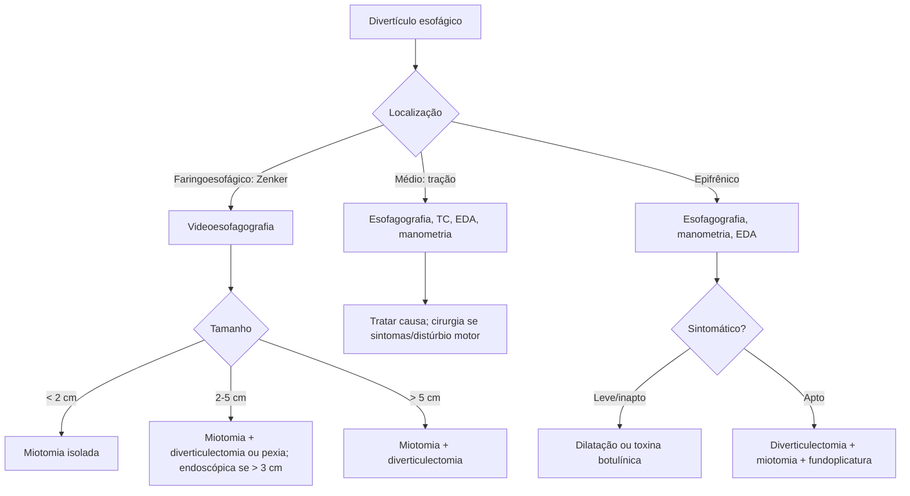

# Divertículos Esofágicos

> Resumo em palavras próprias do Whitebook (Condutas Cirúrgicas > Cirurgia Torácica), sem fisiopatologia, autoria e referências. Confira detalhes e doses na fonte: https://whitebook.pebmed.com.br/conteudo/?id=39156&categoryId=207&subcategoryId=215

**Definição:** doença benigna, em geral adquirida; formação sacular em fundo cego, revestida por epitélio, que se comunica com o esôfago.

## Etiologia e classificação
- **Pulsão** (distúrbio motor/incoordenação; herniação da mucosa por ponto fraco da parede muscular; formam pseudodivertículos): faringoesofágico (**Zenker**, triângulo de Killian, entre tireofaríngeo e cricofaríngeo) e epifrênico/supradiafragmático (terço inferior, associado a distúrbio do EEI; também iatrogênico). Sem anormalidade motora: causas congênitas (Ehlers-Danlos) ou traumáticas.
- **Tração** (inflamação com retração cicatricial dos tecidos periesofágicos; formam divertículos verdadeiros): esôfago médio/parabrônquico, por doença granulomatosa com linfonodos subcarinais (sequela de tuberculose, histoplasmose), mediastinite fibrosante ou neoplasia.
- **Composição:** verdadeiro (todas as camadas) × falso/pseudodivertículo (uma ou duas camadas). Existe ainda pseudodiverticulose intramural difusa.

## Epidemiologia
- **Zenker:** o mais comum (dois terços), embora raro; 50–80 anos; homens 3:1; ~2:100.000/ano; perda de elasticidade e tônus com a idade; apresenta-se mais à direita; associa-se a hérnia hiatal, DRGE, espasmo esofágico, anel de Schatzki; pneumonia aspirativa é causa comum de óbito em idosos.
- **Esôfago médio:** verdadeiros, terço médio junto aos brônquios, historicamente associados à tuberculose.
- **Epifrênico:** raro, ~10 cm da JEG, mais comum à direita e com abertura maior; associado a acalasia e espasmo esofágico difuso; < 10% desenvolvem sintomas ou complicações.

## Clínica
- **Zenker:** assintomático até crescer; disfagia (> 80%) intermitente e progressiva, globus, tosse, pigarro, sialorreia, regurgitação de alimento não digerido e fétido, halitose, voz “molhada”/disfonia, dor retroesternal, infecções respiratórias, emagrecimento.
- **Médio:** maioria assintomática; disfagia, dor torácica e regurgitação indicam distúrbio motor primário; tosse crônica sugere fístula broncoesofágica; hemoptise rara (erosão de linfonodo infectado para vasos/brônquios).
- **Epifrênico:** maioria assintomática; disfagia e regurgitação (ligadas ao distúrbio motor); regurgitação, dor epigástrica, anorexia, perda de peso, tosse e halitose indicam distúrbio avançado.

## Diagnóstico
- **Zenker:** clínica sugestiva; **videoesofagografia** (superior à fluoroscopia; teste inicial; bolsa posterior preenchida por contraste ao nível da cartilagem cricofaríngea); manometria e EDA não são necessárias (EDA: risco de entrar no divertículo e perfurar).
- **Médio:** esofagografia baritada (tamanho, localização, incidências laterais; descartar fístula); TC de tórax (linfadenopatia mediastinal); EDA (mucosa, malignidade, fístula); manometria em todos (doença motora primária).
- **Epifrênico:** achado frequentemente incidental; esofagografia com bário (melhor ferramenta: tamanho, número, posição, proximidade do hiato), manometria (identifica divertículo em até 90%) e EDA (esofagite, Barrett, câncer; risco de neoplasia).
- **Complicações:** aspiração (pneumonia/abscesso), bezoar, fístula aerodigestiva, paralisia de corda vocal, fístula com osteomielite cervical, ulceração/sangramento, perfuração, malignização, desnutrição.

## Tratamento — Zenker
Objetivos: aliviar disfagia, evitar aspiração, deter o crescimento (priorizar o distúrbio motor subjacente). Pode-se observar assintomáticos/oligossintomáticos.
- **Cirurgia** (quase sempre indicada; sintomáticos, complicações pulmonares, perda de peso): *diverticulectomia* com miotomia do cricofaríngeo (tecido íntegro, saco grande) ou *diverticulopexia* à fáscia pré-vertebral com miotomia (menos mórbida; pacientes frágeis). Acesso cervical esquerdo/em colar, miotomia proximal e distal (tireofaríngeo e cricofaríngeo); < 2 cm: miotomia isolada. Alta em ~72 h após esofagografia de controle. Complicações 4–25% (nervo laríngeo recorrente, fístula, ferida, aspiração, hematoma, estenose, fístula salivar); mortalidade 0–2%; bom resultado 75–99%; recorrência 3%.
- **Endoscópico (Dohlman — grampeador transoral):** 3–5 cm; contraindicado < 3 cm (miotomia incompleta); > 3 cm resultado semelhante ao aberto; exige extensão cervical (difícil em idosos); preditores de falha: abertura oral < 3 cm, pescoço curto, distância mento-hioide curta, IMC alto; conversão em 5–13%; alta em 24 h; complicações 2%, sem mortalidade, recorrência 11% em 32 meses. Alternativa flexível (overtube/cap; eletrocautério ou plasma de argônio; mais de uma sessão).
- **Por tamanho:** < 2 cm: miotomia isolada; 2–5 cm: miotomia + diverticulectomia (aberta, ou endoscópica se > 3 cm) ou diverticulopexia; > 5 cm: miotomia + diverticulectomia.

## Tratamento — esôfago médio
Descobrir a causa. Os de tração costumam ser ocasionais e não precisam de tratamento; tratar a doença de base. Cirurgia sempre associada ao tratamento da causa: diverticulopexia (suspensão à fáscia vertebral torácica), esofagomiotomia (dor torácica intensa ou disfagia com anomalia motora); derivação salivar e dieta enteral em casos selecionados sem condição cirúrgica.

## Tratamento — epifrênico
- Tende a progredir; tratamento sempre indicado nos sintomáticos (o texto traz também a frase “não necessita de tratamento”, provavelmente para assintomáticos; conferir na fonte).
- **Endoscópico** (sintomático leve, recusa ou inaptidão à cirurgia): dilatação pneumática ou toxina botulínica.
- **Cirurgia** (todos os sintomáticos aptos; bons resultados > 75%, mortalidade < 10%, morbidade elevada): diverticulectomia com fechamento primário (dilatador endoesofágico), esofagomiotomia ampla na parede contralateral, fundoplicatura parcial (Dor/Toupet por via abdominal; Belsey Mark IV por via torácica); se grande hérnia hiatal, excisar o divertículo, fazer miotomia e reparar a hérnia (falha → refluxo); < 2 cm podem ser suspensos à fáscia vertebral sem excisão. Acessos abdominal ou torácico (aberto ou minimamente invasivo).

## Fluxograma (refeito, a partir do texto; o original não traz algoritmo)

