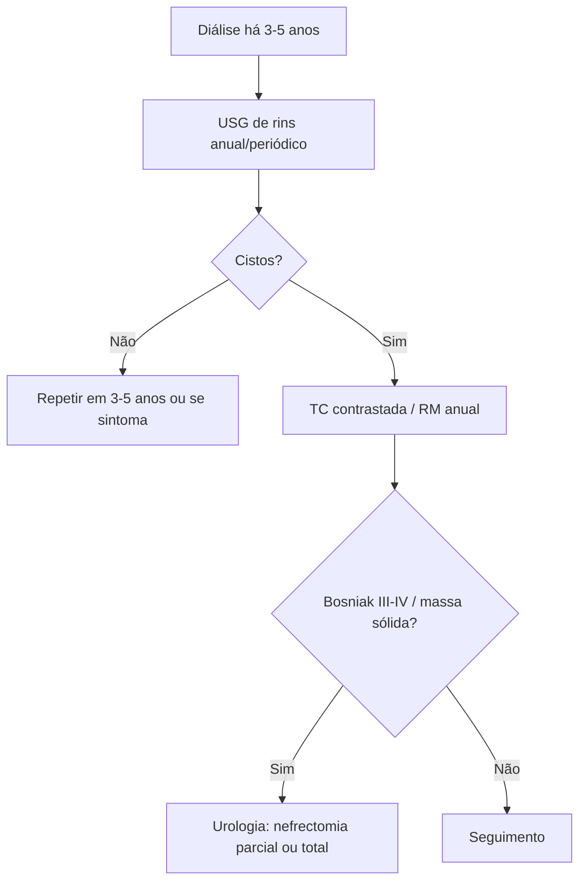

# Doença Cística Renal Adquirida

> Resumo em palavras próprias do Whitebook (Condutas Cirúrgicas > Cirurgia Urológica), sem fisiopatologia, autoria e referências. Confira detalhes e doses na fonte: https://whitebook.pebmed.com.br/conteudo/?id=44924&categoryId=207&subcategoryId=214

**Definição:** múltiplos cistos renais em pacientes com DRC avançada, sobretudo em diálise (hemodiálise ou peritoneal), sem doença cística hereditária prévia. Diagnóstico por USG, TC ou RM (TC e RM detectam melhor cistos pequenos). Diferencia-se da doença renal policística autossômica dominante porque os rins são **pequenos** (grandes na DRPAD).

## Epidemiologia
Pode aparecer com clearance de creatinina até 70 mL/min (na maioria < 50); incidência aumenta com o tempo de diálise; crianças e adultos; independe da causa da DRC.

## Clínica e complicações
- ~90% assintomáticos; sintoma mais comum hematúria, depois dor lombar e ITU; cistos aumentam em número e tamanho no seguimento. Em transplantados é menos comum, mas com mais carcinoma de células renais.
- **Ruptura de vaso cístico** em até 50%; raramente hemorragia perirrenal com hipotensão e morte (cistos muito volumosos).
- **Carcinoma de células renais:** 4–7% em 7–10 anos (0,18%/ano); em geral restrito ao rim, múltiplo e bilateral em 25–50%; surge após 8–10 anos de diálise; risco maior em homens (7:1), cistos volumosos e rins aumentados; também após o transplante.

## Rastreio e diagnóstico
- Rastreio anual em quem faz diálise por 3–5 anos, para lesões pré-malignas/malignas. Começa com USG; se negativa, repetir em 3–5 anos ou se sintomas. Se há cistos: TC contrastada ou RM sem gadolínio anual (sobretudo boa expectativa de vida e cistos grandes).
- TC é mais sensível para cistos (TC helicoidal melhor para malignidade); **RM com gadolínio** é a melhor para cistos complexos (cuidado em DRC 4–5). Cisto hemorrágico avascular não realça e regride em exames seriados.
- **Bosniak III e IV** (50% e 100% de chance de CCR): consulta urológica para nefrectomia parcial ou total.
- O rastreio não é consenso: benefício principalmente em jovens com longa expectativa de vida; irrelevante em idosos com comorbidades.

## Fluxograma (refeito, a partir do texto; o original não traz algoritmo)

