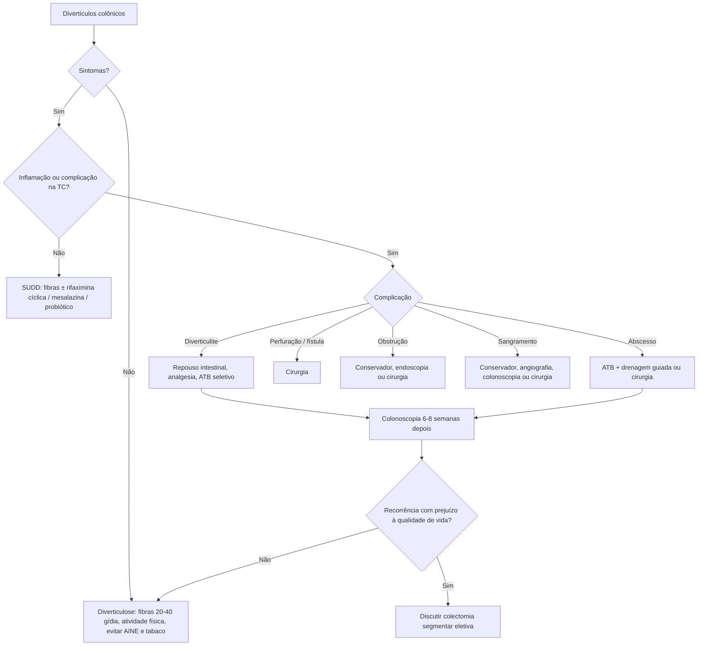

# Doença Diverticular do Cólon

> Resumo em palavras próprias do Whitebook (Condutas Cirúrgicas > Cirurgia Geral e do Aparelho Digestivo), sem fisiopatologia, autoria e referências. Confira detalhes e doses na fonte: https://whitebook.pebmed.com.br/conteudo/?id=23237&categoryId=207&subcategoryId=211

**Definição:** diverticulose é a presença de múltiplos divertículos no intestino grosso (pseudodivertículos: herniação de mucosa e submucosa entre as fibras musculares, nos pontos de penetração dos vasos retos). A doença diverticular ocorre em quem tem diverticulose e vai de quadros assintomáticos a graves.

## Epidemiologia
- Achado frequente em colonoscopia; rara antes dos 40 anos; sem diferença entre sexos. ~**30%** acima dos 60 anos e **60–80%** acima dos 80.
- Cólon esquerdo no Ocidente; cólon direito em asiáticos.
- Complicação mais comum: diverticulite aguda, seguida de hemorragia digestiva baixa.
- ~25% dos portadores de diverticulose têm sintomas. ~20% recidivam após um episódio de diverticulite; ~55% após o segundo; risco maior em mulheres jovens.

## Fatores de risco
Pouca fibra, sedentarismo, obesidade, vitamina D baixa, AINEs, opioides e corticoides, constipação, carne vermelha, nível socioeconômico alto, dislipidemia, tabagismo, idade > 65, síndromes de Williams, Marfan e Ehlers-Danlos, doença renal policística, fibrose cística, hereditariedade.

## Classificação
- **Diverticulose:** achado incidental, ~70% assintomática; até 2/3 da população mundial desenvolve ao longo da vida; sem necessidade de seguimento ou tratamento.
- **Doença diverticular sintomática não complicada (SUDD):** dor em cólica, constante ou recorrente, geralmente em FIE, sem inflamação; piora com alimentação, alivia com flatos/evacuação; distensão, flatulência, alteração do hábito intestinal; difícil diferenciar de síndrome do intestino irritável; calprotectina fecal discretamente elevada.
- **Sintomática recorrente:** sintomas recorrentes (> 1 ataque/ano) sem sinais de inflamação.
- **Sintomática complicada:** com diverticulite e outras complicações. Progressão para diverticulite em ~1% dos portadores de diverticulose; ~12% dos que têm diverticulite terão outra complicação (perfuração, fístula, abscesso).
- **Colite segmentar associada à diverticulose (SCAD):** inflamação inespecífica segmentar do sigmoide entre divertículos, sem envolver necessariamente o orifício; mais em homens > 50 anos; benigna e autolimitada, possivelmente no espectro da DII; sangramento retal, diarreia e/ou dor.

## Apresentação clínica
- **Não complicada:** dor baixa (usualmente FIE), em cólica ou constante, alívio com flatos/evacuação, distensão, mudança do hábito (constipação > diarreia), sensibilidade em FIE.
- **Complicada:** diverticulite aguda (abscesso, flegmão, fístula, perfuração com peritonite purulenta ou fecal, obstrução por aderências pós-inflamatórias); hemorragia digestiva baixa (80% autolimitados; 3–5% graves); estenose colônica.

## Diagnóstico
Em geral achado de rotina em colonoscopia.
- **Colonografia/enema opaco:** mostra presença e extensão, útil em estenoses; pouco usado hoje.
- **TC de abdome:** exame em abdome agudo, suspeita de diverticulite ou sintomas inespecíficos. Divertículos ao longo do cólon; na doença complicada: infiltração/abscesso pericólico, espessamento circunferencial, fístulas, abscesso pélvico, pneumoperitônio, infiltração do mesocólon, sinais de obstrução. Com contraste venoso detecta sangramento ativo se perda > 2 mL/min.
- **Colonoscopia:** biópsias e controle endoscópico de sangramento. Indicada se dúvida de neoplasia (câncer pode simular diverticulite na TC: risco de câncer **1,3%** na diverticulite não complicada e **7,9%** na complicada); sintomas persistentes/recorrentes no quadrante inferior esquerdo; suspeita de estenose ou sangramento recidivante; seguimento após o primeiro episódio ou após diverticulite complicada — fazer **6 a 8 semanas** após a resolução (risco de perfuração e dificuldade técnica); dispensável se houve colonoscopia de boa qualidade no último ano.
- **Laboratório:** hemograma, VHS, PCR; calprotectina fecal (diferencial com DII); EAS pode mostrar piúria estéril por inflamação adjacente a ureter/bexiga. **RX de tórax** se dor intensa e suspeita de perfuração (pneumoperitônio).
- **Diferenciais:** tumor de cólon, endometriose, úlcera péptica, ITU, apendicite, DII, colite infecciosa ou isquêmica, abscesso tubo-ovariano, cisto/torção de ovário, SII, dor funcional, gravidez ectópica, cistite, nefrolitíase, DIP.

## Tratamento
Objetivos: melhorar sintomas, resolver infecção/inflamação, prevenir recorrência e complicações graves.
- **Diverticulose:** sem medicamento. Fibras solúveis e insolúveis, **20–40 g/dia** de fontes variadas; não é preciso evitar sementes, nozes, milho ou pipoca. Fibra e dieta vegetariana podem reduzir o risco de diverticulite; evitar ultraprocessados, excesso de carne vermelha e fast-food. Atividade física, controle do peso, evitar AINEs, parar de fumar.
- **SUDD:** controlar sintomas e evitar progressão. Sem antibiótico sistêmico. Rifaximina, mesalazina e probióticos podem ser tentados, mas ainda em avaliação (a AGA não recomenda).
  - **Rifaximina:** antibiótico local pouco absorvido, eubiótico; uso cíclico **400 mg VO 12/12 h, 7–10 dias/mês**, de preferência com fibras, para sintomas e prevenção primária de diverticulite (NNT 59). Prevenção secundária: controverso.
  - **Mesalazina:** uso cíclico **1,6 g/dia, 7 dias/mês**; papel controverso, sem eficácia clara na prevenção de recorrência; formulações de liberação por tempo ou Eudragit-L parecem melhores que MMX.
  - **Probióticos** (*Lactobacillus*, *Bifidobacterium*, VSL#3, *S. cerevisiae*): evidência controversa; não evitam recidiva.
- **Complicada:**
  - Diverticulite aguda: repouso intestinal, analgesia, antibiótico (estudos sugerem dispensá-lo em casos selecionados leves), cirurgia (ver *Diverticulite aguda*).
  - Abscesso: antibiótico, drenagem guiada por imagem, cirurgia.
  - Perfuração e fístula: cirurgia.
  - Obstrução aguda: conservador ou cirurgia; crônica: endoscopia ou cirurgia.
  - Sangramento: conservador, angiografia, colonoscopia, cirurgia.
- Exercício vigoroso (ex.: corrida) reduz risco de diverticulite.

## Prognóstico e seguimento
- **DICA** (classificação endoscópica): 1 = 1–3 pontos (menor risco); 2 = 4–7 (intermediário); 3 ≥ 7 (maior risco).
- **CODA:** A ≤ 4% de diverticulite e ≤ 0,7% de cirurgia; B < 10% e < 2,5%; C > 10% e > 2,5%.
- ~45% têm dor abdominal periódica 1 ano após diverticulite, em geral por hipersensibilidade visceral.
- **Colectomia segmentar eletiva** em recorrentes com impacto na qualidade de vida: decisão individualizada; reduz mas não elimina a recidiva (em 5 anos: **15%** com ressecção × **61%** com tratamento clínico); dor crônica persiste em > 50% após a ressecção.

## Complicações
Hemorragia, abscesso, flegmão, fístula, perfuração, estenose, peritonite purulenta/fecal, obstrução por aderências, compressão ureteral com lesão renal, trombose séptica da veia porta.

## Fluxograma (refeito, a partir do texto; o texto original não traz um algoritmo único)

