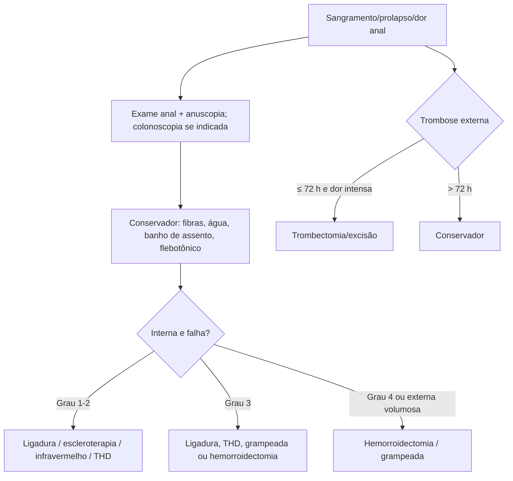

# Doença Hemorroidária

> Resumo em palavras próprias do Whitebook (Condutas Cirúrgicas > Cirurgia em Coloproctologia), sem fisiopatologia, autoria e referências. Confira detalhes e doses na fonte: https://whitebook.pebmed.com.br/conteudo/?id=22611&categoryId=207&subcategoryId=213

**Definição:** dilatação dos coxins vasculares da submucosa do canal anal, com sangramento, prurido, prolapso e dor. Hemorroidas externas (abaixo da linha pectínea), internas (acima) ou mistas. Coxins principais: lateral esquerdo, anterior direito e posterior direito.

## Epidemiologia e fatores associados
Pico entre 45 e 65 anos; até 40% assintomáticas; baixa morbidade, mas impacto na qualidade de vida; causa mais comum de sangramento retal vermelho vivo; hipertensão portal não aumenta a incidência. Fatores: idade, gestação, esforço evacuatório, diarreia crônica, longos períodos sentado, história familiar, disfunção do assoalho pélvico, lesão medular, tosse crônica.

## Clínica
- **Internas** (epitélio colunar, inervação visceral, indolores; endoderma): sangramento vivo, indolor, separado das fezes, gotejante; prolapso (espontâneo ou redução manual); prurido/umidade; sensação de evacuação incompleta. Dor só no pseudoestrangulamento (se é o sintoma principal, pensar em fissura). 
- **Externas** (pele, inervação somática, dolorosas; ectoderma): abaulamento que cresce ao esforço; em geral não sangram (exceto trombose ulcerada com drenagem). **Trombose externa:** nódulo arroxeado, endurecido, doloroso.
- Investigar: tipo de sangramento, hábito intestinal, redução manual, continência, dieta, história de neoplasia/pólipos. Febre, perda de peso, tenesmo, diarreia e dor abdominal **não** são compatíveis e pedem investigação.
- **Exame:** posição de Sims, inspeção estática e com esforço, trombose, plicomas, prolapso; excluir abscesso, fissura, fístula, condiloma, dermatite. Toque retal (massas, tônus, abscesso; não diagnostica internas). **Anuscopia** (coloproctologista; rápida, sem preparo) identifica internas e fissuras.

## Diagnóstico
Essencialmente clínico. Todo sangramento retal exige avaliação do cólon; jovem com quadro típico que responde ao tratamento, sem história familiar, dispensa investigação adicional. **Colonoscopia:** > 45 anos sem exame em 10 anos; > 40 anos ou 10 anos antes do familiar de 1º grau com CCR/adenoma avançado < 60 anos; > 40 anos com dois familiares de 1º grau afetados em qualquer idade; FIT positivo. Exames laboratoriais só se suspeita de anemia.
- **Graus (internas):** 1 sem prolapso, vascularização proeminente; 2 prolapso ao Valsalva, redução espontânea; 3 prolapso que exige redução manual; 4 prolapso crônico irredutível. Externas não têm graduação.
- **Diferenciais:** prolapso retal, papilas hipertróficas, condilomas, pólipos, plicomas, abscesso, fissura, fístula, DII, câncer anal/colorretal, disfunção do assoalho pélvico.

## Tratamento conservador (todos)
Fibras 20–30 g/dia (reduzem sintomas, não prolapso/dor/prurido), ~2 L de água, higiene com água ou lenço (sem papel), evitar esforço e permanência no vaso, atividade física. Banho de assento morno 10–15 min, 2–3×/dia. Laxativos osmóticos (PEG 4000) se constipação. Tópicos (anestésico, corticoide, emoliente; baixa evidência; corticoide ≤ 1–2 semanas). Flebotônicos (flavonoides, dobesilato de cálcio) reduzem sangramento, dor e prurido. Analgésicos/AINEs por via oral, sobretudo na trombose.

## Procedimentos ambulatoriais (internas graus 1–3 refratárias; não tratam externas)
Atenção: podem causar sepse perianal (febre, dor progressiva, retenção urinária) → reavaliar com urgência.
- **Ligadura elástica:** 1ª escolha em saudáveis, graus 1–3; 1–3 elásticos por sessão, intervalo 3–4 semanas; sucesso 60–80%; sem anestesia. Contraindicada em coagulopatia, anticoagulantes/antiagregantes, cirrose/hipertensão portal; imunossupressão é relativa. Complicações (1–3%): dor, retenção urinária, sangramento tardio, trombose, sepse, recorrência, vasovagal; dor intensa perto da linha pectínea exige retirar o elástico.
- **Escleroterapia** (fenol em óleo vegetal): graus 1–2; preferida em anticoagulados, hipertensão portal e imunossuprimidos; menos complicações, mais recorrência.
- **Fotocoagulação infravermelha:** graus 1–2; mais recorrência que a ligadura; complicações raras.

## Cirurgia
- **Indicações:** falha ambulatorial/recorrência, externas ou mistas volumosas sintomáticas, grau 3 refratário, grau 4.
- **Hemorroidectomia** (Ferguson fechada — menos dor/sangramento; Milligan-Morgan aberta): poucas recidivas, muita dor; complicações: retenção urinária (comum), hemorragia, estenose, infecção (< 1%), incontinência (coxins contribuem 10–15% da continência).
- **Hemorroidopexia grampeada:** ressecção circunferencial acima da linha pectínea; menos dor e recuperação rápida, mais recorrência; não trata externas; complicações: sangramento da linha de grampo, fístula retovaginal, estenose, perfuração retal.
- **THD (ligadura arterial guiada por Doppler)** ± mucopexia: menos dor e complicações, recorrência 3–60%, custo maior.
- **Pós-operatório:** analgesia/AINEs, fibras e osmóticos, banhos de assento, lavagem local sem papel, poupar opioides. Complicações: dor, hemorragia, retenção, sepse, recorrência, incontinência, estenose, plicomas.

## Trombose hemorroidária externa
Dor aguda e nódulo duro, pior até o 3º–4º dia; pode ulcerar e drenar. Se confortável: manejo expectante (analgésico, banho de assento, tópico). Excisão (anestesia local), sobretudo nas primeiras 72 h, alivia mais rápido; > 72 h: conservador.

## Algoritmo
Todos: dieta/hábitos, banho de assento, tópicos/flebotônicos. Externas não trombosadas: conservador; hemorroidectomia se volumosas, dor importante e desejo de resolução. Internas: grau 1 — ligadura, escleroterapia ou infravermelho; grau 2 — ligadura, escleroterapia, infravermelho ou THD; grau 3 — ligadura, hemorroidectomia, grampeada ou THD; grau 4 — hemorroidectomia ou grampeada.

## Situações especiais
Crohn/imunossupressão: preferir conservador. Cirrose/hipertensão portal: conservador, escleroterapia se necessário; ligadura elástica contraindicada; se falhar, hemorroidectomia ou ligadura com sutura (varizes retais raramente sangram). Gestação: sintomas frequentes e geralmente remitem após o parto; cirurgia só em gangrena/estrangulamento (2%); conservador (dieta, banho de assento, laxativos, fibras, tópicos; flebotônicos com cautela).

## Prognóstico
Bom; maioria resolve com conservador; recidiva até 50% com tratamento clínico; 5–10% após cirurgia.

## Fluxograma (refeito, a partir do texto; o original traz figuras de classificação)

