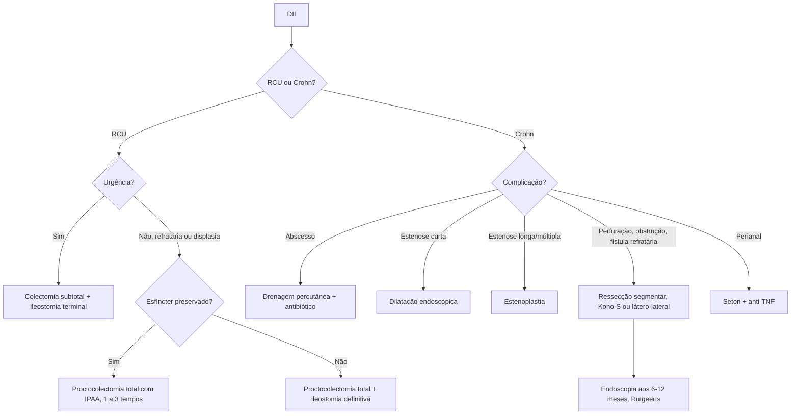

# Doença Inflamatória Intestinal (abordagem cirúrgica)

> Resumo em palavras próprias do Whitebook (Condutas Cirúrgicas > Cirurgia Geral e do Aparelho Digestivo), sem fisiopatologia, autoria e referências. Confira detalhes e doses na fonte: https://whitebook.pebmed.com.br/conteudo/?id=301&categoryId=207&subcategoryId=211

**Definição:** DII reúne principalmente a retocolite ulcerativa (RCU) e a doença de Crohn (DC); se não for possível distinguir, fala-se em colite indeterminada. O foco do tópico é o tratamento cirúrgico, que deve ser visto como parte do arsenal terapêutico, e não como falha do tratamento.

## Clínica
- **DC:** dor abdominal, diarreia crônica (com ou sem sangue), fadiga; também perda de peso, sangramento, febre baixa, retardo de crescimento, constipação. Complicações: estenose, fístulas (enteroentéricas, enterocutâneas, enterovesicais, perianais) e abscessos.
- **RCU:** hematoquezia, diarreia, tenesmo, muco, urgência, sensação de esvaziamento incompleto, dor abdominal. Complicações: megacólon tóxico, sangramento maciço, displasia/câncer.
- **Extraintestinais (ambas):** articulares (espondiloartrites), cutâneas (eritema nodoso, pioderma gangrenoso), oculares (uveíte), hepatobiliares (colangite esclerosante primária).
- **Fatores:** história familiar (principal), síndromes genéticas (ex.: Turner), imunodeficiências; tabagismo piora a DC e melhora a RCU; apendicectomia possivelmente protetora na RCU; contraceptivo oral aumenta o risco de DC (não de RCU); fatores psicossociais agravam sintomas.
- **Exame físico:** DC — paciente emagrecido, dor em quadrante inferior direito, plastrão/massa, fissuras, fístulas e plicomas perianais. RCU — sangue ao toque retal, dor em fossa ilíaca esquerda/hipogástrio. Sinais peritoneais sugerem complicação.

## Diagnóstico
- **Laboratório:** PCR, calprotectina fecal, anemia, hipoalbuminemia, deficiências de ferro, B12, folato e 25-OH-vitamina D.
- **Endoscopia:** DC — lesões salteadas, úlceras lineares/serpiginosas, “pedras de calçamento”; RCU — inflamação contínua a partir do reto, mucosa friável/ulcerada, sem áreas normais intercaladas.
- **Imagem:** enterorressonância ou enterotomografia (delgado e complicações); USG intestinal para monitorar.
- **Histologia:** DC — inflamação transmural, granulomas não caseosos (sugestivos, não patognomônicos); RCU — mucosa/submucosa, distorção de criptas, microabscessos, sem granulomas.

| Característica | RCU | DC |
|---|---|---|
| Envolvimento retal | Quase sempre | Comum |
| Delgado | Nunca (só ileíte por refluxo) | Comum |
| Lesões descontínuas | Não | Sim |
| Úlceras profundas/serpiginosas | Raras | Comuns |
| Transmural | Raro | Comum |
| Granulomas não caseosos | Não | Sim |
| Doença perianal | Não | Sim |
| Estenose | Rara | Sim |
| Fístulas complexas | Nunca | Sim |
| Perfuração | Rara | Eventual |
| Sangramento | Comum | Menos frequente |
| Manifestações extraintestinais | Frequentes | Frequentes |
| Deficiência de B12 | Não | Comum |
| Marcador sorológico | pANCA | ASCA |

## Retocolite ulcerativa: cirurgia
- **Urgência/emergência:** perfuração do cólon; hemorragia maciça; megacólon tóxico sem melhora em 48–72 h de tratamento clínico; colite fulminante refratária.
- **Eletiva:** pancolite com sintomas persistentes apesar do tratamento clínico; alto risco ou presença de neoplasia colorretal; retardo de crescimento. Menos de 5% precisam de cirurgia se a doença for restrita ao reto.
- **Técnicas:** na urgência, colectomia subtotal + coto retal sepultado (Hartmann/fístula mucosa) + ileostomia terminal; proctocolectomia se sangramento retal incontrolável. Eletiva: proctocolectomia total restauradora com bolsa ileal (IPAA) é o padrão com esfíncter preservado; na doença grave, em 2–3 tempos (colectomia subtotal com ileostomia → protectomia com IPAA e ileostomia em alça → fechamento). Disfunção esfincteriana ou comorbidades relevantes: proctocolectomia total com ileostomia definitiva.
- **Preparo:** corrigir anemia, coagulopatia, volemia, distúrbios hidroeletrolíticos/ácido-básicos e desnutrição; profilaxia de TEV; marcação do local da ostomia com estomaterapeuta; antibioticoprofilaxia; discutir com o gastroenterologista a suspensão de corticoide, biológicos e imunossupressores antes de cirurgia eletiva.
- **Ta-IPAA (transanal):** opção em centros experientes; menor internação, segurança semelhante aos acessos transabdominais.
- **Complicações:** leak pélvico (principal risco de falência da bolsa), estenose do canal anal, incontinência, fístulas, displasia/câncer da bolsa, reto retido/zona de transição, disfunção sexual (impotência, ejaculação retrógrada), infertilidade feminina (aconselhar no pré-operatório).

## Doença de Crohn: cirurgia
- **Indicações:** perfuração; megacólon tóxico; abscesso (perianal, intra-abdominal, retroperitoneal, parede) refratário — preferir drenagem por radiologia intervencionista; sangramento refratário; obstrução inflamatória/cicatricial; fístulas refratárias (perianal, enterovesical, retovaginal, enterocutânea, enteroentérica/enterocolônica com prejuízo nutricional); câncer colorretal ou de delgado; intratabilidade clínica; retardo de crescimento em crianças.
- **Princípios:** evitar grandes ressecções (síndrome do intestino curto); controle séptico prévio (drenagem percutânea de abscessos > 3 cm + antibiótico); na urgência, colectomia com ileostomia em colite fulminante/megacólon; ressecção segmentar em perfuração, hemorragia instável, estenose fibrótica obstrutiva ou refratariedade segmentar.
- **Estenose:** curta (< 5 cm) e não complicada → dilatação endoscópica com balão CRE sobre fio-guia; múltiplas ou longas → estenoplastia/estricturoplastia.
- **Doença perianal:** sedenhos (setons) + terapia combinada, principalmente anti-TNF.
- **Doença ileocecal limitada:** considerar ressecção ileocecal precoce — melhores desfechos em longo prazo que anti-TNF de primeira linha em coortes populacionais (seleção criteriosa e decisão compartilhada).
- **Hemorragia:** manejo endoscópico ou angiográfico se estável.
- **Técnicas:** Kono-S (ressecção do segmento estenótico, anastomose primária término-terminal antimesentérica e óstio perianastomótico nos cotos proximal e distal, unificados para restaurar a luz) reduz recorrência; anastomose látero-lateral grampeada costuma ter menos complicações e reoperações que a término-terminal; margens: não ampliar, ~2 cm bastam.
- **Otimização pré-operatória:** IMC, perda > 10% em 6 meses, albumina < 3; nutrição enteral preferida (7–14 dias, se tolerada), parenteral ≥ 2 semanas se a enteral não for tolerada; ferro EV e reposição de B12, folato, vitamina D; hipoalbuminemia é forte preditor de complicação. Prednisona ≥ 20 mg por > 6 semanas aumenta o risco cirúrgico e de insuficiência adrenal. Biológicos: alinhar o momento (suspensão não é obrigatória de rotina), reiniciar em 2–4 semanas com boa cicatrização; sepse/abscesso: drenar e dar antibiótico antes da ressecção. Profilaxia estendida de TEV (~30 dias) em casos selecionados. Imagem/endoscopia para mapear estenose, fístula e abscesso; marcar ostomia.
- **Intraoperatório:** anastomoses sem tensão e bem perfundidas; drenos seletivos; ileostomia de proteção em alto risco (IPAA em 2–3 tempos; DC com hipoalbuminemia, corticoide em altas doses, sepse recente, desnutrição); ERAS (normotermia, fluidos restritivos individualizados, profilaxia de náusea/vômito, analgesia multimodal) e, no pós, mobilização e dieta precoces, poucos cateteres, analgesia poupadora de opioides.
- **Pós-operatório:** vigiar leak pélvico (dor pélvica, taquicardia, febre discreta, débito purulento/fecal); recidiva da DC costuma ocorrer na anastomose — profilaxia precoce em alto risco ou endoscopia aos 6–12 meses (Rutgeerts ≥ 2 indica tratar/otimizar); evidência crescente para vedolizumabe e ustequinumabe; parar de fumar; reavaliação por imagem seccional e colonoscopia em 6–12 meses; biológicos de volta em 2–4 semanas se sem infecção; manter profilaxia de TEV quando indicada.

## Fluxograma (refeito, a partir do texto; o original não traz algoritmo, só a estrutura por doença)

