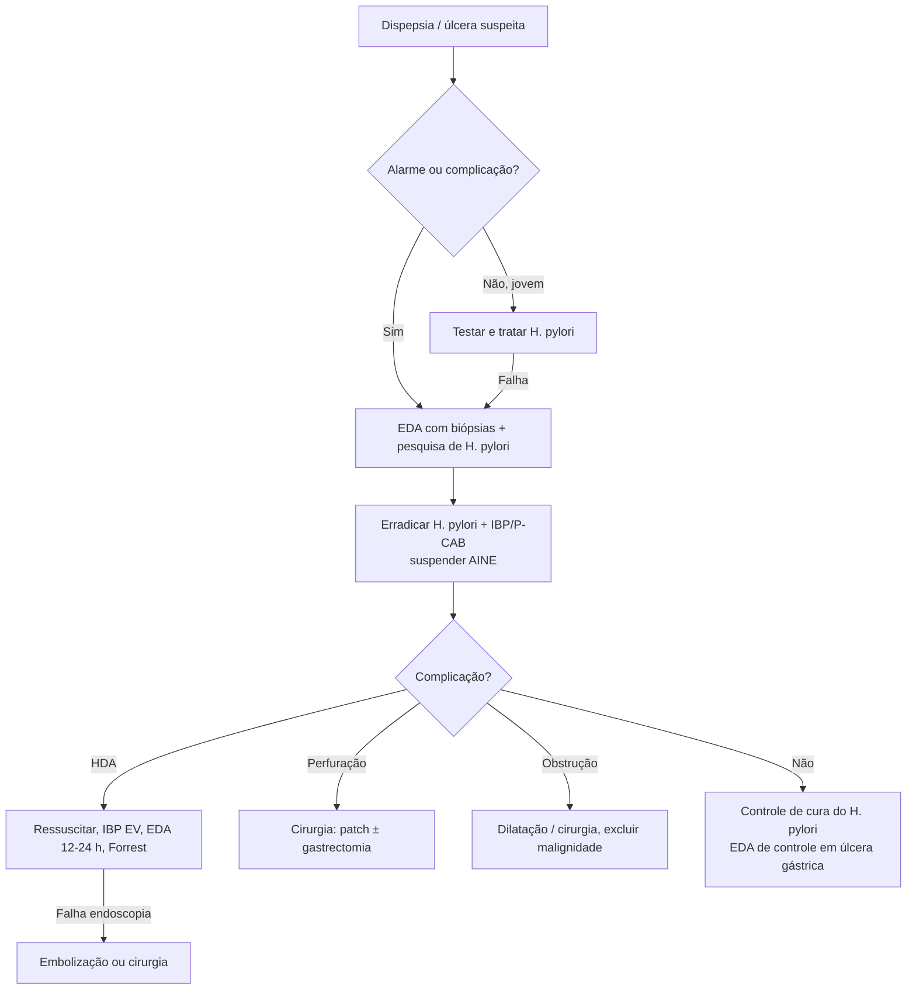

# Doença Ulcerosa Péptica

> Resumo em palavras próprias do Whitebook (Condutas Cirúrgicas > Cirurgia Geral e do Aparelho Digestivo), sem fisiopatologia, autoria e referências. Confira detalhes e doses na fonte: https://whitebook.pebmed.com.br/conteudo/?id=22167&categoryId=207&subcategoryId=211

**Definição:** solução de continuidade da mucosa gastroduodenal que atinge ao menos a muscular da mucosa (erosões são mais superficiais).

## Etiologia e epidemiologia
- ***H. pylori***: > 95% das úlceras duodenais e 80% das gástricas; a erradicação reduz a recorrência de 50% para < 2%. Outras infecções: CMV, HSV, sífilis, TB, *Candida*, mucormicose, paracoccidioidomicose, *Strongyloides*.
- **Medicamentos:** AINE (2ª causa; suspender cicatriza 95% e reduz recorrência de 40% para < 10%), corticoide, AAS e outros antiagregantes, anticoagulantes, bisfosfonatos, sirolimo, micofenolato, KCl, quimioterápicos, ISRS, pembrolizumabe. Risco dos AINE: baixo — tópico, celecoxibe, ibuprofeno; intermediário — diclofenaco, meloxicam, cetoprofeno, paracetamol > 2 g/dia; alto — naproxeno, indometacina, AINE + corticoide; muito alto — piroxicam, cetorolaco.
- **Outras:** neoplasias (linfoma, carcinoma, gastrinoma/Zollinger-Ellison, mastocitose), Crohn, sarcoidose, Behçet, síndrome do antro retido, bypass gástrico, lesão actínica, cirrose, isquemia, choque, idiopática (recorrência 25% em 5 anos).
- Fatores de risco para complicação: > 75 anos, tabagismo, doença cardiovascular, DUP prévia, narcóticos (cocaína, crack, anfetaminas).
- Incidência 0,1–0,3%/ano (1% nos infectados); prevalência na vida 5–10%.

## Quadro clínico
- **70% assintomáticos**, sobretudo idosos e usuários de AINE (apresentam-se com complicações). Dispepsia em 80% (epigastralgia em queimação ou desconforto pós-prandial). Úlcera duodenal: dor 2–5 h após comer e à noite (23h–2h), com despertar.
- **Alarme (indica EDA):** dispepsia nova após 50 anos, emagrecimento, disfagia/odinofagia, vômitos persistentes, sangramento GI, massa, icterícia, linfonodomegalia, anemia ferropriva inexplicada, história familiar de câncer GI.
- **Exame:** dor epigástrica à palpação; complicações — HDA (73%: hematêmese, melena, sinais de anemia/choque), perfuração (9%: peritonite, abdome em tábua), obstrução (3%: vascolejo gástrico).

## Diagnóstico
- Suspeita com dispepsia, medicamentos ulcerogênicos, infecção por *H. pylori* ou complicações. **EDA** é o diagnóstico definitivo (teste da urease; biópsias de antro e corpo para *H. pylori*; biópsia das úlceras gástricas). Jovens sem alarme: testar e tratar (teste respiratório C13/C14 ou antígeno fecal); EDA se falhar. Sorologia só para inquéritos (bom VPN).
- Labs: hemograma, cinética do ferro; na HDA, função renal, eletrólitos (inclusive cálcio), hepatograma, coagulograma. RX de abdome agudo se suspeita de perfuração (pneumoperitônio).
- **EDA indicada:** complicação aguda, alarme, refratariedade após 8 semanas de tratamento empírico, diferenciais. Benigna: bordas regulares, fundo liso. Maligna: massa ulcerada infiltrativa, pregas convergentes irregulares, bordas espessas. **Toda úlcera gástrica deve ser biopsiada** nas margens (pré-pilóricas costumam ser pépticas); duodenais só se Crohn, linfoma ou infecção (CMV: biópsia do centro).
- **Dicas:** para sensibilizar a pesquisa de *H. pylori*: 14–28 dias sem antibiótico, IBP, P-CAB e bismuto; ≥ 2 métodos; protocolo de Sydney (2 fragmentos do antro pré-pilórico, 1 da incisura, 2 do corpo para histologia + 1 antro e 1 corpo para urease); na HDA com teste negativo, repetir após 1 mês. Para AINE: perguntar por analgésicos, AAS, clopidogrel, antigripais, relaxantes musculares. **Zollinger-Ellison:** úlceras múltiplas, refratárias, em duodeno distal/jejuno, com diarreia e DRGE; gastrina com jejum de 8 h, sem IBP por ≥ 14 dias e sem anti-H2 por ≥ 24 h.
- **Sakita:** A1, A2 (ativa); H1, H2 (cicatrização); S1 (cicatriz vermelha), S2 (cicatriz branca).
- **Forrest (HDA):** IA em jato; IB babando; IIA coto vascular visível; IIB coágulo; IIC fundo hematínico; III sem sangramento. IA, IB e IIA = maior risco de ressangramento: terapia combinada (adrenalina + clipe).
- **Johnson:** I — pequena curvatura próxima à incisura (ácido normal/baixo); II — gástrica com duodenal (hipercloridria); III — pré-pilórica (hipercloridria); IV — estômago proximal/cárdia; V — qualquer local, por AINE.
- **Diferenciais:** dispepsia funcional ou medicamentosa, gastrite eosinofílica, DRGE, esofagite, distúrbios motores, cólica biliar, paniculite mesentérica, neoplasias, DAC, dissecção de aorta, angina mesentérica, pericardite, pneumonia de bases, TEP, pneumotórax, pancreatite, parasitoses.
- **Seguimento:** EDA de controle (8 semanas após o fim do tratamento) em refratários e úlceras gástricas; sempre checar erradicação do *H. pylori*. Repetir EDA também se: etiologia desconhecida, persistência, úlcera gigante (> 2 cm) ou suspeita de malignidade, biópsia ausente/inadequada (< 4 fragmentos), primeira EDA em HDA, risco de câncer gástrico (> 50 anos, *H. pylori*+, história familiar, atrofia, displasia, metaplasia intestinal, adenoma). Úlcera duodenal: sem EDA de controle de rotina.
- **Complicações:** sangramento; perfuração (2–10%; livre, tamponada, fistulizada, pancreatite se parede posterior); obstrução (canal pilórico/duodeno; saciedade precoce, vômitos, emagrecimento).

## Tratamento clínico
- **Erradicação do *H. pylori*** (14 dias):
  - Triplo: amoxicilina 1 g 12/12 h + claritromicina 500 mg 12/12 h + IBP 12/12 h; ou amoxicilina 1 g 12/12 h + levofloxacino 500 mg/dia + IBP 12/12 h.
  - Duplo: amoxicilina 1 g 8/8 h + vonoprazana 20 mg 12/12 h.
  - Quádruplo: IBP + tetraciclina 500 mg 6/6 h + metronidazol 400 mg 8/8 h + subcitrato de bismuto 120 mg 6/6 h ou 240 mg 12/12 h.
  - Controle de cura ≥ 4 semanas depois: teste respiratório, antígeno fecal ou EDA com histologia (nunca urease nem sorologia).
- **Suspender** fatores: tabaco, álcool, AINE/ulcerogênicos.
- **Antissecretor:** IBP/P-CAB superiores aos anti-H2 (reservados para contraindicação). *H. pylori*+: úlcera duodenal — IBP/P-CAB por 14 dias junto aos antibióticos e manter 4–8 semanas; úlcera gástrica — manter 8–12 semanas. Associada a AINE: IBP ≥ 8 semanas (manutenção se AINE continuar).
- **HDA ulcerosa:**
  - Cristaloide 30 mL/kg se instável; noradrenalina se choque refratário; 2 acessos calibrosos.
  - Escores: **Rockall** (< 3 bom; > 8 alto risco de ressangramento/morte); **Blatchford** (≥ 6 alto risco de necessitar intervenção; **0** pode ser ambulatorial com EDA eletiva em uma semana).
  - Transfundir se Hb < 7–8 g/dL (cardiopatas: manter > 8–9); em choque ou sangramento vultuoso, independentemente da Hb; tipagem e prova cruzada.
  - **IBP EV** por ≥ 72 h: pantoprazol/omeprazol 80 mg bólus + 8 mg/h ou 40 mg 12/12 h; omeprazol 80 mg + 40 mg 12/12 h; esomeprazol 80 mg + 40 mg 12/12 h; depois via oral.
  - **EDA em 12–24 h** após estabilizar (EDA muito precoce, antes da compensação, aumenta mortalidade). Alto risco (Forrest Ia, Ib, IIa, IIb): hemostasia combinada e IBP em dose alta por 3 dias, depois VO 2×/dia por 2 semanas e então 1×/dia. Baixo risco (IIc, III): IBP VO 1×/dia e alta se possível. Eritromicina 250 mg EV 30 min antes da EDA melhora a visão. Repetir a EDA no ressangramento; falha na 2ª terapia endoscópica → cirurgia ou embolização superseletiva (via tronco celíaco). Sem lavagem gástrica; sem benefício do ácido tranexâmico.
  - **Antitrombóticos:** AAS em prevenção secundária: retomar assim que houver hemostasia; em dupla antiagregação, suspender clopidogrel por 5 dias e manter AAS (conversar com cardiologista, sobretudo stent recente); prevenção primária: considerar suspensão definitiva. Varfarina: suspender 3–15 dias (alto risco trombótico: retorno em < 7 dias). DOACs: avaliar retorno 2 dias após hemostasia. IBP enquanto usarem antitrombóticos. Dieta: suspensa por ≥ 24–48 h nas úlceras de alto risco. Repor ferro se necessário.
- **Manutenção** se: úlcera > 2 cm, > 50 anos ou muitas comorbidades; idiopática, refratária (> 5 mm após 12 semanas) ou recorrente (2 episódios/ano); falha de erradicação; uso contínuo de AINE/AAS/antiagregantes. Refratária: repetir EDA com biópsias, outro método para *H. pylori*, checar adesão e fármacos; dobrar IBP por 8–12 semanas com EDA de controle.
- **Profilaxia com IBP** em ≥ 3 fatores: ≥ 65 anos, DUP prévia, AAS, prednisona > 30 mg/dia por > 2 meses, AINE em dose alta (ibuprofeno > 750, diclofenaco > 100, celecoxibe > 200 mg/dia) ou paracetamol > 2 g/dia, ISRS, anticoagulantes.

## Tratamento cirúrgico
Hoje quase só em urgência. Indicações: hemorragia com instabilidade ou persistência (> 6 CH) refratária à terapia endoscópica/endovascular; perfuração; obstrução; suspeita de malignidade. Vagotomia reduz o ácido em ~50%; vagotomia + antrectomia em até 85%.
- **Úlcera duodenal:** intratável — vagotomia de células parietais (superseletiva); sangramento — duodenotomia longitudinal, sutura do vaso (gastroduodenal) com 3 pontos em U, piloroplastia e vagotomia troncular; perfuração — patch de omento (Graham) ± vagotomia superseletiva; obstrução — excluir malignidade, vagotomia superseletiva + gastrojejunostomia.
- **Úlcera gástrica:** intratável/sangramento — tipo I: gastrectomia distal com Billroth I; tipos II/III: gastrectomia distal + vagotomia troncular. Perfuração — tipo I estável: gastrectomia distal Billroth I; tipo I instável: biópsia e patch; II/III: patch. Obstrução — excluir malignidade, antrectomia com vagotomia. Tipo IV: depende do tamanho, distância da JEG e inflamação (ressecar; gastrectomia com parte do esôfago + Y de Roux; úlcera a 2–5 cm da JEG: procedimento de Pauchet; Csendes em estáveis; Kelling-Madlener em instáveis). Se há malignidade: gastrectomia subtotal com Billroth II ou Y de Roux. ~15% das tipo I são tipo II e podem exigir vagotomia.
- **Úlcera intratável:** falha após 12 semanas ou recaída após suspensão, já considerando erradicação e suspensão de AINE; dosar gastrina (gastrinoma).
- **Úlcera gástrica gigante (≥ 2 cm):** mais maligna (6–30%, cresce com o tamanho), pode invadir baço/pâncreas/fígado/cólon e parecer irressecável; cura clínica em 80% (EDA em 6–8 semanas); complicações ou falha: gastrectomia incluindo o leito, com vagotomia nos tipos II/III; em alto risco: excisão local + vagotomia + piloroplastia.
- **Técnicas:** *vagotomia troncular* (seção dos vagos acima dos ramos celíaco e hepático) + drenagem (Heineke-Mikulicz, Finney, Jaboulay): refluxo biliar mais comum após gastroenterostomia, diarreia após piloroplastia, dumping similar; rápida, boa para hemorrágicas instáveis. *Vagotomia de células parietais:* preserva o antro, menos complicações (~1%), recorrência 10–15% (tratável com IBP), não é a escolha para úlcera pré-pilórica; secciona-se a "pata de corvo" e cuida-se do nervo criminoso de Grassi. *Antrectomia/gastrectomia distal:* recorrência 0–2% (padrão-ouro), mas ~20% de síndrome pós-gastrectomia; contraindicações relativas: cirrose, cicatrizes duodenais, cirurgia duodenal prévia; reconstrução Billroth I (preferida em doença benigna) ou II. *Gastrectomia subtotal:* para malignidade.
- **Complicações:** hemorragia, infecção, retardo de esvaziamento (~5%).

## Fluxograma (refeito; o original "Decision Tracks" está como diagrama na fonte)

