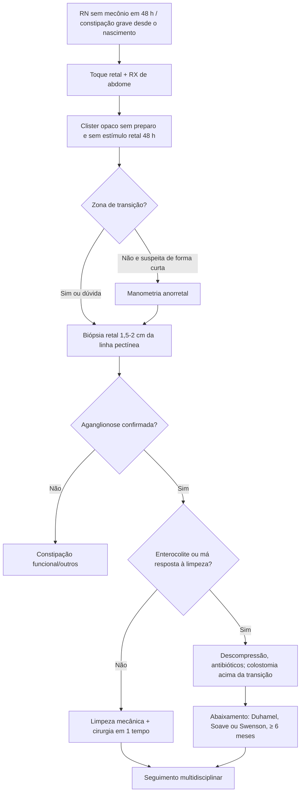

# Doença de Hirschsprung

> Resumo em palavras próprias do Whitebook (Condutas Cirúrgicas > Cirurgia Pediátrica), sem fisiopatologia detalhada, autoria e referências. Confira detalhes e doses na fonte: https://whitebook.pebmed.com.br/conteudo/?id=39157&categoryId=207&subcategoryId=826

**Definição:** megacólon aganglionar congênito: ausência de neurônios dos plexos mioentéricos (Meissner e Auerbach) em um segmento intestinal, que fica espástico e não propulsivo, causando obstrução funcional. Sinônimos: aganglionose congênita do cólon, megacólon congênito, síndrome de aganglionose intestinal.
Base: parada prematura da migração craniocaudal das células da crista neural (5ª–12ª semana). Há zona de transição entre o segmento normal e o aganglionar; o intestino proximal dilata e hipertrofia; o reflexo de abertura do esfíncter interno é anormal ou ausente.

## Epidemiologia
- 1:5.000 nascidos vivos; forma clássica (retossigmoide) 4× mais em meninos; 10% hereditários; causa mais comum de obstrução funcional do cólon em crianças.
- Diagnóstico no 1º mês em 65% e até 1 ano em 95%.
- Genética: deleção 10q, proto-oncogene **RET**; anomalias associadas em 5–30%, sendo a síndrome de Down a cromossômica mais comum. Associações: NEM 3, disautonomia familiar, surdez, Waardenburg, von Recklinghausen, Smith-Lemli-Opitz, Goldberg-Shprintzen, entre outras.
- **Extensão:** clássica retossigmoide (até 80%); ultracurta (rara, questionada); segmento longo, até o ângulo esplênico/cólon descendente (10%); **aganglionose colônica total** (síndrome de Zuelzer-Wilson), até o íleo (8%).

## Clínica
- **Neonato:** retardo na eliminação de mecônio > 48 h; obstrução com distensão e vômito bilioso; melhora com estímulo retal e fezes explosivas; irritabilidade, desnutrição; diarreia fétida na enterocolite; rolha meconial (1/3 dos casos).
- **Lactente:** constipação com distensão; obstruções recorrentes que melhoram com enema; impactação, vômitos, desidratação; enterocolite (diarreia fétida, distensão, febre, queda do estado geral).
- **Pré-escolar/escolar:** retardo de crescimento, constipação crônica grave refratária a dieta e laxantes, peristalse visível, fecalomas, idas à emergência para desimpactação.
- **Exame:** toque retal vazio, com saída explosiva de gases/fezes; distensão e timpanismo; alças palpáveis; sinais de sepse/peritonite na enterocolite com perfuração.
- **Gravidade não depende da extensão:** na colônica total os sintomas são mais brandos/intermitentes (sem incoordenação), com diagnóstico mais tardio e maior risco de enterocolite e perfuração.
- **Enterocolite** é a principal causa de morbimortalidade (megacólon tóxico: diarreia profusa fétida com sangue e muco, distensão, mau estado geral). Perfuração de cólon ou apendicite em < 2 anos deve levar a investigar Hirschsprung.

## Diagnóstico
- **Anamnese** dos hábitos intestinais desde o mecônio e **toque retal**.
- **RX de abdome:** distensão gasosa, níveis hidroaéreos, fecaloma em maiores.
- **Clister opaco (exame de escolha):** transição estreitamento distal → dilatação proximal em cone/funil (melhor na incidência lateral). **Sem preparo de cólon e sem toque/estímulo retal por ≥ 48 h.**
- **Manometria anorretal:** ausência do reflexo inibidor retoanal; útil em formas curta/ultracurta para diferenciar de constipação funcional.
- **Biópsia retal (padrão-ouro):** cirúrgica ou por sucção, 1,5–2 cm da linha pectínea; HE, acetilcolinesterase (↑ atividade), calretinina (imuno-histoquímica); ausência de gânglios e hipertrofia dos troncos nervosos.
- **Diferencial:** displasia neural intestinal, hipotireoidismo, síndrome do cólon esquerdo, íleo meconial, constipação funcional, megarreto funcional, corpo estranho.

## Tratamento
**Cirúrgico**, em uma ou duas etapas conforme idade, extensão, apresentação e resposta clínica. Objetivo: ressecar o segmento aganglionar e anastomosar o segmento ganglionar no canal anal.
- **Limpeza mecânica do cólon** (enema com soro fisiológico ou clister glicerinado, sonda além da zona de transição): alivia obstrução, previne enterocolite, reduz o calibre. **Internar** se obstrução, suspeita de enterocolite/perfuração, falha da limpeza ambulatorial ou comprometimento; neonatos geralmente ficam até a cirurgia definitiva.
- **Colostomia descompressiva** acima da zona de transição, com biópsias de congelação seriadas (estreitado, cone, dilatado, colostomia).
- **Cirurgia definitiva (abaixamento):** Duhamel (retrorretal), Soave-Boley (endorretal) ou Swenson; costuma ser feita ≥ 6 meses após a colostomia; hoje há versões em tempo único ou via transanal exclusiva (De La Torre), mais em neonatos e lactentes.
- **Enterocolite:** suspender dieta, hidratação IV, NPT se grave, sonda nasogástrica, antibióticos de amplo espectro (sugestão: ampicilina + gentamicina + metronidazol), irrigações colônicas cuidadosas com SF 2–3×/dia; colostomia se não descomprimir ou sem melhora.
- Terapias regenerativas (células-tronco entéricas) em estudo.

## Seguimento, complicações e prognóstico
- Seguimento contínuo (cirurgia pediátrica, pediatria, gastropediatra, nutricionista, psicólogo) até continência e evacuações satisfatórias; constipação pós-operatória pode exigir dieta, rituais, enemas/laxantes; enterocolite pós-operatória (relacionada a obstrução crônica): irrigações/medicamentos ou nova cirurgia.
- **Complicações:** infecção/deiscência de ferida, fístula e estenose anastomótica, constipação, incontinência fecal, dermatite perianal grave.
- Morbimortalidade caiu bastante; a qualidade de vida relaciona-se ao grau de continência fecal.

## Fluxograma (refeito, a partir do texto; o original traz figuras)

