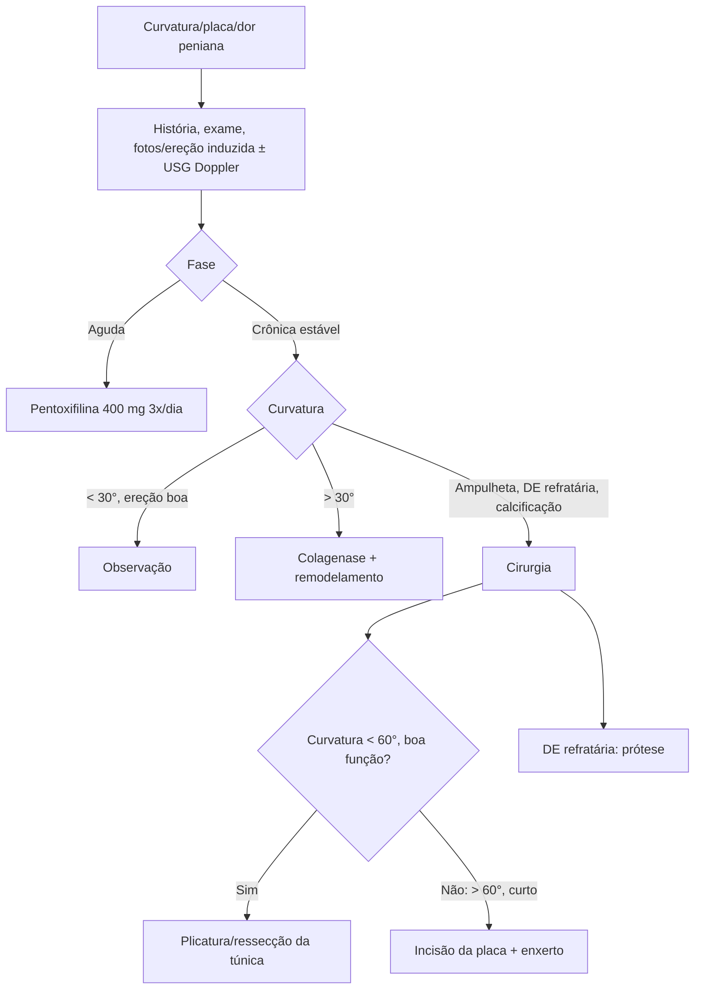

# Doença de Peyronie

> Resumo em palavras próprias do Whitebook (Condutas Cirúrgicas > Cirurgia Urológica), sem fisiopatologia, autoria e referências. Confira detalhes e doses na fonte: https://whitebook.pebmed.com.br/conteudo/?id=45418&categoryId=207&subcategoryId=214

**Definição:** doença fibrótica adquirida da túnica albugínea, com deformidade peniana, dor e, em parte dos casos, disfunção erétil. Fisiopatologia desconhecida; teoria mais aceita: cicatrização anômala por microtraumas sexuais; placa fibrosa focal (calcificada ou não); placas dorsais são as mais comuns; há componente genético.

## História natural e epidemiologia
- Melhora em 12% sem tratamento; piora em 40–48% nos primeiros 12 meses; o restante estabiliza. Prevalência ~5% (0,5–20%); 40–70 anos; subdiagnosticada.
- **Fase aguda (6–18 meses):** dor na ereção, curvatura progressiva, formação da placa. **Crônica:** curvatura estável, raramente dor; a DE ocorre geralmente aqui.

## Clínica
- Dor (principalmente na ereção; resolve em 12–24 meses), curvatura, indentação, placa ou nódulo, encurtamento, estreitamento “em ampulheta”; deformidade mais evidente na ereção. Disfunção sexual por deformidade, fator psicológico ou disfunção veno-oclusiva; **DE em 20–50%**.
- **Fatores de risco:** história familiar (2%); contratura de Dupuytren (21%); HAS, diabetes, cardiopatia isquêmica, dislipidemia, DE, tabagismo, etilismo; associação fraca com trauma, prostatectomia radical, fáscia plantar, timpanosclerose, instrumentação uretral, Paget, gota, lipomas.

## Diagnóstico
- História sexual e exame do pênis (flácido; fotos da ereção em casa em vários ângulos, ou ereção fármaco-induzida); documentar início, comprimento e impacto psicossocial. Placa/nódulo palpável na forma clássica; em acometimento dorsal, 2/3 têm placa. Lateral/ventral dificultam mais o coito; placa septal ou ventral+dorsal causa encurtamento sem angulação.
- **Imagem** só na dúvida: **USG** é a mais sensível (placas, calcificação, fibrose septal/intracavernosa); Doppler com ereção induzida se considerar reconstrução.
- **Diferenciais:** curvatura ventral congênita, *chordee* sem hipospádia, curvatura da epispádia, linfangite esclerosante, neoplasias raras.

## Tratamento
- Encaminhar ao urologista. **Observar** se curvatura < 30° com ereção satisfatória (avisar sobre progressão); curvatura > 30° → colagenase intralesional; indentação, ampulheta, DE refratária ou grande calcificação → cirurgia.
- Pelo texto: após pentoxifilina, se não houver melhora, injeção de **colagenase de *Clostridium histolyticum* (CCH)**; se melhorar, mais 6 meses de pentoxifilina ou parar e observar.
- **Oral:** **pentoxifilina 400 mg VO 3×/dia** (1ª linha). Vitamina E, colchicina, PABA, tamoxifeno, carnitina: controversos.
- **Intralesional:** CCH é a única aprovada pela FDA; reduz a placa mas não trata a curvatura → associar remodelamento manual (força oposta à curvatura). Outros: interferon alfa-2b, verapamil. Sem eficácia conclusiva: tópicos, tração, iontoforese, ondas de choque, radioterapia.
- **Cirurgia:** doença estável ≥ 3 meses; deformidade que impede a penetração; falha ou insatisfação com conservador; paciente motivado e esclarecido. Planejamento: Doppler com vasoativo (função erétil, placas, calcificação), fotos/medidas em vários ângulos. Categorias: corporoplastia, incisão/excisão da placa, prótese.
  - **Encurtamento da túnica** (ressecção ou plicatura): curvatura simples < 60°, tamanho e função preservados (pode ser > 60° com aviso de encurtamento); menor morbidade; plicatura pura tem menor risco de DE.
  - **Ampliação da túnica** (incisão da placa + enxerto 20% maior que o defeito): pênis curto, curvatura > 60°, ampulheta, indentação grave, boa função erétil.
  - **Prótese peniana** concomitante: DE refratária ou alto risco de DE.
  - Orientar: hipoestesia/anestesia temporária ou definitiva, novas placas, recorrência, piora/início de DE, redução do pênis, postectomia simultânea em certas incisões.
  - **Complicações:** DE em ~20% (até 45% dos que já tinham DE pioram); enxerto: dor, protuberância, hematoma, infecção, contratura (encurtamento, recidiva); prótese: infecção, extrusão, alteração do corpo esponjoso.

## Fluxograma (refeito, a partir do texto; o original não traz algoritmo)

