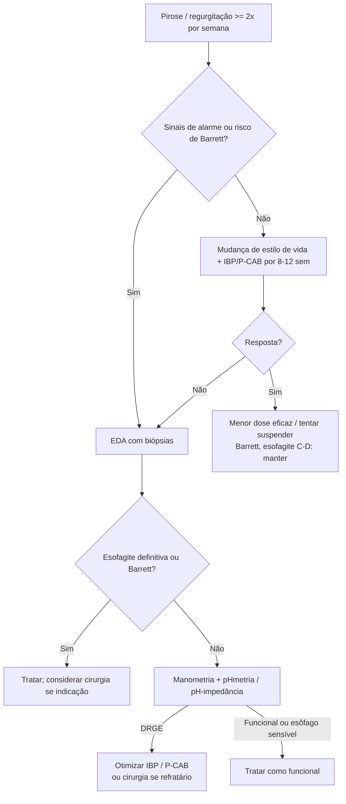

# Doença do Refluxo Gastroesofágico (DRGE)

> Resumo em palavras próprias do Whitebook (Condutas Cirúrgicas > Cirurgia Geral e do Aparelho Digestivo), sem fisiopatologia, autoria e referências. Confira detalhes e doses na fonte: https://whitebook.pebmed.com.br/conteudo/?id=22578&categoryId=207&subcategoryId=211

**Definição:** sintomas ou complicações do refluxo de conteúdo gastroduodenal para o esôfago e/ou órgãos adjacentes (boca, laringe, pulmões). Diagnóstico exige evidência conclusiva de refluxo na EDA e/ou monitorização anormal, com sintomas compatíveis. Formas: não erosiva, esofagite erosiva, esôfago de Barrett.

## Epidemiologia
- 10–23% da população ocidental, 5–10% da oriental, 23% na América do Sul; complicações mais comuns em homens. Sintomas cardinais (pirose, regurgitação): sensibilidade 30–76%, especificidade 62–96%. Complicações em 10–15% (úlcera, estenose, sangramento, Barrett, adenocarcinoma). Idosos: doença mais grave com sintomas atípicos leves. Forte relação com obesidade.

## Quadro clínico
- **Típicos:** pirose (retroesternal, pós-prandial, noturna), regurgitação, sialorreia.
- **Outros:** dor epigástrica, dor torácica, saciedade precoce, náusea, eructação, vômitos, plenitude, odinofagia, desgaste do esmalte, sintomas respiratórios (broncoespasmo, rouquidão, laringite, pigarro, tosse crônica, rinossinusite, disfonia), globus, disfagia, aftas.
- **Alarme:** dispepsia nova ≥ 40–50 anos, sangramento GI, anemia ferropriva, perda de peso, disfagia, odinofagia, vômitos persistentes, câncer gástrico em parente de 1º grau.
- **Risco para Barrett:** DRGE > 5–10 anos, idade > 50, homem, branco, hérnia de hiato, obesidade, refluxo noturno, tabagismo, familiar de Barrett/adenocarcinoma esofágico.
- Fármacos que pioram: ferro, potássio, AINE, narcóticos, nitratos, progesterona, quimioterápicos, estrogênios, tricíclicos, bisfosfonatos, bloqueadores de cálcio, benzodiazepínicos, prostaglandinas, anticolinérgicos.
- Exame: peso, altura e IMC; tórax, abdome, cavidade oral e dentes.

## Diagnóstico
Clínico, presumido com pirose e/ou regurgitação **≥ 2×/semana**.
- **EDA** (1º exame): indicada com sinais de alarme, risco de Barrett, refratariedade ou recorrência após 8 semanas de IBP, dor torácica não cardíaca, sintomas atípicos sem pirose, suspeita de complicação ou diagnóstico alternativo. Não é necessária de imediato nos sintomas clássicos. Repetir apenas em Barrett, sintomas novos ou esofagite C/D (nova EDA após 8 semanas). Suspender IBP 2–4 semanas antes. Só 30% dos não tratados têm esofagite. Sinais definitivos: esofagite B (com sintomas típicos e resposta a IBP), C ou D, Barrett > 3 cm, estenose péptica. Biópsia em estenose, úlcera, suspeita de Barrett ou esofagite eosinofílica.
- **Manometria** (alta resolução preferencial): dor retroesternal/disfagia com EDA normal, refratários, pré-fundoplicatura; exclui acalasia e distúrbios motores; antes da pHmetria.
- **pHmetria 24 h** (padrão-ouro) ± impedância: confirma DRGE com EDA normal e sintomas após IBP, sintomas atípicos, adequação do tratamento, pré-operatório sem esofagite. Sem DRGE definida: sem IBP por ≥ 7 dias; com DRGE documentada e refratária: em uso de IBP (pH-impedância). Parâmetros: tempo de exposição ácida, escore de DeMeester, **índice de sintomas ≥ 50%** ou **PAS > 95%** positivos. Com impedância: exposição **> 6%** com **> 80 episódios/dia** = DRGE; **< 4%** com **< 40 episódios** exclui. Telemetria sem fio de 96 h: **< 4%** exclui; **> 6% em > 2 dias** sugere DRGE.
- **Los Angeles:** A — lesões ≤ 5 mm; B — > 5 mm, sem continuidade entre pregas; C — contínua entre pregas, < 3/4 da circunferência; D — ≥ 3/4.
- **Savary-Miller:** I — pontos vermelhos isolados; II — erosões confluentes não circunferenciais; III — erosões circunferenciais com exsudato; IV — complicações crônicas (úlcera, estenose, Barrett).
- **Diferenciais:** esofagites infecciosa, medicamentosa e eosinofílica; divertículo; úlcera péptica; acalasia; anel de Schatzki; estenose; dispepsia funcional; distúrbios motores (espasmo difuso, quebra-nozes); pirose funcional; esôfago sensível ao ácido; doença biliar; DAC; neoplasia GI.

## Tratamento clínico
- **Estilo de vida:** parar de fumar; perder peso; elevar cabeceira em 15 cm; não comer até 3 h antes de deitar; evitar decúbito lateral direito; reduzir cafeína, cítricos, gordura, condimentos, tomate, gaseificados, álcool, menta/hortelã, chocolate.
- **IBP** (pela manhã em jejum, 30–60 min antes da refeição), 8–12 semanas e depois menor dose eficaz: omeprazol 20–40 mg; lansoprazol 15–30 mg; dexlansoprazol 30–60 mg; pantoprazol 20–40 mg; rabeprazol 10–20 mg; esomeprazol 20–40 mg. Melhora de 57–80% na doença erosiva e ~50% na não erosiva. Esomeprazol cicatriza a esofagite 5% mais em 8 semanas (NNT 25). Equivalência a omeprazol 20 mg: pantoprazol 40 mg = 9 mg; lansoprazol 30 mg = 27 mg; rabeprazol 20 mg = 36 mg; esomeprazol 40 mg = 64 mg. Em falha: reforçar estilo de vida, horário correto, trocar de IBP.
  - Efeitos adversos do uso crônico: deficiência de Mg e B12, diarreia do viajante, *C. difficile*, osteoporose/fratura, nefrite intersticial/DRC.
- **P-CAB:** vonoprazana 10–20 mg; potente, rápido, sem jejum; pode ser 1ª linha; melhor em esofagite erosiva grave.
- **Adjuvantes:** cimetidina 400 mg 12/12 h ou famotidina 20–40 mg 2×/dia (jejum e antes do jantar); procinéticos (domperidona, metoclopramida, bromoprida 10 mg 8/8 h); antiácidos (hidróxido de alumínio 460–920 mg ou de magnésio 5–10 mL, 1 h após refeições e ao deitar); alginato (pós-prandial, bolsão ácido, refratários); sucralfato (gestantes).
- **Seguimento:** teste terapêutico de 6–8 semanas e tentativa de suspensão; Barrett ou esofagite C/D não suspendem IBP (recidiva em 6 meses). Sintomas atípicos sem pirose/regurgitação: confirmar com pHmetria antes do IBP (videolaringoscopia não serve). Retorno em 2–3 meses; titular para a menor dose; DRGE não erosiva pode usar sob demanda. Erradicar *H. pylori* se positivo (não altera sintomas de DRGE).
- **Refratária** (10–40%): falta de resposta ao IBP dobrado; esofagite B–D ou estenose recorrente. Causas: não adesão, uso incorreto, CYP2C19 de metabolização rápida, bolsão ácido, refluxo fracamente ácido/alcalino, esôfago sensível ao ácido, pirose funcional. Investigar com pHmetria sem IBP (se DRGE não comprovada) ou pH-impedância com IBP; manometria. Diferenciação:

| Diagnóstico | Exposição ácida | Índice de sintomas | PAS |
|---|---|---|---|
| DRGE | > 6% | > 50% | > 95% |
| Pirose funcional | < 4% | < 50% | < 95% |
| Esôfago sensível ao ácido | < 4% | > 50% | > 95% |
Conduta: aumentar dose, trocar IBP ou usar P-CAB.

## Cirurgia
Opção para quem precisa de manutenção prolongada e nas formas complicadas.
- **Indicações:** falha ou recusa do tratamento clínico otimizado; não adesão (efeitos colaterais, receio de uso crônico); regurgitação de alto volume; pHmetria anormal com dose máxima de IBP; esofagite C/D; estenose benigna; Barrett sem displasia grave/carcinoma; hérnia de hiato volumosa sintomática (**≥ 5 cm**); sintomas por refluxo não ácido com IBP máximo. Melhor resultado com sintomas típicos controlados por IBP ou boa correlação na pHmetria; pior com sintomas atípicos/extraesofágicos.
- **Pré-operatório:** EDA (comprimento do esôfago, hérnia; esôfago muito curto ou hérnia irredutível pode exigir via transtorácica); pHmetria se EDA normal; manometria (excluir acalasia/dismotilidade); seriografia.
- **Técnicas:** **fundoplicatura total (Nissen)**, preferencialmente laparoscópica, em esôfago de comprimento e motilidade normais (melhora em 85–90%); parcial (menos disfagia, menor durabilidade); motilidade reduzida: evitar total (Toupet, Hill, Belsey transtorácico); esôfago curto: gastroplastia de Collis + fundoplicatura. Laparoscopia reduz complicações em 65% vs aberta; sucesso global ~85% (Nissen, Belsey Mark IV, Hill).
  - **Nissen:** fundo gástrico envolve ~6 cm distais do esôfago, em geral frouxo (floppy) de 1–2 cm, com reparo crural posterior. Variações: Rosetti-Nissen (sem ligar curtos), Toupet 270° posterior (alteração motora grave), 180° parcial. Complicações: lesão gástrica/esofágica, lesão esplênica, pneumotórax, sangramento, pneumonia, febre/infecção, disfagia (8–12% na laparoscopia).
  - **Belsey Mark IV:** parcial transtorácica; menos sintomas obstrutivos; útil em dismotilidade, obesidade ou esôfago curto.
  - **Hill:** imbricação anterior e posterior da pequena curvatura; manometria intraoperatória.
  - Obesidade mórbida: considerar bypass gástrico.
- **Outros:** anel magnético (LINX) em quem falha no clínico, doença leve a moderada e hérnia < 3 cm (disfagia mais comum; resultado similar ao Nissen, menos suspensão de IBP); **Stretta** (radiofrequência no EGJ; EEI ≥ 8 mmHg e hérnia < 3 cm; resultados conflitantes); **EsophyX** (fundoplicatura transoral; DRGE com pHmetria alterada e esofagite leve, sem hérnia ou ≤ 2 cm; suspende IBP em 75–80% após 6 meses).

## Fluxograma (refeito; o original "Decision Tracks" está como diagrama na fonte)

