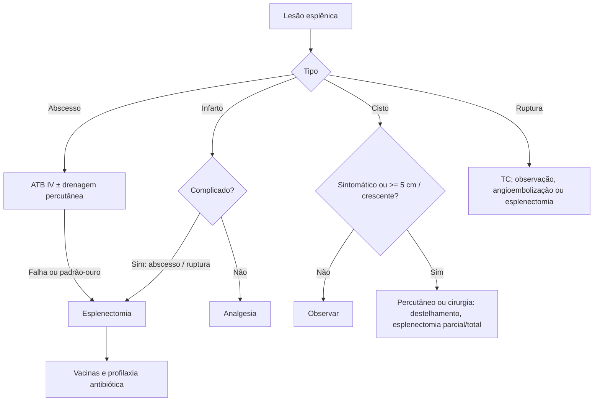

# Doenças Cirúrgicas do Baço

> Resumo em palavras próprias do Whitebook (Condutas Cirúrgicas > Cirurgia Geral e do Aparelho Digestivo), sem fisiopatologia, autoria e referências. Confira detalhes e doses na fonte: https://whitebook.pebmed.com.br/conteudo/?id=39158&categoryId=207&subcategoryId=211

O baço (~150 g, QSE, muito vascularizado) faz hemocaterese, hematopoese fetal, imunidade celular (25% dos linfócitos), via alternativa do complemento (tuftsina, C3b, IgG) e participa do metabolismo lipídico.

## Consequências do asplenismo
Imunodepressão com risco de sepse fulminante por capsulados; queda de IgM/IgG, de linfócitos T supressores, de opsoninas (tuftsina, properdina), da via alternativa do complemento e da fagocitose; autoanticorpos aumentados; mais LDL e triglicerídeos e menos HDL (aterosclerose); corpúsculos de Howell-Jolly; malária mais grave.

## Doenças hematológicas e indicação de esplenectomia
- **PTI:** plaquetas **< 10.000** por ≥ 6 semanas; refratária a corticoide, agonistas de TPO e rituximabe após ≥ 12 meses do diagnóstico; necessidade de doses muito altas de corticoide; resposta incompleta; gestantes (2º–3º trimestres) com falha de corticoide/imunoglobulina e plaquetas < 10.000 sem sintomas ou < 30.000 com sangramento.
- **Esferocitose hereditária:** corrige a anemia (sem normalizar a morfologia); adiar até os **5 anos** (menor risco de sepse).
- **Hemoglobinopatias:** a falciforme costuma autoesplenectomizar; esplenectomia no hiperesplenismo (reduz transfusões), esplenomegalia volumosa sintomática e crianças com atraso de crescimento/perda de peso.

## Abscesso esplênico
- Coleção purulenta única ou múltipla; incidência **0,05–0,7%**. Risco: endocardite (principal origem, geralmente foco único), imunossupressão (câncer, transplante, corticoide, HIV), diabetes, hemoglobinopatias, drogas IV, trauma. Múltiplos e imunodeficiência pioram o prognóstico; mortalidade **24%**.
- **Classificação:** primário (hematogênico) ou secundário (após infarto, em baço alterado: doenças mielo/linfoproliferativas, falciforme, trauma, embolia).
- **Clínica:** febre recorrente ou persistente apesar de antibiótico, dor no QSE, esplenomegalia, derrame pleural esquerdo ou infarto. Tríade: febre, leucocitose, dor no QSE.
- **Diagnóstico:** RX (derrame, elevação do hemidiafragma, massa, ar extraluminal); **TC com contraste** (padrão-ouro): halo espesso irregular com centro hipodenso; múltiplos/miliares são mais difíceis.
- **Tratamento:** antibiótico IV (empírico: ceftriaxona + metronidazol), com sucesso em **70–100%** (melhor em abscessos pequenos e múltiplos); drenagem percutânea (críticos, jovens, preservar o baço; uniloculares liquefeitos; sempre com antibiótico); **padrão-ouro: antibiótico + esplenectomia**. Se aderências inflamatórias impedirem esplenectomia segura: esplenotomia e drenagem, com possível esplenectomia tardia.

## Infarto esplênico
- Oclusão da artéria esplênica ou ramos por êmbolo séptico, coágulo ou causa iatrogênica. Causas: hipercoagulabilidade (câncer, SAF), embolias (FA, forame oval, ateroma, endocardite), neoplasias mieloproliferativas, hemoglobinopatias, grandes esplenomegalias (Gaucher, linfoma), trauma, torção da artéria.
- Clínica: dor à esquerda, febre, náuseas, vômitos, esplenomegalia, LDH e leucócitos altos. **TC de abdome** é o exame de escolha.
- Não complicado: clínico com analgesia. Complicado (abscesso, ruptura): cirurgia.

## Cisto esplênico não parasitário
- Em geral incidental e assintomático (sem tratamento). Verdadeiros (revestimento epitelial, ~20%; epidermoides/dermoides, hemangioma ou linfangioma) e pseudocistos (~80%; pós-trauma ou infarto). Classificação mais nova: neoplásico, congênito, traumático verdadeiro ou degenerativo.
- Sintomas: dor no QSE, dor referida em ombro esquerdo, aumento abdominal, esplenomegalia.
- **Conduta:** assintomático e **< 5 cm** com aspecto benigno (parede lisa, sem sólido, ± calcificação): observar. Sintomáticos ou crescentes: percutâneo (biópsia, aspiração, drenagem, esclerosante; recidiva maior) ou cirurgia (destelhamento, marsupialização, esplenectomia parcial/total).

## Cisto esplênico parasitário (hidatidose)
- *Echinococcus granulosus* (hidatidose cística) e *E. oligarthrus*/*vogeli* (poliquística); endêmica na América Latina, sobretudo Sul do Brasil; humano é hospedeiro intermediário (ovos em alimentos ou pelo de cães); cistos mais comuns em pulmão e fígado.
- Assintomáticos por longo tempo; no baço, dor, massa, esplenomegalia, compressão; ruptura pode causar anafilaxia.
- Diagnóstico: clínico-epidemiológico, USG/TC, identificação do agente.
- **Tratamento ideal:** cirúrgico quando factível (cistectomia no cisto único; esplenectomia na doença poliquística) — indicado na refratariedade ao antiparasitário ou cistos grandes com risco de ruptura. **Albendazol ou mebendazol** (sem condição cirúrgica) ou punção com injeção de escolicida. Riscos: anafilaxia e disseminação de escólices; albendazol prévio e instilação de salina hipertônica ou etanol reduzem o risco.

## Ruptura esplênica
- Traumática (trauma contuso; até 60% sem outra lesão; ver Trauma Esplênico) ou atraumática (rara: neoplasia, infecção, inflamação, medicamentos, congestão, gestação).
- Clínica: dor no QSE, dor em ombro esquerdo (sinal de Kehr), dor pleurítica, saciedade precoce.
- Diagnóstico: USG inicial; **TC com contraste** (líquido periesplênico e livre com densidade de sangue).
- Tratamento: da observação e angioembolização até esplenectomia.

## Tumores esplênicos (raros)
- **Metástases** (mais comuns; 7% dos cânceres; pele, mama, ovário, pulmão, estômago, próstata): esplenectomia se o baço for o único sítio metastático.
- **Benignos:** hamartoma, pseudotumor inflamatório, hemangioma (o mais comum; observar se < 4 cm, assintomático e não expansivo), linfangioma, peliose.
- **Malignos primários não linfoides:** angiossarcoma (mais comum; ~60 anos; dor, esplenomegalia, anemia hemolítica microangiopática; rompe em 25%; prognóstico ruim; esplenectomia paliativa ou na ruptura), histiocitoma fibroso maligno, hemangioendotelioma.

## Indicações de esplenectomia
Trombocitopenia, anemia hemolítica ou neutropenia isoladas; esplenomegalia dolorosa; ruptura; aneurisma da artéria esplênica; citopenias múltiplas com hiperesplenismo; lesão parenquimatosa ou vascular isolada; esplenomegalia de causa incerta; PTI refratária; esferocitose; mielofibrose primária; talassemia major ou intermédia.

## Sepse fulminante pós-esplenectomia (OPSI)
- Incidência **4,25%**; 58× maior que na população geral (sobretudo crianças); pode ocorrer até 40 anos depois, mais nos 2–3 primeiros; agentes capsulados: *S. pneumoniae* (50–90%), *H. influenzae* b, *N. meningitidis*, *E. coli*, estreptococos; CMV em imunodeprimidos. **Mortalidade 50–75%**.
- Clínica: pródromo gripal, rápida evolução para choque, anúria e CIVD; maioria morre em 48 h; sem foco evidente (em < 5 anos: meningite e pneumonia).
- Diagnóstico: suspeitar em todo asplênico febril; bacteremia > 10⁶ UFC/mL; Gram/cultura de petéquias; hemoculturas positivas em 24 h; punção lombar (sobretudo crianças).
- **Tratamento:** antibiótico IV empírico, agressivo e precoce: penicilina, ampicilina, ceftriaxona; áreas de pneumococo resistente: cefalosporina de 4ª geração, vancomicina ou carbapenêmico (alergia à penicilina). Imunoglobulina e corticoide sem eficácia comprovada.
- **Profilaxia:** orientar o paciente a procurar atendimento se houver qualquer sinal infeccioso; vacinas contra Hib, pneumococo 23-valente e meningococo C conjugada (esplenectomia eletiva: 2 semanas antes; urgência: até 2 semanas depois); reimunizar pneumococo a cada 5–10 anos e meningococo após 2 anos em alto risco; influenza anual; encaminhar ao CRIE. Antibiótico diário (penicilina/amoxicilina; eritromicina se alergia) em quem já teve sepse, grandes imunodeprimidos e crianças asplênicas < 5 anos; antibiótico *stand-by* em adultos. **Autoimplante esplênico** (≈30% do órgão em cubos/fatias em locais bem vascularizados) preserva parte da função imune.
- **Complicações da esplenectomia:** hemorragia (vasos gástricos curtos), sepse fulminante, atelectasia, abscesso subfrênico, trombose mesentérica/porta, leucocitose, trombocitose reativa, fístula pancreática ou gástrica.

## Fluxograma (refeito, a partir do texto; o texto original não traz um algoritmo único)

