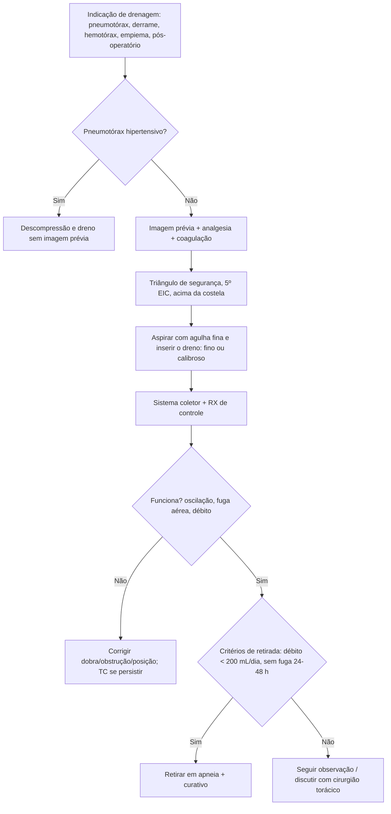

# Drenagem Pleural e Cuidados Associados

> Resumo em palavras próprias do Whitebook (Condutas Cirúrgicas > Cirurgia Torácica), sem autoria e referências. Confira detalhes e doses na fonte: https://whitebook.pebmed.com.br/conteudo/?id=44556&categoryId=207&subcategoryId=215

**Definição:** introdução de um dreno na cavidade pleural (patologia ou pós-operatório) para esvaziar líquido ou ar. **Objetivos:** retirar fluido/ar, colapsar cavidade pleural residual para prevenir complicações, garantir reexpansão pulmonar e restaurar a mecânica respiratória.

## Indicações
- **Pneumotórax:** qualquer paciente em ventilação com pressão positiva (risco de pneumotórax hipertensivo); hipertensivo após descompressão; recorrente ou persistente após aspiração simples (> 2,5 L); espontâneo secundário volumoso em > 50 anos; iatrogênico (avaliar tamanho, sintomas, comorbidades); qualquer pneumotórax que será submetido a variação de pressão atmosférica (ex.: transporte aeromédico).
- **Outras:** derrame pleural maligno (sobretudo sintomático/recorrente), derrames recorrentes sintomáticos, parapneumônico complicado/empiema, quilotórax, hemo/pneumotórax traumático, pós-operatório com violação da pleura (cirurgia torácica, esofagectomia, cirurgia cardíaca, miotomia de Heller), fístula broncopleural.
- **Contraindicações relativas:** INR > 1,5; plaquetas < 50.000/mm³; TTPa > 2× o normal. **Cuidado extra:** imunocomprometidos, cirurgia cardiotorácica prévia, pleurodese prévia, coagulopatia grave, nefropatia (creatinina > 6 mg/dL).
- **Fatores que influenciam o manejo:** viscosidade e debris, loculações, tamanho do pulmão, capacidade de reexpansão, fuga aérea.
- **Diferenciais (antes de drenar):** atelectasia total, hérnia diafragmática, derrame encistado, espessamento pleural, tumores, elevação diafragmática por lesão frênica (pós-cirurgia cardíaca), encarceramento pulmonar, ressecções prévias, abscesso, bolhas.

## Preparo e técnica
- **Consentimento** prévio (exceto emergência). **Antibiótico profilático:** não rotineiro; considerar em trauma (sobretudo penetrante); estudos heterogêneos (dose única de cefalosporina, 24 h ou enquanto durar o dreno).
- **Analgesia sempre antes** (ex.: morfina 2 mg EV); sedação possível (midazolam 1–2 mg); atropina ainda usada em alguns centros contra reação vasovagal, sem evidência de eficácia.
- **Avaliação por imagem** (RX, USG ou TC) antes; **única exceção:** pneumotórax hipertensivo. Cuidado em cirurgia cardiotorácica prévia, elevação diafragmática, pleurodese e obesos.
- **Local:** "triângulo de segurança" — borda lateral do peitoral maior (anterior), porção lateral do grande dorsal (lateral), base axilar (superior), 5º espaço intercostal (inferior). Punção no 5º EIC, linha axilar média, sempre **acima do arco costal inferior** (feixe neurovascular); evitar mama e pele lesada.
- **Posição:** semirrecumbente com braço abduzido (atrás da cabeça ou sobre o quadril); decúbito lateral; sentado apoiado numa mesa (drenagem posterior); supino com braços estendidos (drenos anteriores).
- **Escolha do dreno:** finos (tipo pigtail) — primeira linha em pneumotórax e derrames fluidos; maior taxa de obstrução/deslocamento/acotovelamento; podem exigir desobstrução regular (empiema). Calibrosos — maior fluxo em escape aéreo persistente (pós-operatório torácico) e hemotórax (menor obstrução). Evitar drenos de orifício único (Malecot, Pezzer): preferir tubular multifenestrado ou pigtail. Em geral, **26–28 Fr** em adultos.
- **Anestesia local:** pele, periósteo e pleura (mais dolorosos); considerar bloqueio intercostal; lidocaína 1% até 3 mg/kg sem epinefrina (ou 5 mg/kg com). **Aspirar o conteúdo pleural com agulha fina antes** de inserir (se nada, reavaliar sítio e imagem). Para derrames, inserção **guiada por imagem** (USG; TC se difícil) é muito recomendada.
- **Técnicas:** (1) *aberta convencional* — sem trocarte, dissecção romba com pinça/tesoura, nunca forçar a pleura; com drenos > 24 Fr permite exploração digital (útil no trauma); o último orifício lateral deve ficar dentro da cavidade. (2) *Percutânea* — agulha + dilatador com ou sem fio-guia (Seldinger), em geral sem avançar mais de 1 cm do dilatador; último orifício dentro da pleura. (3) *Trocarte* (guia rígido; tipo pigtail) — não fazer às cegas (risco de lesão pulmonar).

## Sistemas coletores
Todos têm válvula unidirecional.
- **Selo d'água (frasco):** o mais comum; submersão de 2–3 cm, respiro aberto; exige internação e troca do nível; aceita drenos de vários diâmetros.
- **Válvula de Heimlich/sistemas portáteis:** sem troca, facilita mobilização e tratamento ambulatorial; indicada em pneumotórax/fístula aérea.
- **Sistemas integrados descartáveis:** selo d'água + aspiração + coleta em câmaras separadas; descarte quando cheio.
- **Digitais** (ex.: Thopaz): medem perda aérea em mL/min, gráficos, aspiração ajustável e débito líquido.
- **Sistema de pneumonectomia (balanceado):** só no pós-operatório imediato, equaliza a pressão pleural.
- **Drenos tunelizados/cateteres pleurais de longa permanência:** manejo hospitalar/ambulatorial de derrame exclusivo, sobretudo neoplásico.

## Fixação e curativo
Fixar ao subcutâneo com fio não absorvível calibroso (0-0 a 2-0); evitar sutura em bolsa (pior cicatrização e mais dor); não deixar óstio frouxo (enfisema, sobretudo em pneumotórax); curativo transparente (avaliar infecção); curativo tipo omento/meso na porção mais distal do dreno com fita para evitar tração e acotovelamento.

## Cuidados pós-procedimento
- **RX de controle obrigatório** (comparar com pré e pós): posição do dreno e do orifício sentinela, reexpansão, mediastino, líquido residual, lesões iatrogênicas. Ponta idealmente superior para ar e inferior para líquido, mas se o dreno funciona **não reposicionar** só pela aparência; pode-se retirar um pouco de dreno muito inserido, nunca reintroduzir (infecção). Dreno que não funciona apesar de RX adequado → TC (pode estar intraparenquimatoso, fissural, mediastinal ou extrapleural).
- **Débito líquido imediato alto:** clampear temporariamente, abrir após 1 h e eliminar lentamente; enviar amostra do líquido pleural (do dreno/tórax, não do coletor).
- **Aspiração:** sem evidência a favor ou contra, mas muito usada (pneumotórax com fuga persistente, pós-ressecção); objetivo: reexpansão completa; risco: perpetuar a fuga. Quando usada: **−10 a −20 cmH2O** (adultos) e **−8 a −12 cmH2O** (crianças), sistemas de baixa pressão e alto volume; **nunca ligar direto à rede de vácuo da parede**.
- **Acompanhamento:** ausculta, enfisema subcutâneo, sítio de inserção, fixação, fuga aérea (espontânea, à fala, Valsalva, tosse, choro), **oscilação respiratória** da coluna (dreno funcionante), débito 24 h (descontar o líquido do selo), aspecto do líquido, sinais de obstrução (coágulos, fibrina), sistema abaixo do nível do tórax, conexões, **evitar clampear** (sobretudo se borbulha: enfisema e pneumotórax hipertensivo), selo d'água não > 3 cm, desobstruir drenos finos ≥ 2×/dia com seringa na torneira de 3 vias. "Efeito do espaço pleural": cavidade residual causa grandes oscilações sem fuga aérea. Analgesia regular e fisioterapia respiratória; educar paciente e enfermagem; cuidado na transferência (tração), manter a extremidade no selo, jamais ocluir o dreno no transporte.
- **Problemas frequentes:** dobrado → desdobrar; obstruído → aspirar/ordenhar; extrapleural ou intra-abdominal → remover e redrenar; clampeado → abrir; lado errado/fora da coleção → reposicionar; conexões finas ou não submersas → trocar/ajustar; selo > 2–3 cm ou frasco cheio → trocar; frasco na altura do sistema → baixar. Escape aéreo persistente: excluir causas relacionadas ao manejo (orifício cutâneo alargado, conexões ruins, frasco furado, dreno aberto sem selo, dreno transfixado ou com orifícios no subcutâneo → redrenar) e discutir com cirurgião torácico.

## Retirada do dreno
- **Critérios:** melhora clínica e da ausculta; débito < 200 mL/dia (referência da BTS, variável); sem débito purulento, francamente sanguinolento ou quiloso; sem fuga aérea por 24–48 h com expansão radiológica (em VM, ≥ 48 h; em sistemas digitais, fluxo < 20 mL/min por ≥ 12 h); ou dreno não funcionante. Clampeamento prévio não é necessário; se em aspiração, retirar da aspiração por 12–24 h e reavaliar.
- **Método:** retirada rápida com o paciente em apneia (final de expiração ou inspiração profunda) ou Valsalva; pausa inspiratória se em pressão positiva; idealmente por dois médicos; fechar com o fio de fixação, nova sutura ou fitas adesivas (curativo mantido 48–72 h se só fitas).

## Complicações
- **Do procedimento:** laceração pulmonar (pneumotórax — principal; contusão/hemotórax; fístula aérea prolongada; fístula broncopleural; abscesso), lesões diafragmáticas (tardiamente hérnia e elevação), cardíaca e de grandes vasos, vasos intercostais, transfixação mediastinal, esofágica (alargamento mediastinal + saliva/conteúdo entérico), síndrome de Horner, lesões intra-abdominais (gástrica e intestinal em hérnia diafragmática prévia → remoção e cirurgia; hepática → sangramento, remoção e possível embolização; esplênica → conservador ou cirúrgico), reação vasovagal, dreno extrapleural (obesos, fraturas costais).
- **Edema pulmonar de reexpansão:** edema unilateral após reexpansão rápida de pulmão colapsado (em geral > 72 h); raro, mortalidade > 20%; por ↑ permeabilidade vascular, lesão de reperfusão, shunt. Sintomas: tosse, dispneia, taquipneia/taquicardia, hipotensão, febre, náusea/vômito, cianose. RX: consolidação, infiltrado intersticial, broncograma, linhas B de Kerley, atelectasia — progride em 24–48 h, persiste 4–5 dias, resolve em 5–7. Diferenciais: EAP cardiogênico, pneumonite, pneumonia. Risco: colapso crônico > 72 h, grande volume, técnica de reexpansão, jovens (20–39 anos), pneumotórax > 30% ou hipertensivo, hipertensão pulmonar. Prevenção: limitar drenagem inicial (< 1.500 mL), monitorar sintomas/SpO2, pressão negativa só após 24–48 h. Tratamento: suporte hemodinâmico, O2/CPAP/VM, evitar diuréticos, decúbito lateral do lado afetado.
- **Relacionadas ao cuidado do dreno:** infecção pleural (0,2–2,4%), infecção de ferida, deslocamento/acotovelamento, obstrução, infarto pulmonar periférico (aspiração inadequada), enfisema subcutâneo, transfixação do dreno pelo ponto.

## Fluxograma (refeito, a partir do texto; o original traz figuras ilustrativas)

