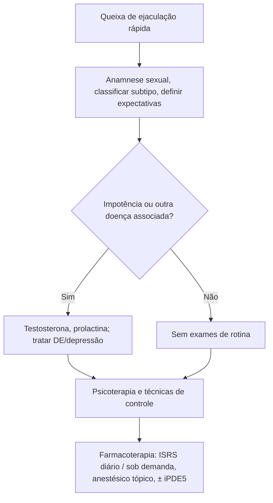

# Ejaculação Precoce

> Resumo em palavras próprias do Whitebook (Condutas Cirúrgicas > Cirurgia Urológica), sem fisiopatologia, autoria e referências. Confira detalhes e doses na fonte: https://whitebook.pebmed.com.br/conteudo/?id=45172&categoryId=207&subcategoryId=214

## Conceito
- Ejaculação que ocorre sempre ou quase sempre em **menos de 1 minuto** da penetração vaginal, com incapacidade de retardá-la e sofrimento/insatisfação de um ou ambos os parceiros. As definições compartilham três elementos: tempo até ejaculação, controle percebido e angústia/dificuldade interpessoal.
- Distúrbio sexual mais comum em homens < 40 anos (cerca de 1 em 3 relatam; 30–70% em algum grau/momento nos EUA); a prevalência não aumenta com a idade (ao contrário da disfunção erétil). Causa ansiedade, frustração e desinteresse sexual; poucos procuram tratamento; > 1 ano de persistência piora o impacto.
- **Tipos:** primária (nunca controlou), secundária/adquirida (controlava e perdeu há pouco), ocasional (variação normal) e disfunção ejaculatória tipo *premature-like* (percepção/expectativa distorcida). Alguns pacientes confundem a perda de ereção pós-ejaculação (normal) com disfunção erétil. Não há tratamento curativo para a primária.
- Ejaculação: controle espinhal (L1–L2) e cortical; fases de emissão (simpático, L2–L4, fecha o esfíncter urinário), expulsão (reflexo espinhal S1–S2) e orgasmo (cortical, ocorre mesmo após prostatectomia radical).

## Avaliação
- Anamnese, exame físico e história sexual, comportamental e medicamentosa; definir subtipo e expectativas antes de tratar. Investigar relações anteriores/atuais, envolvimento da parceira, ansiedade de desempenho, experiências iniciais, autoestima.
- **Associações:** disfunção erétil (30–50% dos casos de DE têm EP), ansiedade, psicotrópicos, etilismo, alterações hormonais (FSH, LH, prolactina, TSH, serotonina), insônia, prostatite, diabetes, neuropatia, hiper-reflexia ejaculatória.
- Sem exames de rotina. Testosterona (livre e total) e prolactina se houver impotência associada; exames específicos se depressão ou outras condições.
- **Diferenciais:** orgasmo muito atrasado da parceira, efeito adverso de psicotrópico, disfunção erétil.

## Tratamento (frequentemente multidisciplinar)
- **Psicoterapia/comportamental:** educação sexual do casal, redução da ansiedade (dessensibilização), técnicas de controle (Semans stop-start, compressão do sulco coronal, masturbação prévia, preservativo espesso). Efeito mais rápido, porém menos duradouro que o farmacológico.
- **Dapoxetina** (ISRS de meia-vida curta, sob demanda 1–2 h antes; aumenta a latência 2–3×; não comercializada no Brasil).
- **ISRS e tricíclicos (uso diário):** paroxetina (↑ latência ~8×), clomipramina (~6×), fluoxetina, sertralina e escitalopram (~5×), citalopram (~2×). Efeitos: náusea, fadiga, insônia, constipação, inapetência, ↓ libido, DE; ISRS 4–6 h antes é tolerado, mas menos eficaz que o uso diário. Cautela em ≤ 18 anos e em depressão com ideação suicida; evitar suspensão brusca; evitar se tentando engravidar (efeito nos espermatozoides). Inibidores de PDE5 isolados ou com ISRS podem prolongar a latência.
- **Anestésicos tópicos:** spray de lidocaína 150 mg/mL + prilocaína 50 mg/mL (aprovado pela EMA para EP vitalícia); cremes/géis podem passar à parceira (usar preservativo).
- Terapia cirúrgica: o texto lista o título mas não detalha.

## Fluxograma (refeito, a partir do texto; o original não traz algoritmo)

