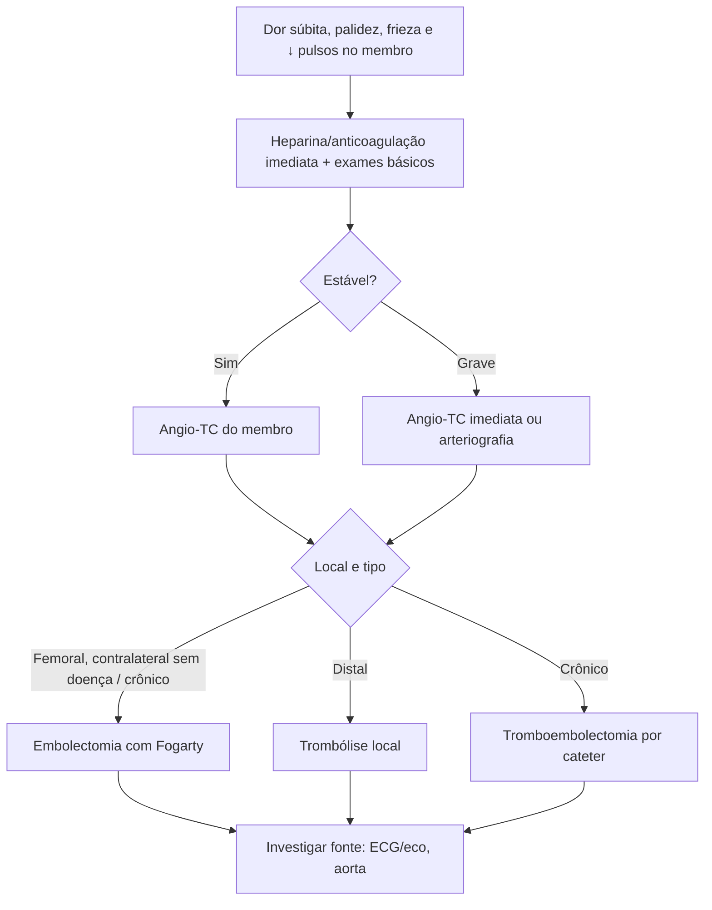

# Embolia Para os Membros Inferiores

> Resumo em palavras próprias do Whitebook (Condutas Cirúrgicas > Cirurgia Vascular), sem autoria e referências. Confira detalhes e doses na fonte: https://whitebook.pebmed.com.br/conteudo/?id=48804&categoryId=207&subcategoryId=238

**Definição:** material (trombo, gordura, ar) vindo de outro ponto do organismo impacta nas artérias dos membros inferiores, por calibre ou estreitamento do lúmen, interrompendo o fluxo de forma súbita e, às vezes, ameaçando a viabilidade do membro.

## Etiologia
- **Cardíaca (a mais comum, 55–87%):** trombos de AE/VE (fibrilação atrial, trombo de VE pós-infarto), vegetações e trombos valvares; mais raro, embolização de tumores cardíacos.
- **Ruptura de placa aórtica:** exposição do cerne lipídico, trombogênico, com êmbolos trombóticos ou lipídicos para as extremidades.
- **Aneurisma de aorta:** fluxo turbilhonar forma trombo mural que se desprende.
- **Embolia paradoxal:** trombo venoso passa à circulação arterial por comunicação interatrial ou forame oval patente.
- **Iatrogênica:** cateterização vascular, implante de dispositivos cardíacos.

## Clínica
- Variável conforme a fonte, o local de impactação, a doença arterial prévia e a rede colateral.
- **Anamnese:** fibrilação atrial, troca valvar, cardiopatia estrutural; anticoagulação (motivo e se está no alvo); doença arterial periférica prévia (piora ou sintomas novos); doença da aorta (aterosclerose, aneurisma); procedimento endovascular recente.
- **Quadro:** dor, palidez, pele fria e redução de pulsos no membro. Examinar femoral, poplíteo, tibial posterior e pedioso bilateralmente.
- **Síndrome do dedo azul:** êmbolo pequeno atinge apenas a circulação digital, sem alterar pulsos, e causa necrose do dedo muito dolorosa.

## Diagnóstico
- **Laboratório:** não diagnostica, mas mostra se o paciente está de fato anticoagulado e avalia a função renal (contraste iodado). Pedir hemograma, bioquímica com eletrólitos, coagulograma com fibrinogênio.
- **Imagem:** na maioria, história e exame bastam para forte suspeita. Quadros estáveis: **angio-TC do membro** (vê o êmbolo, localização, aterosclerose, aneurismas; planeja intervenção aberta ou endovascular). Casos graves: angio-TC imediata ou arteriografia.
- **Diferencial:** trauma, tromboangeíte obliterante, neuropatia diabética, claudicação intermitente.

## Tratamento
- **Anticoagulação em todo paciente com suspeita** (evita progressão do trombo e favorece fluxo colateral).
- Tratamento específico com o especialista (cirurgião vascular), conforme gravidade e etiologia. Três opções: **embolectomia aberta com cateter de Fogarty** (oclusão em femoral com lado contralateral sem doença, ou trombos crônicos); **trombólise química local** (quadros mais distais); **tromboembolectomia por cateter** (trombos crônicos).

## Fluxograma (refeito, a partir do texto; o original não traz algoritmo)

