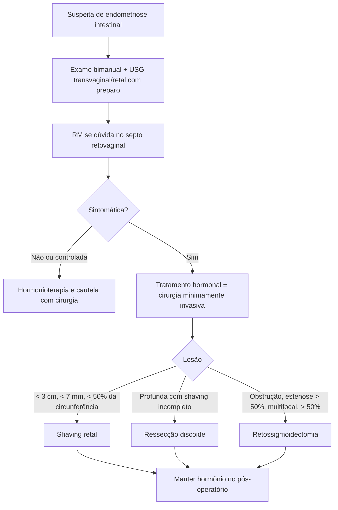

# Endometriose Intestinal

> Resumo em palavras próprias do Whitebook (Condutas Cirúrgicas > Cirurgia Geral e do Aparelho Digestivo), sem fisiopatologia, autoria e referências. Confira detalhes e doses na fonte: https://whitebook.pebmed.com.br/conteudo/?id=45394&categoryId=207&subcategoryId=211

**Definição:** implantes de tecido endometrial no intestino, atingindo ao menos a camada muscular (≥ 5 mm abaixo do peritônio). Endometriose profunda infiltrativa invade o espaço retovaginal e/ou o intestino; a peritoneal tem profundidade < 5 mm da serosa. Doença estrogênio-dependente, que regride na gestação e na menopausa (mas pode haver doença profunda pós-menopausa). Sigmoide e fundo de saco de Douglas são os pontos de partida; o nódulo pode atingir ligamentos uterossacros, paramétrio e ureteres.

## Quadro clínico
- Início mais comum entre **34 e 40 anos**; reto, sigmoide e íleo terminal.
- Clássicos: dismenorreia, dispareunia, infertilidade. Intestinais: dor à evacuação, sangramento retal, diarreia, constipação, dor abdominal, distensão; sintomas costumam variar com o ciclo. **A gravidade não se relaciona com o tamanho/extensão da doença.**
- Exame: palpação abdominal (massas, mapear dor); especular (nódulos vaginais, desvio do colo sugere ligamento uterossacro); bimanual com fórnix posterior, tecido retocervical e paramétrio (nódulos, útero fixo, fibrose).

## Diagnóstico
- Sugerido por nódulo retovaginal doloroso ao exame ou por achados de imagem. **Padrão-ouro:** histologia de lesão biopsiada por videolaparoscopia. Exames laboratoriais são inespecíficos.
- **USG transvaginal com preparo intestinal** (melhora sensibilidade e especificidade): avalia pelve profunda, profundidade e mobilidade/sensibilidade; **USG retal** define distância da borda anal, profundidade e extensão. **RM** (sensibilidade 88%, especificidade 98%): para suspeita de doença no septo retovaginal não detectada ao exame ou à USG transvaginal.
- **Colonoscopia:** antes da cirurgia para excluir malignidade com sintomas sugestivos e avaliar estenoses em obstrução parcial ou achados anormais.
- **Diferenciais:** adenomiose, cisto ovariano, DII, SII, doença diverticular, hemorroidas, neoplasia colorretal.

## Tratamento
- Indicado com sintomas característicos e doença intestinal identificada; se os sintomas são gastrointestinais, tratar após excluir outras causas. Assintomáticas ou controladas clinicamente: cirurgia com cautela (riscos e recorrência).
- **Clínico:** estrogênio-progestágeno ou progestágeno isolado, que reduzem ou resolvem a dor.
- **Cirúrgico:** minimamente invasivo (laparoscopia ou robótica); remover todos os segmentos e preservar a função dos órgãos. Para retossigmoide:
  - ***Shaving* retal:** nódulo **< 3 cm**, infiltração **< 7 mm**, acometimento **< 50%** da circunferência.
  - **Ressecção discoide:** alternativa à ressecção segmentar quando o *shaving* seria incompleto pela profundidade; recorrência 1,8–8%.
  - **Retossigmoidectomia:** obstrução, estenose **> 50%** do lúmen, lesões multifocais, acometimento **> 50%** da circunferência; preservar a vascularização (sem excisão total do mesocólon).
- Pós-operatório: manter terapia hormonal com anticoncepcional.

## Fluxograma (refeito, a partir do texto)

