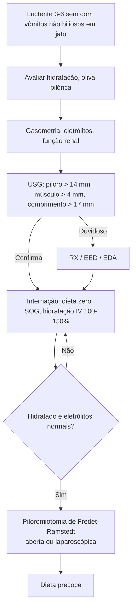

# Estenose Hipertrófica de Piloro

> Resumo em palavras próprias do Whitebook (Condutas Cirúrgicas > Cirurgia Geral e do Aparelho Digestivo), sem fisiopatologia, autoria e referências. Confira detalhes e doses na fonte: https://whitebook.pebmed.com.br/conteudo/?id=23242&categoryId=207&subcategoryId=211

**Definição:** estreitamento e alongamento do canal pilórico por hipertrofia muscular (sobretudo circular), com retardo do esvaziamento gástrico, dilatação, hipertrofia e hiperperistalse do estômago.

## Epidemiologia
- Causa cirúrgica mais comum de vômito em recém-nascidos e lactentes; **2–5/1.000** nascidos vivos; M:F **4–6:1**; primogênitos (30–40%); apresentação após 12 semanas é rara; história familiar em até 15%; mais em brancos.
- Fatores de risco: tabagismo materno, não amamentação, macrolídeos/eritromicina antes de 2 semanas de vida. Síndromes: Smith-Lemli-Opitz, trissomia 18, Turner, Cornélia de Lange.

## Clínica
- Início tipicamente em **3–6 semanas** de vida.
- **Vômitos** alimentares (não biliosos), em jato, após as mamadas, com leite não digerido; podem ter sangue (gastrite, 15%). Criança faminta após vomitar, em bom estado inicial.
- **Desidratação:** fontanela deprimida, mucosas secas, lágrimas reduzidas, turgor ruim, letargia, ≤ 4 fraldas molhadas/dia. **Alterações metabólicas, perda ou estagnação de peso, desnutrição**, constipação; icterícia em 2–5% (redução da glicuronil-transferase).
- **Exame:** priorizar estado geral e hidratação; palpar a **oliva pilórica** (massa dura, patognomônica) no QSD/epigástrio, mais evidente após o vômito ou durante a mamada (relaxar a criança com chupeta com glicose); ondas peristálticas visíveis da esquerda para a direita. Corrigir a desidratação primeiro.

## Diagnóstico
- **Labs:** hemograma (geralmente normal), coagulograma, função renal, eletrólitos, gasometria, urina. **Alcalose metabólica hipoclorêmica e hipocalêmica** (perda de HCl; rins perdem K⁺ para reter H⁺). Ureia/creatinina: insuficiência pré-renal. Icterícia: bilirrubinas, AST/ALT, FA/GGT (hiperbilirrubinemia não conjugada é compatível).
- **USG** (confirmatório): piloro com diâmetro **> 14 mm**, espessura muscular **> 4 mm**, comprimento **> 17 mm**; sinal do alvo/rosca em corte transversal; sinais indiretos: canal não abre em 15 min, contrações retrógradas, ecogenicidade desigual.
- **RX:** distensão gástrica com pouco ar distal. **EED:** canal longo e fino (sinais do ombro, cordel, bico de seio, cogumelo/guarda-chuva, duplo trato, estrada de ferro). **EDA:** diagnóstica mas pouco usada (imagem duvidosa ou quadro atípico).
- **Diferenciais:** obstrução intestinal, gastroenterite, DRGE, alergia alimentar, atresia duodenal, insuficiência adrenal, HAC, piloroespasmo, erros inatos, ITU, hepatopatia.

## Tratamento
Todos são internados para hidratação IV e cirurgia, **após** corrigir desidratação, eletrólitos e equilíbrio ácido-base.
- **Pré-operatório:** dieta zero; sonda oro/nasogástrica; expansão em choque hipovolêmico (diurese 1–2 mL/kg/h); hidratação IV a **100–150%** das necessidades diárias com glicose e eletrólitos conforme os distúrbios.
- **Piloromiotomia (Fredet-Ramstedt):** incisão longitudinal anterossuperior do piloro com dissecção romba até a submucosa. A via laparoscópica tem menos vômito pós-operatório e internação menor, mas pode deixar piloromiotomia incompleta.
- Complicações: piloromiotomia incompleta, perfuração de mucosa, vômitos (mais frequentes), sangramento (veia pilórica), infecção.
- Dilatação endoscópica com balão: só em risco cirúrgico muito alto. Conservador (alimentação nasoduodenal contínua por meses): exceção, quando a cirurgia não é viável.
- **Pós-operatório:** reiniciar dieta em poucas horas, progredir conforme tolerância; manter hidratação IV até dieta plena; vômitos por 1–2 dias (**50%**, edema do piloro) tratados conservadoramente; vômitos persistentes após 5 dias sugerem piloromiotomia incompleta, gastrite, DRGE ou outra obstrução; não repetir imagem de rotina.

## Fluxograma (refeito, a partir do texto)

