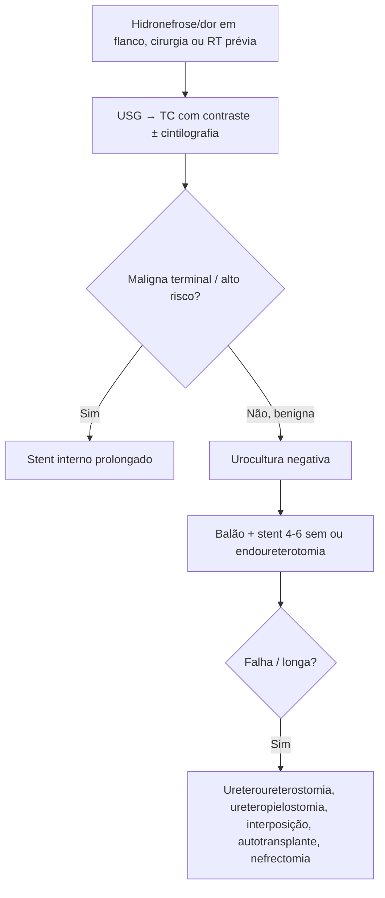

# Estenose Ureteral

> Resumo em palavras próprias do Whitebook (Condutas Cirúrgicas > Cirurgia Urológica), sem fisiopatologia, autoria e referências. Confira detalhes e doses na fonte: https://whitebook.pebmed.com.br/conteudo/?id=46110&categoryId=207&subcategoryId=214

**Definição:** estreitamento do diâmetro ureteral com obstrução funcional. Ureter proximal: da junção ureteropélvica (JUP) até o cruzamento com a sacroilíaca; médio: ao longo da pelve óssea e vasos ilíacos; distal/pélvico: dos vasos ilíacos à bexiga.

## Causas
- Mais comum: obstrução da JUP (congênita ou adquirida). Classificação: extrínseca/intrínseca, benigna/maligna, iatrogênica/não.
- **Maligna extrínseca:** câncer pélvico (colo uterino, próstata, bexiga, cólon) comprime o ureter distal; linfadenopatia retroperitoneal (linfoma, testículo, mama, próstata) obstrui o proximal/médio. Carcinoma urotelial: obstrução intrínseca. Massa extrínseca à TC/USG e aspecto do ureter ao contraste distinguem maligna de benigna.
- **Benigna:** fibrose retroperitoneal idiopática (uni ou bilateral, azotemia); iatrogênica — ureteroscopia (3–11%, < 1% com instrumentos menores), cirurgia aberta/laparoscópica, radioterapia, derivações urinárias, transplante renal. Trauma iatrogênico é a causa mais comum de lesão ureteral, sobretudo histerectomia e sigmoidectomia; cirurgia ginecológica responde por até 75%.
- **Graus de lesão:** I hematoma/contusão sem desvascularização; II laceração < 50%; III laceração ≥ 50%; IV transecção completa com < 2 cm de desvascularização; V avulsão com > 2 cm.

## Clínica e diagnóstico
- História de neoplasia, cirurgia, radioterapia, ureteroscopia. Dor, plenitude ou desconforto em flanco/ângulo costovertebral; muitas são achadas no seguimento (ureteroidronefrose assintomática); rim único pode evoluir com insuficiência renal.
- EAS, urocultura, eletrólitos, ureia, creatinina. **USG** (inicial, sensível a hidronefrose); **TC** helicoidal sem contraste (localiza dilatação) e com contraste (grau de obstrução, causas extrínsecas, doença regional/metastática); **cintilografia dinâmica** mede obstrução e função relativa. Pielografia retrógrada e TC contrastada detalham a anatomia.

## Tratamento
- **Indicações:** dor, infecção, obstrução com risco à função renal; menos comum: cálculo proximal, hematúria.
- **Contraindicações:** ITU ativa não tratada (absoluta); diástese hemorrágica não corrigida (relativa). Urocultura prévia a qualquer abordagem.
- Maligna terminal, muito idoso ou alto risco que tolera stent: **stent interno** de longa duração (falha em 41% em 1 ano). Função renal < 10%: recuperação improvável, considerar nefrectomia.
- **Benigna:** dilatação por balão + stent 4–6 semanas; **endoureterotomia** (incisão endoscópica) tem sucesso maior que o balão e é o manejo minimamente invasivo inicial de escolha para a maioria; bom resultado se duração < 3 meses e estenose curta. Stent metálico (apesar da oclusão) para quem não pode operar.
- **Reconstrução:** ureter médio com estenose curta benigna → ureteroureterostomia primária sem tensão; proximal → ureteropielostomia se o comprimento permitir; longas e complexas do trato superior → nefrectomia, interposição intestinal ou autotransplante.
- **Pós-operatório:** drenos até débito < 30 mL ou apenas soro (conferir creatinina); stent 4–6 semanas após endoureterotomia, 10–21 dias após anastomose; nefrostomia retirada por último (nefrograma anterógrado).

## Fluxograma (refeito, a partir do texto; o original não traz algoritmo)

