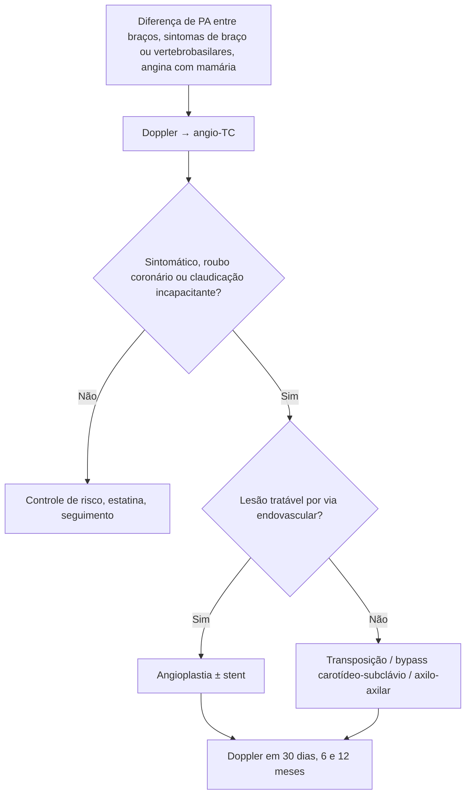

# Estenose de Subclávia

> Resumo em palavras próprias do Whitebook (Condutas Cirúrgicas > Cirurgia Vascular), sem fisiopatologia detalhada, autoria e referências. Confira detalhes e doses na fonte: https://whitebook.pebmed.com.br/conteudo/?id=64428&categoryId=207&subcategoryId=238

**Definição:** redução do lúmen da subclávia, em geral aterosclerótica e proximal; pode ser assintomática ou causar isquemia do membro superior, síndrome do roubo da subclávia e isquemia miocárdica por roubo coronário-subclávio em quem tem enxerto de mamária interna.

## Etiologia
Aterosclerose (principal; coexiste com doença coronariana, carotídea e DAP); arterite de Takayasu e de células gigantes; raras: trauma, iatrogenia endovascular, radioterapia, compressão extrínseca (tumor, desfiladeiro torácico). Predomina em óstio e terço proximal (turbilhonamento); focal, extensa ou oclusão.

## Clínica
Depende do grau, das colaterais, da demanda do braço e do envolvimento vertebrobasilar ou coronariano; muitos são assintomáticos (achado ao investigar diferença de PA entre braços).
- **Fatores:** aterosclerose conhecida, tabagismo, HAS, idade, DRC, desfiladeiro arterial, radioterapia cervical/torácica, trauma ou instrumentação.
- **Sintomas:** claudicação do braço, dor/fadiga/peso aos esforços, parestesias, frialdade, fraqueza; tontura, vertigem, síncope, ataxia, disartria, diplopia (piores com exercício do braço); angina em quem tem mamária interna.
- **Exame:** pulsos braquial, radial e ulnar reduzidos ou ausentes, assimetria, extremidade fria, enchimento capilar lento, **diferença de PAS > 15–20 mmHg** entre braços, sopro supra/infraclavicular.

## Diagnóstico
Clínico + imagem. Nem toda estenose é hemodinamicamente significativa nem requer cirurgia.
- **Doppler:** inicial; quantifica estenose e mostra roubo vertebral/inversão de fluxo.
- **Angio-TC:** anatomia, grau, extensão, calibre do vaso e do arco; planeja o endovascular.
- **Arteriografia:** padrão-ouro, hoje terapêutica (angioplastia + stent na mesma sessão).
- **Diferencial:** desfiladeiro arterial, DAOP distal do membro superior, embolia/trombose aguda, insuficiência vertebrobasilar por doença vertebral, radiculopatia cervical ou neuropatia.

## Tratamento
- **Clínico (sempre, inclusive após revascularização):** tratar a causa (vasculite: controlar atividade), parar de fumar, controlar glicemia, PA e lipídios, estatina de alta potência, atividade física; antiagregante em sintomáticos e no pós-angioplastia. Assintomáticos: conservador.
- **Revascularização:** principalmente em sintomáticos ou situações selecionadas. **Endovascular é o padrão-ouro** (angioplastia ± stent; sucesso técnico alto, sobretudo em estenose ostial; menos morbimortalidade e recuperação mais rápida).
- **Aberto** (oclusões extensas, falha endovascular, lesões complexas ou associadas a outra reconstrução): transposição subclávia–carótida comum, bypass carotídeo-subclávio ou axilo-axilar; maior morbimortalidade (lesão neurológica, hematoma, infecção).

## Seguimento
Assintomáticos: clínico periódico. Sintomáticos: cirurgião vascular. Pós-operatório: Doppler em 30 dias, 6 e 12 meses (perviedade e reestenose).

## Fluxograma (refeito, a partir do texto; o original não traz algoritmo)

