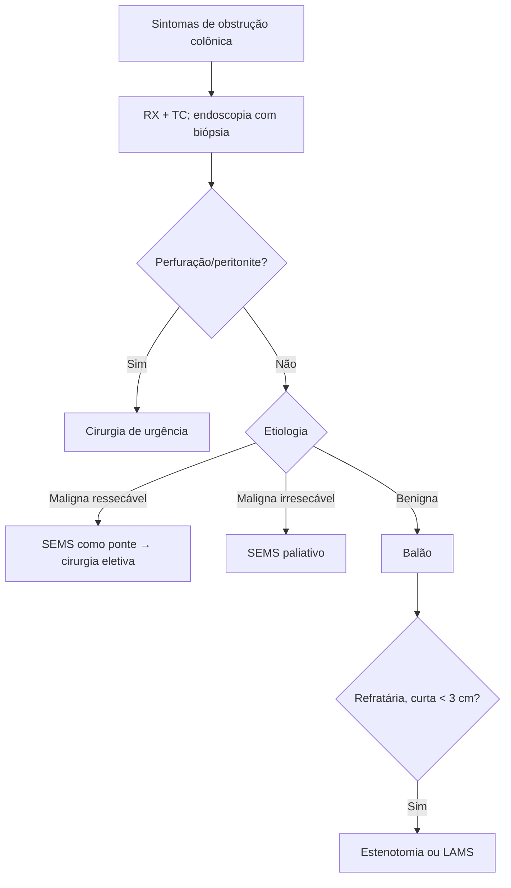

# Estenoses Colônicas

> Resumo em palavras próprias do Whitebook (Condutas Cirúrgicas > Cirurgia em Coloproctologia), sem fisiopatologia, autoria e referências. Confira detalhes e doses na fonte: https://whitebook.pebmed.com.br/conteudo/?id=64414&categoryId=207&subcategoryId=213

**Definição:** estreitamento luminal do ceco ao reto, incidental ou sintomático, de causa benigna ou maligna. Sinônimos: obstrução/semiobstrução colorretal ou colônica.

## Causas
- **Malignas:** câncer colorretal (principal causa endoluminal), malignidades extracolônicas (compressão/invasão), carcinomatose peritoneal (obstruções complexas, multifocais, mau prognóstico), linfomas.
- **Benignas:** doença de Crohn (estenose fibrótica), estenose anastomótica, diverticulite aguda, ressecções endoscópicas extensas (mucosectomia, dissecção de submucosa), volvo de sigmoide.
- Mais frequente no cólon esquerdo (sigmoide e reto). O ceco é o mais suscetível a perfuração, sobretudo acima de 9 cm (lei de Laplace); válvula ileocecal competente aumenta a distensão colônica, incompetente favorece náusea e vômito.

## Clínica
- Obstrução parcial: constipação, diarreia paradoxal, distensão, flatulência, cólica, náuseas e vômitos. Incapacidade de eliminar fezes e gases sugere obstrução completa. Perguntar sobre história familiar de DII/câncer colorretal, emagrecimento, anemia, sangramento retal.
- Exame: normal ou com distensão e timpanismo, dor à palpação, ruídos metálicos/peristaltismo de luta (abolidos nos casos avançados), ampola vazia na obstrução completa, massa ao toque em reto baixo; irritação peritoneal na perfuração; sinais de sepse nos casos complicados.

## Diagnóstico
- **RX de abdome** (AP, deitado e em pé): dilatação do cólon a montante, níveis hidroaéreos, pouco ou nenhum ar na ampola; com válvula ileocecal incompetente, também dilatação do delgado.
- **TC de abdome** (de preferência contrastada): além disso, espessamento parietal, realce, borramento da gordura, ingurgitamento vascular.
- **Contraste endoluminal** hidrossolúvel iodado define topografia e extensão; **bário contraindicado** se suspeita de perfuração.
- **Retossigmoidoscopia/colonoscopia:** biópsia, terapia, avaliação de lesões sincrônicas. Preparo anterógrado é arriscado; se necessário, PEG 1–2 L fracionado sob supervisão; preparo baixo com clister glicerinado costuma bastar; insuflação mínima.
- **Critérios:** estreitamento < 10 mm ou > 50% do segmento adjacente; espessamento parietal > 3 mm; dilatação pré-estenótica > 25–30 mm.
- **Diferenciais:** Ogilvie, pseudobstrução crônica, megacólon chagásico/tóxico, constipação funcional, intestino irritável, bloating, intolerâncias, impactação/bezoar.
- **Seguimento nos semioclusivos:** exame abdominal seriado e radiografias seriadas (tórax PA, abdome AP em pé e deitado).

## Tratamento (diretriz ASGE 2026), com equipe multidisciplinar
Antes de intervir: imagem, biópsias múltiplas (inclusive bordas), tatuagem distal à lesão se for operar. Antibiótico profilático não é rotina para stent.
- **Próteses metálicas autoexpansíveis (SEMS):** mais usadas em obstrução maligna; no câncer ressecável, ponte para cirurgia eletiva (mais anastomose primária, menos estoma definitivo); paliação em doença irresecável. Recobertos preferidos nas benignas (retirada mais fácil); não recobertos têm melhor patência e menos migração nas malignas.
- **Dilatação com balão:** 1ª linha nas estenoses benignas (anastomótica, Crohn, pós-ressecção endoscópica).
- **Estenotomia endoscópica** (eletroincisão com needle knife ou IT-knife): estenoses benignas curtas (< 3 cm), não anguladas, fibróticas e refratárias ao balão.
- **LAMS** (stent de aposição de lúmen): estenoses anastomóticas benignas curtas e refratárias; balão pós-implante possível; troca/retirada em 2–3 meses.
- **Cuidados/contraindicações:** DII ativa → otimizar tratamento sistêmico antes (sem respaldo para triancinolona intralesional de rotina); evitar SEMS com abscesso pericólico; bevacizumabe aumenta risco de perfuração com stent; doenças tratáveis por quimio/RT (linfoma): evitar stent não recoberto.

## Prognóstico
- Ponte para cirurgia: mortalidade em 60 dias (OR 0,93) e sobrevida em 3 anos (OR 1,66) semelhantes entre SEMS e cirurgia de urgência (evidência de baixa certeza); paliação sem diferença em mortalidade de 30 dias.
- Possível maior recorrência de câncer com stent (OR 1,84), talvez por disseminação em perfuração.
- Stent favorece anastomose primária (OR 2,35), reduz estoma definitivo (OR 0,51 como ponte; OR 0,15 na paliação) e encurta a internação em ~4,85 dias. Não recobertos mantêm patência ~18,5 dias a mais.
- Benignas: balão com sucesso clínico de 88% contra 56% do stent (que migra). Estenotomia reduz recorrência (RR 0,63) frente à dilatação, com risco muito maior de sangramento (RR 14,08).

## Fluxograma (refeito, a partir do texto; o original não traz algoritmo)

