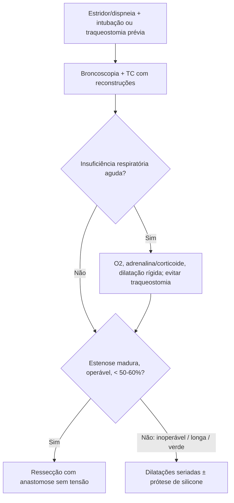

# Estenoses Traqueais Benignas

> Resumo em palavras próprias do Whitebook (Condutas Cirúrgicas > Cirurgia Torácica), sem fisiopatologia, autoria e referências. Confira detalhes e doses na fonte: https://whitebook.pebmed.com.br/conteudo/?id=44555&categoryId=207&subcategoryId=215

**Definição:** estreitamento do lúmen traqueal por causa benigna (inclui granulomas e tumores benignos; o texto cita também traqueobroncomalácia e compressões extrínsecas no grupo de obstruções benignas). Lesão da mucosa (infecção, isquemia, DRGE) → inflamação → cicatriz hipertrófica. Isquemia por balonete (hoje mais por diâmetro do tubo); pior com cicatrização anormal, hipotensão, corticoide, infecção traqueal. Risco de insuficiência respiratória obstrutiva.

**Etiologia:** intubação orotraqueal (principal), traqueostomia/cricotireoidostomia, trauma, infecções (difteria, TB, histoplasmose, leishmaniose, blastomicose), DRGE, queimadura inalatória, cáusticos, amiloidose, manipulação endoscópica, radioterapia, Wegener, policondrite recidivante, esclerodermia, traqueopatia osteocondroplástica, idiopática (mulheres 20–60 anos, sem manipulação prévia), congênita.

## Clínica
Sintomas desde logo após a extubação até meses/anos. Insuficiência respiratória em quem teve intubação/traqueostomia prévia, às vezes tratados como asma de início tardio. Estridor (inspiratório se extratorácica; expiratório se intratorácica), dispneia ao ultrapassar ~50% de obstrução (lúmen < 8 mm) e em repouso com lúmen < 25% (< 4–5 mm), piora ao esforço, disfonia, tosse em latido/ineficaz, ansiedade, hipoxemia, estoma persistente após decanulação, impossibilidade de decanular, insuficiência respiratória aguda. Pesquisar cicatrização hipertrófica/queloide e tratamentos prévios (dilatações, corticoide, laser, traqueoplastia).

## Diagnóstico
- **Espirometria** (única prova funcional): limitação de fluxos inspiratório/expiratório conforme o nível (intra ou extratorácico); VEF1 subestima a gravidade; pouco sensível/específica; os pacientes cooperam mal.
- **Broncoscopia (padrão-ouro):** visão direta, localização, extensão, gravidade; avalia laringe a brônquios subsegmentares (paralisia ou sinéquia de pregas, granulomas, traqueobroncomalácia, tumores, compressão, corpo estranho); biópsia.
- **TC cervicotorácica** com reconstruções (axial, sagital, coronal): correlação fraca com sintomas; muco e sinéquias podem enganar; define localização, quantidade e extensão (% da traqueia) para planejar cirurgia. RX cervicotorácico (PA e perfil; ideal com fluoroscopia). Esofagograma ou EDA se suspeita de fístula traqueoesofágica; manometria e pHmetria em estenose recidivante (tratar DRGE). Exames para causa secundária (eosinofilia, ANCA, VHS).
- **Myer-Cotton:** I — até 50%; II — 51–70%; III — > 70% com lúmen detectável; IV — sem lúmen.
- **Diferenciais:** asma, laringite, corpo estranho, neoplasia maligna, compressão extrínseca, doenças de pregas vocais, traqueomalácia/colapso dinâmico.

## Tratamento
- **Emergência:** O2 umidificado, monitorização, acesso; nebulização com adrenalina e/ou corticoide; **dilatação traqueal é o padrão-ouro** (broncoscopia rígida mais usada; balão em broncoscopia flexível); se impossível ventilar: tubo fino, máscara laríngea, traqueostomia. **Evitar traqueostomia na abordagem inicial** (compromete traqueoplastia posterior); se necessária, passar a cânula pela estenose para não danificar segmento são.
- **Eletivo:** encaminhar ao cirurgião torácico/pneumologista intervencionista. Antibióticos e corticoides reduzem edema/inflamação agudos (não tratam a estenose); corticoide inalatório; mucolítico (acetilcisteína); IBP.
- **Endoscópico (efeito transitório; ponte; muitos precisam de reintervenção):**
  - *Dilatação mecânica* (laringoscopia de suspensão, broncoscopia rígida, balão): estenoses pós-intubação/traqueostomia ainda inflamatórias; também retira granulomas/tumores benignos; contraindicada em estenoses maduras estáveis/oligossintomáticas ou com componente cartilaginoso, baixas, excêntricas/tortuosas, longas, alto risco anestésico; recorrência rápida.
  - *Eletrocautério, argônio, laser:* coagulação superficial (laser mais profundo, mais risco de sangramento/perfuração, contraindicado na subglote); risco de queimadura.
  - *Endopróteses* (após dilatação até o diâmetro externo da prótese, sob anestesia geral): sem indicação cirúrgica, recusa, baixa expectativa de vida, ponte pré-operatória, pós-operatório de reconstrução malsucedida. **Silicone** (mais usado): tubo T (precisa de traqueostoma; preserva a fonação; ramo lateral sempre ocluído; trocar anualmente; 4,5–16 mm); em dispneia aguda: ventilar por máscara com o ramo lateral ocluído, ou intubar através dos ramos com tubo fino (DE 4–5,5 mm), ou retirar o tubo T e intubar pelo estoma; prótese em Y para estenose distal/carina/brônquios (9–16 mm × 20–60 mm). **Metálicas autoexpansíveis** (Palmaz, nitinol Wallstent, Polyflex): inserção fácil por broncoscopia flexível, mas difícil de ajustar/retirar, mais granulomas; em doença benigna só após esgotar outras opções; não usar como ponte para cirurgia; indicadas em estenoses malignas, reestenose com traqueia muito curta, estenose/malácia > 60% da traqueia, sem condições para ressecção.
  - Outros: braquiterapia, terapia fotodinâmica, crioterapia.
- **Cirurgia (único tratamento curativo definitivo):** operabilidade, estenose rígida/madura, extensão < 50–60% da traqueia. **Contraindicações:** alto risco clínico, lesão > metade da traqueia ou estenose dupla, falha cirúrgica prévia (ressecção possível, mas difícil), "estenose verde" (inflamação aguda; adiar).
  - *Traqueostomia definitiva:* estenoses subglóticas (até 2 cm da glote), com alteração vocal; em etapas (secção da cricoide com interposição de enxerto autólogo e prótese de silicone + traqueostomia; retirar a prótese e colocar tubo T; retirar o tubo T).
  - *Ressecção com anastomose terminoterminal:* acesso cervical em colar (terços proximal e médio), cervicoesternal ou toracotomia posterolateral direita (terço distal); sem tensão na anastomose. Pós-operatório: extubação em geral na sala; cabeça fletida (~35°) por 1 semana e, depois, posição neutra por mais 7 dias (ponto mento-torácico); evitar corticoide e AINE (cicatrização), exceto reoperação/edema laríngeo; broncoscopia no 14º dia; alta no 5º–7º dia; em anastomoses de risco, manter prótese ou traqueostomia; avaliar dispneia, fonação e deglutição.
  - *Complicações:* infecção de ferida, osteomielite esternal, enfisema, mediastinite, edema laríngeo, paralisia de pregas vocais, disfonia, hematoma, granuloma, reestenose (precoce ou > 30 dias), **deiscência** (3º–5º dia; parcial: enfisema e infecção — abrir pontos, drenar, curativo; completa: insuficiência ventilatória, mediastinite, ruptura do tronco braquiocefálico e óbito — reabrir a cervicotomia, intubar o coto distal, tamponar a artéria, levar ao centro cirúrgico; não refazer a anastomose: tubo T grande, traqueostomia definitiva, neotraqueia cervical, tubo metálico dilatador ou prótese de Neville). **Ruptura do tronco braquiocefálico:** por deiscência total — ligar o tronco acima e abaixo (risco de AVC isquêmico); por atrito dos pontos — suturar com polipropileno 4-0.
- **Específicos:** pós-intubação — endoscópico, endoprótese e ressecção; infecciosa — tratar o agente na fase aguda; se obstrução, dilatar e colocar endoprótese; em fase fibrótica crônica, ressecção; doenças reumatológicas (Wegener etc.) — tratamento clínico (ciclofosfamida/corticoide), sem ressecção (alto risco de reestenose), dilatação e prótese temporárias; idiopática laringotraqueal — dilatação, ressecções endoscópicas, tubo T e ressecção com anastomose cricotraqueal/traqueotraqueal.

## Fluxograma (refeito, a partir do texto; o original não traz algoritmo)

