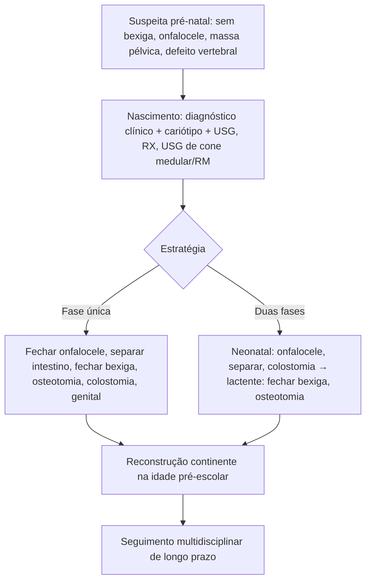

# Extrofia de Cloaca

> Resumo em palavras próprias do Whitebook (Condutas Cirúrgicas > Cirurgia Pediátrica), sem fisiopatologia detalhada, autoria e referências. Confira detalhes e doses na fonte: https://whitebook.pebmed.com.br/conteudo/?id=63986&categoryId=207&subcategoryId=826

**Definição:** anomalia congênita rara e complexa dos sistemas geniturinário e intestinal, a forma mais grave dos defeitos ventrais da parede abdominal. Caracteriza-se por **onfalocele**, duas hemibexigas extróficas laterais, placa de mucosa intestinal central, orifício inferior (cólon encurtado), um ou dois orifícios apendiculares laterais e genitália ambígua. A ruptura precoce da membrana cloacal (4ª–6ª semana) causa diástase púbica, exteriorização dos órgãos pélvicos, malformações anorretais e genitais e falha de fusão dos tubérculos genitais (clitóris ou pênis duplos).

## Epidemiologia
Forma mais grave e rara do complexo extrofia-epispádia; 10% das extrofias; **1:200.000–400.000** nascidos vivos; leve predominância masculina (discordante); maioria esporádica. **Anomalias associadas em 85%:** vertebrais 65% (mielomeningocele, medula ancorada, escoliose, hemivértebras); trato urinário superior 60% (hidronefrose, rim pélvico, agenesia, multicístico); gastrointestinais 40% (atresias, Meckel, má rotação, duplicação); genitais (duplicação uterina 95%, vaginal 65%, agenesia de vagina 25%); cardiovasculares mais raras; pênis inadequado ou ausente, hérnia inguinal, criptorquidia.

## Clínica
Onfalocele (90%); diástase púbica importante; intestino extrófico central entre duas hemibexigas; imperfuração anal; criptorquidia; bolsa escrotal ausente, bífida ou em dois hemiescrotos. Meninos: ausência de pênis (30%), pênis muito pequeno ou dois rudimentos, epispádia. Meninas: clitóris em duas metades (ou unido/ausente).

## Diagnóstico
- **Pré-natal (USG do 2º trimestre):** bexiga não visualizada, massa pélvica de linha média inferior, onfalocele ou outras hérnias, anormalidades vertebrais; RM pré-natal para diferencial.
- **Pós-natal:** clínico, ao nascimento. **Cariótipo** (sexo e síndromes). **USG** de abdome e vias urinárias em todos; **UCM** só se bexiga coberta (refluxo); RX de abdome (gás) e de coluna (vértebras); **USG do cone medular** (só no período neonatal até os primeiros meses); RM para disrafismos.
- **Diferencial:** gastrosquise, onfalocele, extrofia de bexiga.

## Tratamento
Cirúrgico, complexo e multidisciplinar (urologia e cirurgia pediátrica, ortopedia, neurocirurgia); metas: reconstrução intestinal, urinária e genital; preservar a função renal; continência urinária e fecal; desenvolvimento psicossocial e sexual normal. O componente crítico é fechar a bexiga e reconstruir uretra, genitália e sínfise púbica.
- **Fase única:** fechamento da onfalocele, separação da placa intestinal das hemibexigas, aproximação e fechamento das metades vesicais, osteotomia bilateral, colostomia terminal e revisão genital.
- **Duas fases:** (1) neonatal — fechamento da onfalocele, separação intestino–hemibexigas, aproximação das hemibexigas, colostomia terminal; (2) lactente — fechamento das metades vesicais, osteotomia bilateral e revisão genital.
- **Reconstrução continente** (pré-escolar/escolar): colo vesical, reimplante ureteral ± ampliação vesical, reconstrução genital.
- **Complicações:** ITU recorrente, incontinência fecal e urinária persistentes, estenoses anorretais e vaginais, DRC, disfunção sexual adulta.
- **Prognóstico:** depende das malformações associadas (cardíacas, SNC, renais) e da qualidade da reconstrução inicial; sem malformações graves a expectativa de vida é alta; qualidade de vida depende de apoio psicossocial e seguimento em centro de referência (família, terapia ocupacional, orientação sexual).

## Fluxograma (refeito, a partir do texto; o original traz apenas figura)

