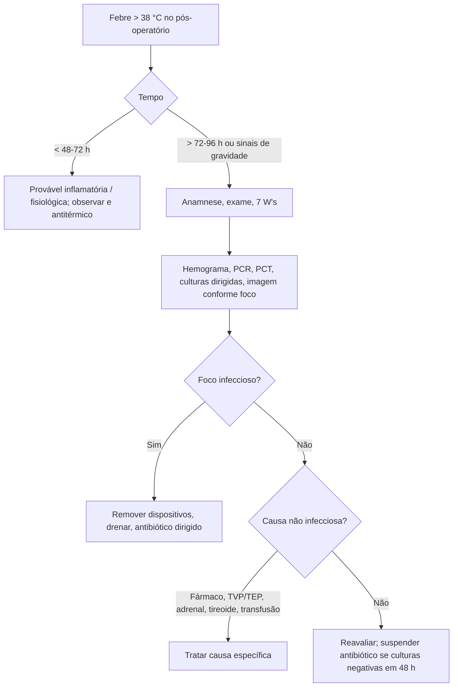

# Febre Pós-operatória

> Resumo em palavras próprias do Whitebook (Condutas Cirúrgicas > Cirurgia Geral e do Aparelho Digestivo), sem fisiopatologia, autoria e referências. Confira detalhes e doses na fonte: https://whitebook.pebmed.com.br/conteudo/?id=296&categoryId=207&subcategoryId=211

**Definição:** temperatura central > 38 °C nos primeiros dias após cirurgia, por causa inflamatória (lesão tecidual, corpos estranhos/próteses) ou infecciosa. O fluxograma original está na fonte (figura/Decision Track); abaixo há uma redação própria.

## Contexto
- Muito comum: até 70% conforme porte e tempo de internação; ~25% nas cirurgias de médio porte. Na UTI cirúrgica, metade tem causa infecciosa; o resto é inflamatório ou medicamentoso. A maioria das febres nas primeiras 48 h é autolimitada e não infecciosa. Identificar a causa evita antibiótico desnecessário.
- **Fisiologia:** citocinas pirogênicas (IL-1, IL-6, TNF-α, interferon-γ) → prostaglandina E2 no hipotálamo → ↑ set point. Cirurgias maiores febre mais que as minimamente invasivas. Febre fisiológica: 48–72 h, autolimitada, sem repercussão. Síndromes hipertérmicas: hipermetabolismo muscular (hipertermia maligna, síndrome neuroléptica maligna).

## Causas
- **Infecciosas:** ISC, pneumonia (VM/aspiração), ITU (sonda), infecção de cateter venoso central, *C. difficile*, sinusite/otite/parotidite, abscesso intra-abdominal, colecistite acalculosa, infecção viral pós-transfusional, infecção de prótese/dispositivo, osteomielite, endocardite, pericardite (Dressler).
- **Não infecciosas:** inflamação do sítio (hematoma, seroma, corpo estranho), TVP/TEP, gota/pseudogota, pancreatite, AVC hemorrágico/isquêmico, HSA, IAM, isquemia intestinal, hipertireoidismo/crise tireotóxica, insuficiência adrenal, medicamentos, abstinência, reação transfusional (TRALI, imunomodulação), rejeição de enxerto, febre neoplásica.
- **Sete W's:** *Wind* (pulmão), *Water* (urina), *Wound* (ferida), *Wonder drugs* (drogas), *Walking* (TVP/TEP), *Withdrawal* (álcool/opioides), *Wonky glands* (adrenal/tireoide).
- **Tempo:** não infecciosa mais comum nas primeiras 48–96 h; infecciosa mais comum após 72–96 h; infecções necrosantes ou prévias podem aparecer antes.

## Avaliação
- Anamnese: medicamentos (corticoide, antitireoidiano), álcool e drogas, febre prévia ou hipertermia maligna, sinais infecciosos antes da internação, curva térmica (pico isolado × persistente), infusões e hemoderivados coincidentes.
- Exame: completo; ferida (hiperemia, pus, dor, abaulamento, crepitação — necrosante); dispositivos invasivos; rigidez, taquipneia, convulsões, mioglobinúria (síndromes hipertérmicas); sepse, TVP, peritonite (deiscência/abscesso). Idosos: delírio, inapetência, queda funcional.
- **Exames:** hemograma, PCR, procalcitonina (**PCT > 0,7 ng/mL no 3º PO** sugere complicação anastomótica); culturas dirigidas (sangue, urina, secreção, dreno); RX de tórax, USG ou TC conforme o foco. **Evitar pan-culturas** sem base clínica.

## Tratamento
- **Sintomático:** antitérmicos (dipirona, paracetamol, AINE); resfriamento passivo (manta, gelo axilar/inguinal/cervical, soluções frias) se não responder ou hipertermia.
- **Não infecciosa:**
  - Suspender fármacos suspeitos. Febre medicamentosa sugerida por: 7–10 dias após início do fármaco, sem foco infeccioso, eosinofilia e rash discreto, queda da temperatura ≤ 72 h após suspender.
  - Atelectasia: estudos não mostram causalidade com febre (efeito do estresse cirúrgico por 48–72 h), mas predispõe a complicações pulmonares (90%): fisioterapia e deambulação.
  - Trocar acessos periféricos com flebite; drenar seroma; reação febril à transfusão (anticorpos anti-HLA): interromper, avisar enfermagem, antitérmico EV.
- **Infecciosa:** achar o foco; retirar dispositivos assim que possível; ISC superficial/profunda: abrir, drenar, lavar e fechar por segunda/terceira intenção; órgão/espaço: drenagem percutânea (TC/USG) ou reoperação; sempre coletar material para cultura; necrosante: antibiótico amplo + desbridamento precoce e agressivo. Antibiótico conforme estabilidade (grave: empírico amplo imediato; descalonar; suspender se sem foco e culturas negativas em 48 h). Culturas: hemocultura, urocultura, secreções estéreis (swab tem alta contaminação).
- **Outras:**
  - Síndrome neuroléptica maligna: controlar temperatura, suspender fármacos, dantrolene/bromocriptina, UTI.
  - Hipertermia maligna: dantrolene EV, suspender voláteis, resfriamento ativo.
  - Síndrome serotoninérgica: suporte, suspender fármacos, benzodiazepínicos.
  - Insuficiência adrenal: hidratação, glicocorticoide em bólus (dexametasona 4 mg, hidrocortisona 100 mg EV 6/6 h), eletrólitos.
  - Crise tireotóxica: propranolol, propiltiouracil, solução iodada, UTI.

## Febre induzida por fármacos
| Fármaco | Mecanismo | Clínica | Conduta |
|---|---|---|---|
| Betalactâmicos | Hipersensibilidade tipo III | Rash, eosinofilia | Suspender, sintomático, evitar reexposição |
| Carbapenêmicos / vancomicina | Liberação de citocinas | Febre isolada | Suspender, suporte |
| Opioides (morfina, tramadol) | Citocinas | Febre baixa, prurido | Suspender/substituir |
| Propofol / anestésicos | Idiossincrática | Febre alta, taquicardia | Suspender; monitorar CK |
| Fenitoína / carbamazepina | Hipersensibilidade IV (DRESS) | Rash, ↑ transaminases | Suspender; corticoide se sistêmico |
| Heparina | Imune II/III | Febre leve, plaquetopenia | Suspender; trocar anticoagulante |
| Quimioterápicos | Pirógenos | Febre isolada | Sintomático; manter se indispensável |
| Antidepressivos / neurolépticos | Termorregulação | Febre alta + rigidez | Suspender; dantrolene ou bromocriptina |
| AINE | Idiossincrática hepática | Febre, dor, ↑ transaminases | Suspender; suporte hepático |

## Fluxograma (refeito, a partir do texto; o original está na fonte)

