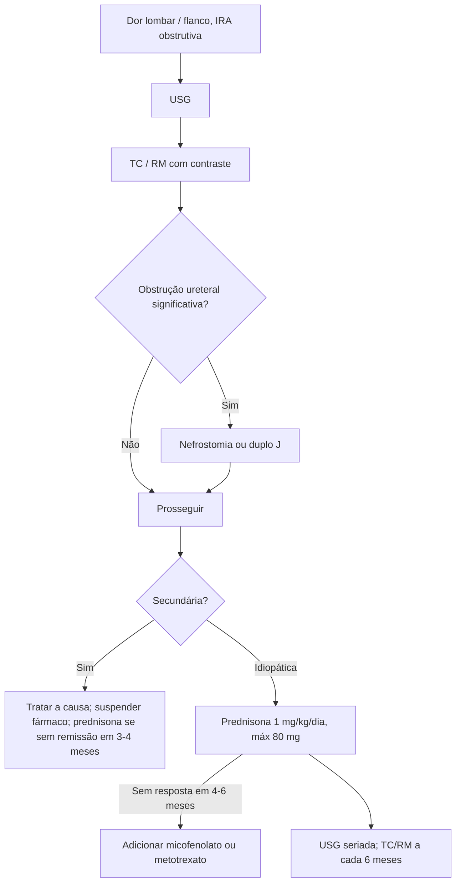

# Fibrose Retroperitoneal

> Resumo em palavras próprias do Whitebook (Condutas Cirúrgicas > Cirurgia Geral e do Aparelho Digestivo), sem fisiopatologia, autoria e referências. Confira detalhes e doses na fonte: https://whitebook.pebmed.com.br/conteudo/?id=45416&categoryId=207&subcategoryId=211

**Definição:** condição rara, predominante em homens (3:1), com tecido inflamatório e fibrótico no retroperitônio que costuma envolver os ureteres e outros órgãos. Sinônimos: doença/síndrome de Ormond. Pode ser idiopática (imunomediada, parte do espectro da periaortite crônica; pode associar-se a doença relacionada à IgG4) ou secundária.

## Causas secundárias
Fármacos (derivados do ergot — metisergida, bromocriptina; betabloqueadores, metildopa, hidralazina, analgésicos; etanercepte), malignidades (carcinoides, linfomas, sarcomas, carcinomas colorretal, mama, próstata, bexiga), infecções (tuberculose, histoplasmose, actinomicose), radioterapia (seminoma, cólon, pâncreas), hemorragia retroperitoneal, cirurgia (linfadenectomia, colectomia, aneurismectomia), asbesto, tabagismo, amiloidose, enema baritado, trauma, paniculite mesentérica, histiocitoses (Erdheim-Chester).

## Quadro clínico
- Início inespecífico; diagnóstico muitas vezes só quando há dano renal por obstrução ureteral. Sintoma mais comum: dor lombar ou no flanco, uni ou bilateral, mal delimitada, podendo irradiar para a virilha, sem relação com posição ou esforço.
- Mal-estar, anorexia, perda de peso, febre, dor testicular, constipação, náusea, vômito; urgência, polaciúria, disúria.
- Claudicação de MMII → comprometimento vascular; isquemia mesentérica → compressão das mesentéricas; tosse seca; claudicação de MMSS e rouquidão → aorta torácica/epiaórticas.
- Exame: hipertensão por acometimento da renal; edema de MMII, TVP (obstrução de cava/ilíacas); hidrocele e varicocele.

## Diagnóstico
- **Laboratório:** sem alteração específica; ureia e creatinina se obstrução; PCR alta na maioria.
- **USG:** primeiro exame na IRA obstrutiva — massa periaórtica mal definida, hipo/anecoica, ± hidronefrose.
- **TC com contraste IV:** método de escolha; massa confluente que envolve sem deslocar a aorta (porções anterior e lateral), às vezes envolve/comprime a cava; mostra linfadenopatia e tumor; guia biópsia.
- **Biópsia** (percutânea/core ou cirúrgica): localização atípica, achados sugerindo infecção ou malignidade, pouca experiência do serviço, ausência de resposta ao tratamento inicial.
- **RM:** semelhante à TC, melhor definição da fibrose. **Urografia:** extensão do envolvimento ureteral. **PET-TC:** atividade da doença, sítios e recidivas.
- **Diferenciais:** nefrolitíase, linfoma, sarcoma, fibromatose retroperitoneal (desmoide), pseudotumor inflamatório, tuberculose, Erdheim-Chester.
- **Investigação:** rever radioterapia, cirurgias e fármacos; TC/RM de tórax, abdome e pelve (malignidade ou infecção); se provável idiopática: FAN, anti-músculo liso, ANCA, hormônios tireoidianos.
- **Monitoramento:** imagem e marcadores inflamatórios periódicos; USG é o melhor para obstrução ureteral e resposta; **TC ou RM a cada 6 meses**.

## Tratamento
Metas: aliviar a obstrução, parar a fibrose e prevenir recorrência. Secundária: tratar a causa; idiopática: imunossupressão.
- **Obstrução significativa:** desobstrução imediata — nefrostomia percutânea ou cateter duplo J.
- **Cirurgia (ureterólise etc.):** dificuldade técnica ou complicação das vias cistoscópica/percutânea, suspeita de malignidade que exija diagnóstico definitivo, resposta clínica insatisfatória.
- **Secundária por fármaco:** suspender; sem remissão em 3–4 meses ou sintomas graves → prednisona.
- **Idiopática:** prednisona **1 mg/kg/dia (máx. 80 mg/dia)**; sem resposta em 4–6 meses, adicionar micofenolato de mofetila ou metotrexato.

## Fluxograma (refeito, a partir do texto; o texto original não traz uma figura)

