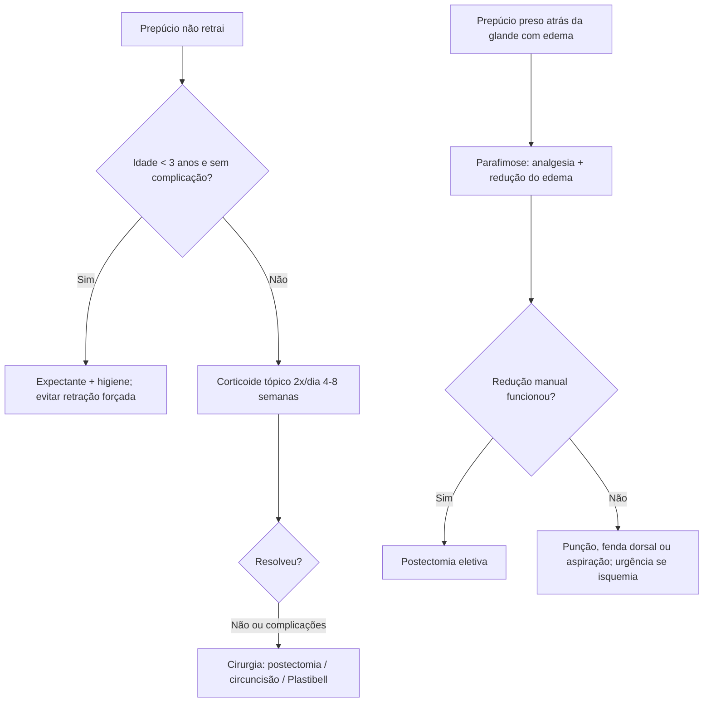

# Fimose e Parafimose em Pediatria

> Resumo em palavras próprias do Whitebook (Condutas Cirúrgicas > Cirurgia Pediátrica), sem autoria e referências. Confira detalhes e doses na fonte: https://whitebook.pebmed.com.br/conteudo/?id=23715&categoryId=207&subcategoryId=826

# Fimose
**Definição:** estreitamento do orifício prepucial que impede a exposição total ou parcial da glande. **Congênita** (fisiológica até 3–4 anos) ou **adquirida** (higiene inadequada, balanopostite crônica, balanite xerótica obliterante, retração forçada, trauma).

**Epidemiologia:** prepúcio redutível em < 5% ao nascer, 15% aos 6 meses, 50% no 1º ano, 80% aos 2 anos e 90% aos 3 anos.

## Clínica
Responsável não consegue retrair o prepúcio; abaulamento do prepúcio na micção (urina retida); cistos de retenção de esmegma ou saída de esmegma; balanopostite. Complicações: edema e dor, disúria, jato fraco, dor à ereção, ITU de repetição.

## Diagnóstico
Clínico: retração delicada com polegar e indicador, em direção à base, sem forçar; não expõe totalmente a glande = fimose. **Aderência balanoprepucial** (fisiológica, resolve até 5–6 anos, sem estreitamento do orifício) é o principal diferencial.

**Classificação:** grau 0 retração completa; 1 completa com estreitamento atrás da glande; 2 exposição parcial da glande; 3 só o meato uretral exposto; 4 retração discreta sem expor glande nem meato; 5 nenhuma retração.

**Outros diferenciais:** hipospadia, epispadia, pênis embutido, micropênis, fusão penoescrotal.

## Conduta
- **Até 3 anos:** expectante; orientar higiene (lavar nos banhos, trocar fraldas com frequência, **evitar retração forçada**, higienizar e secar entre prepúcio e glande à medida que retrai e recolocar o prepúcio) e tranquilizar os pais.
- **Encaminhar ao cirurgião pediátrico:** fimose sem complicação persistente após 3 anos, ou complicações (parafimose prévia, balanopostite grave/recorrente, abaulamento com compressão manual, ITU de repetição).
- **Corticoide tópico:** 2×/dia por **4–8 semanas**; tracionar levemente o prepúcio até o limite, aplicar pequena quantidade na área estreita, massagear e recobrir a glande; associar retrações leves várias vezes ao dia a partir de 5–7 dias de uso. Opções: betametasona dipropionato 0,05% creme; betametasona valerato 0,1–0,2%; mometasona 0,05–0,1%; triancinolona 0,01–0,5%; clobetasol 0,05%; dexametasona 0,1%; fluticasona 0,05%; hidrocortisona 0,2%. Sucesso **67–95%**, poucos efeitos adversos.
- **Indicações cirúrgicas:** abaulamento com compressão manual; fimose persistente sem resposta ao clínico após 4–5 anos; balanopostite importante ou ITU de repetição; sem exposição da glande ou fibrose do orifício; parafimose prévia.
- **Contraindicações ao tratamento tópico:** instabilidade, prematuridade, distúrbios hemorrágicos (hemofilia A, anemia falciforme), anomalias penianas (hipospadia, epispadia, micropênis, megaprepúcio), chordee/torção peniana, inflamação local.
- **Técnicas:** *postoplastia* (incisão dorsal do anel, inclusive fáscia de Buck; resultado estético ruim, pouco usada); *postectomia convencional* (retirada do anel e excesso, sutura mucocutânea absorvível); *circuncisão* (retirada maior, glande sempre exposta; escolha em motivo religioso e em doença do prepúcio, como BXO); *Plastibell* (anel plástico com hemostasia por esmagamento e necrose; cai em 2–3 semanas; menor tempo, sem pontos, melhor analgesia).
- **Complicações cirúrgicas:** sangramento (mais comum), infecção, ITU, lesão uretral/glandar, cisto de inclusão, cicatrização inadequada, ressecção cutânea excessiva, estenose meatal.
- **Pós-operatório:** analgésicos/anti-inflamatórios, banho de assento morno, pomadas com antibiótico e/ou corticoide; na postectomia clássica, mobilizar o prepúcio com frequência (evita estenose); no Plastibell, não tracionar e evitar impacto genital até a queda do anel.
- **Complicações da fimose:** retenção urinária, balanopostite, ITU de repetição, HPV/ISTs, câncer de pênis (longo prazo), parafimose.

## Balanite xerótica obliterante (BXO)
Inflamação progressiva e infiltrativa do prepúcio, equivalente masculino do líquen escleroso; cicatriz branca característica, pequena abertura prepucial, pode haver eritema e secreção, e atingir glande e uretra. Diagnóstico definitivo: **histopatologia**. Tratamento em geral cirúrgico (corticoide tópico temporário até a cirurgia): circuncisão se restrita ao prepúcio/glande; se atinge meato e uretra distal, considerar meatoplastia, uretrotomia, dilatação ou uretroplastia.

# Parafimose
**Epidemiologia:** relativamente rara, **emergência urológica**; não ocorre após circuncisão.

## Clínica e causas
Irritabilidade (crianças), dificuldade para urinar, retenção aguda, dor e edema da glande e do prepúcio retraído, banda de constrição no sulco coronal; só a glande é afetada (corpo do pênis flácido). Causas: fimose, procedimento geniturinário sem reposição do prepúcio (exame, cateter, cistoscopia), atividade sexual, retração inadequada na higiene ou autoprodução, trauma, piercing.

## Diagnóstico
Clínico; sempre excluir **corpo estranho** garroteando o pênis (pelo, anel, borracha, fio); confirmar banda e alteração distal. Diferenciais: balanopostite, urticária, fratura peniana, edema generalizado, angioedema, hematoma, edema idiopático.

## Conduta
- Analgesia (inclusive opioide); anestesia com lidocaína gel ou bloqueio do nervo dorsal do pênis + bloqueio em anel, **sem epinefrina**; em crianças, em geral com sedação.
- **Reduzir o edema:** compressão manual ou com luva por ~5 min; "turbante" (atadura elástica da glande à base, mais pressão distal; 5–10 min); gelo sobre filme plástico; gaze com solução salina hipertônica/glicosada por ≥ 1 h.
- **Redução manual** (1ª opção): comprimir e alongar a glande com uma mão e tracionar a banda distalmente com a outra (vaselina ou lidocaína gel ajudam; exige boa analgesia); pinças atraumáticas tipo Babcock em cada quadrante se falhar.
- **Se falhar:** punção (agulha 18–25 G no anel distal; depois antibiótico oral ou tópico); **fenda dorsal** (incisão às 12 h, perpendicular à corona, sem suturar, com antibioticoprofilaxia); aspiração dos corpos cavernosos (torniquete na base, agulha 18–20 G, após bloqueio); **postectomia de emergência** não é medida imediata (fazer depois de o edema regredir).
- Após redução: avaliar postectomia eletiva. Sofrimento isquêmico (pele azulada/preta e endurecida) ou falha: avaliação de urgência.
- **Complicações:** isquemia/necrose da glande, necrose cutânea, postite, ulceração, gangrena, autoamputação, recidiva.

## Fluxograma (refeito, a partir do texto; o original não traz algoritmo)

