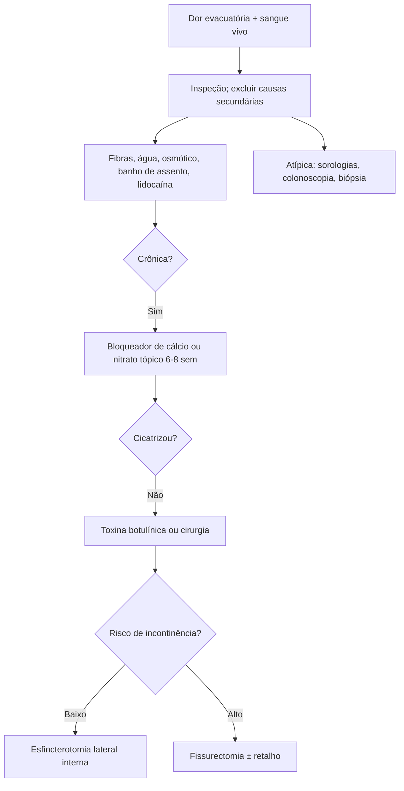

# Fissura Anal

> Resumo em palavras próprias do Whitebook (Condutas Cirúrgicas > Cirurgia em Coloproctologia), sem fisiopatologia, autoria e referências. Confira detalhes e doses na fonte: https://whitebook.pebmed.com.br/conteudo/?id=22612&categoryId=207&subcategoryId=213

**Definição:** ruptura do revestimento epitelial do canal anal distal (anoderme). Aguda (< 6 semanas; cicatriza espontaneamente em até 90%) ou crônica (> 6 semanas). Primária (trauma: constipação, diarreia, parto vaginal, coito anal) ou secundária (Crohn, HIV, ISTs — sobretudo sífilis —, sarcoidose, tuberculose, neoplasias, cirurgia prévia).

## Patogenia
Trauma → dor → espasmo/hipertonia do esfíncter interno → menor perfusão → isquemia → má cicatrização. A linha média posterior recebe menos da metade da perfusão do resto do canal. Localização: posterior 73–90%; anterior 13% (mulheres; até 25% em outras citações) e 8% (homens); lateral e múltipla = atípicas (pensar em causa secundária: Crohn, TB, carcinoma espinocelular, ISTs).

## Epidemiologia e clínica
Qualquer idade, mais em adultos jovens, sem predomínio de sexo; 2ª complicação gastrointestinal da gestação (após hemorroidas); ~40% das agudas cronificam. **Aguda:** dor intensa na evacuação (pode durar horas, com espasmo) e sangue vermelho vivo; medo de evacuar piora a constipação. **Crônica:** aspecto esbranquiçado, bordas fibróticas, fibras do esfíncter interno expostas, plicoma sentinela, papila hipertrófica. Prurido, irritação, ardor. Dor intensa diferencia de hemorroida (exceto trombose). **Risco:** constipação, diarreia, parto vaginal, coito anal, opioides, gestação/puerpério.

## Exame e diagnóstico
Ruptura linear (aguda: “corte de papel”; crônica: mais profunda). Toque e anuscopia podem ser adiados até a dor melhorar (necessários se suspeita de abscesso). Se não visualiza: anuscopia/retossigmoidoscopia sob sedação; suspeita de abscesso/fístula: USG, RM ou TC; **colonoscopia** se risco de neoplasia, hematoquezia intensa, > 45 anos, ou sem melhora com tratamento; atípicas: exames dirigidos (sorologias de IST, colonoscopia se DII); **manometria** na crônica. **Diferenciais:** hemorroida interna, fístula, úlcera retal solitária, carcinoma do canal anal, neoplasia do reto distal, abscessos, Crohn, sífilis, TB.

## Tratamento clínico (todos)
Evacuação atraumática, fibras e água, suspender constipantes, laxativos osmóticos (lactulose, PEG 4000), banho de assento morno 10–15 min ≥ 3×/dia, sem papel higiênico, pomada analgésica (lidocaína 2% gel) 2–3×/dia ou com corticoide (hidrocortisona 1%; no máximo 2 semanas), analgésicos/AINEs por pouco tempo. Encaminhar: sem resposta, atípicas, recidivas frequentes.

**Crônica:** clínico seguro; ~65% melhoram em 6–8 semanas (sintomas melhoram antes da cicatrização). Vasodilatadores tópicos (relaxam o esfíncter interno; efeito mais comum: cefaleia):
- **Bloqueadores de canal de cálcio** (nifedipina 0,2–0,4%, diltiazem 2%), 3×/dia: 1ª opção, mais tolerados.
- **Nitratos** (nitroglicerina 0,2%, isossorbida 1–2%), 3×/dia: eficácia similar, mais efeitos (cefaleia até 30%); evitar na gestação/lactação; evitar sildenafila, tadalafila, vardenafila.
- Sem melhora → trocar o agente, ou cirurgia/toxina botulínica. Vasodilatadores orais pouco usados. Sintomas > 1 ano = pior resposta clínica.

**Toxina botulínica A:** relaxa o esfíncter hipertônico; indicada se falha do tópico, 1ª linha em crônicas, ou recusa de cirurgia; sem protocolo de dose/local; inferior à esfincterotomia e levemente superior à nitroglicerina; cicatrização 33–96% em 9 semanas; preditores: sexo feminino, IMC menor; complicação: incontinência transitória.

## Cirurgia (crônica refratária após 6–8 semanas)
Avaliar risco de incontinência (idade, partos, DII, tônus) com manometria/USG endoanal; excluir causa secundária.
- **Esfincterotomia interna lateral:** 1ª opção; cicatrização até 95%; aberta ou fechada; risco de incontinência até 30%; ideal na hipertonia; limitar a extensão até o ápice da fissura reduz o risco.
- **Fissurectomia ± retalho de avanço:** mais falhas, menor risco de incontinência (alto risco ou sem hipertonia).
- **Dilatação anal:** pouco usada, mais incontinência e menor cicatrização.
- Complicações: incontinência temporária/definitiva, sangramento, hematoma, infecção. Resolutividade cirúrgica até 90%.

## Fissuras secundárias
Atípicas, múltiplas ou refratárias: considerar endoscopia. Crohn → tratar a doença. Infecciosas (HIV, sífilis, TB, clamídia, herpes): sorologias ± biópsia; tratar o agente.

## Fluxograma (refeito, a partir do texto; o original não traz algoritmo)

