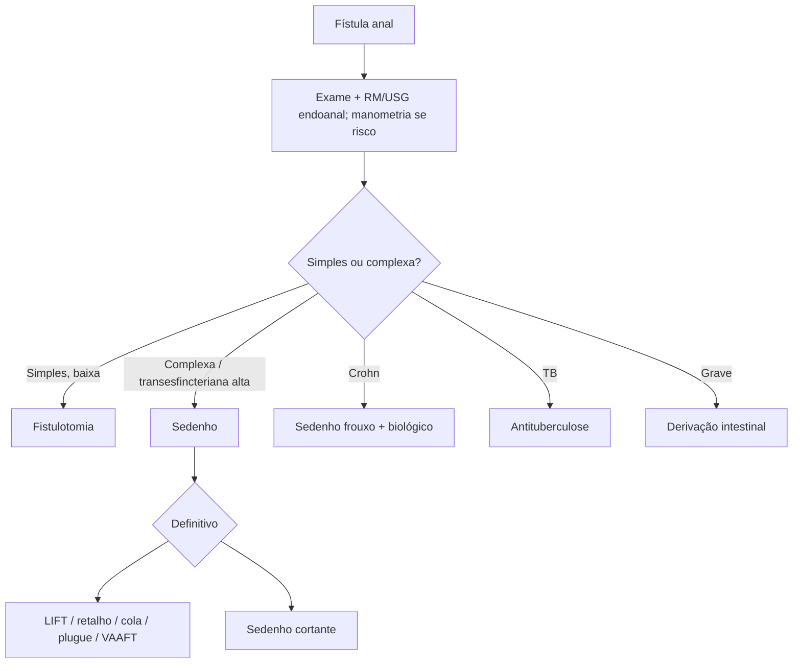

# Fístula Anal

> Resumo em palavras próprias do Whitebook (Condutas Cirúrgicas > Cirurgia em Coloproctologia), sem fisiopatologia, autoria e referências. Confira detalhes e doses na fonte: https://whitebook.pebmed.com.br/conteudo/?id=22615&categoryId=207&subcategoryId=213

**Definição:** trajeto epitelizado entre o canal anal e a pele perianal; fase crônica do abscesso perianal. Orifício interno em geral na linha pectínea e externo na pele. Teoria criptoglandular (obstrução e infecção das glândulas anais; a infecção se propaga pelo plano gorduroso entre os esfíncteres).

## Etiologia e epidemiologia
- 90% idiopáticas (criptoglandulares). Secundárias: Crohn, linfogranuloma venéreo, tuberculose, trauma anorretal/obstétrico, corpo estranho, cirurgia prévia, radioterapia, malignidade.
- Homens 2:1; 3ª–5ª décadas. Após drenagem de abscesso, 26–50% evoluem para fístula (até 66% se drenagem espontânea). Risco: IMC > 25, diabetes, tabagismo, hiperlipidemia, idade < 40.

## Clínica e exame
- Secreção purulenta/sanguinolenta crônica, “pústula” perianal, dor crônica, prurido, abaulamento, abscessos recorrentes; história de abscesso, trauma, cirurgia, RT, DII.
- Inspeção: orifício externo (distância da margem anal e posição), dermatite; palpação: **cordão fibroso** em direção ao ânus (sinal do cordonete); toque: fibrose do orifício interno; anuscopia: orifício interno.
- **Regra de Goodsall:** orifício anterior → trajeto radial reto até a linha denteada; posterior → trajeto curvo para a linha média posterior; exceção: orifício externo > 3 cm da margem (possível ferradura com orifício interno posterior).

## Classificação
- **Parks:** tipo 1 interesfincteriana (50–80%): atravessa o esfíncter interno e não o externo; tipo 2 transesfincteriana (30%): atravessa o externo abaixo do puborretal; tipo 3 supraesfincteriana (20%): sobe sobre o puborretal e desce até a fossa isquiorretal, poupando o externo (descrição do texto); tipo 4 extraesfincteriana (5%): orifício interno acima da linha pectínea, engloba todo o aparelho esfincteriano e elevadores, em geral por causas secundárias. Superficial/submucosa fora de Parks.
- **Simples:** sem trajetos secundários/abscesso residual e continência preservada. **Complexas:** transesfincteriana com > 30% do esfíncter externo, supra/extraesfincterianas, ferradura, Crohn, RT prévia, malignidade, incontinência.

## Diagnóstico
Clínico. Imagem define curso e etiologia: **USG endoanal** (operador-dependente); **RM de pelve** (melhor para trajeto, abscessos ocultos e esfíncteres; sensibilidade ~87% similar à USG, especificidade 69% vs 43%); TC (abscessos/coleções, menos sensível); fistulografia (pouco útil); **manometria** se alteração de continência antes da cirurgia.

## Tratamento
É cirúrgico (Crohn: cirurgia + medicamento). Metas: controlar sepse, erradicar a fístula, preservar a continência, evitar recorrência. Nenhuma técnica serve para todas; frequentemente em dois tempos com sedenho.
- **Fistulotomia:** simples, baixas, pouco esfíncter envolvido.
- **Sedenho não cortante (frouxo):** controla sepse, drena, ponte para reparo definitivo. **Sedenho cortante:** tração lenta; transesfincterianas altas.
- **Técnicas poupadoras de esfíncter:** retalho de avanço endoanal, LIFT, cola de fibrina, plugue.
- **VAAFT:** fistuloscópio, cauterização, desbridamento e sutura (recente).
- **Derivação (colostomia/ileostomia):** rara; Crohn anorretal grave, fístula retovaginal recidivada, fasciite necrosante perineal, fístula actínica.
- **Crohn:** fístulas complexas — sedenhos frouxos + imunobiológico ± imunomodulador. **Tuberculose:** antituberculostático primeiro.
- **Complicações:** infecção recorrente, recidiva, incontinência (conforme técnica), malignização (rara), sangramento, celulite, Fournier, sepse, estenose.
- **Prognóstico:** cicatrização ≈ 80% nas simples e ≈ 60% nas complexas com poupadoras.

## Fluxograma (refeito, a partir do texto; o original traz figuras de classificação)

