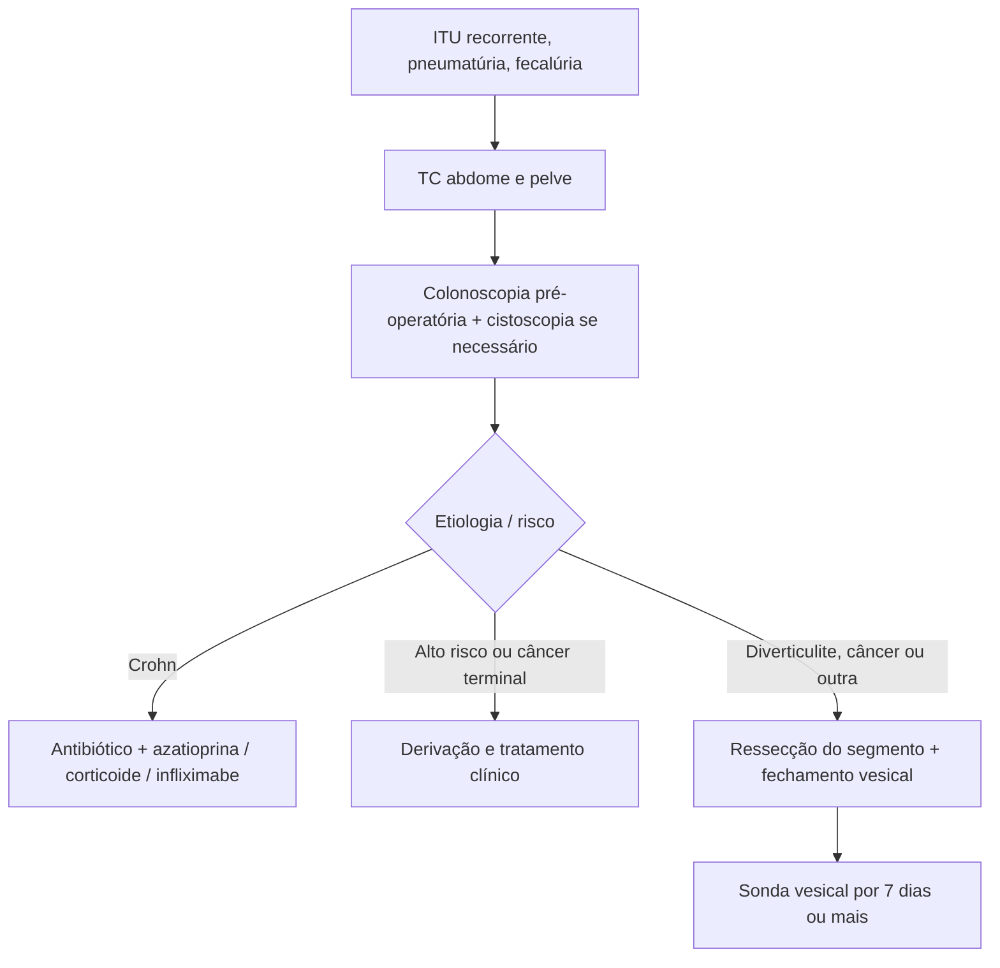

# Fístula Enterovesical

> Resumo em palavras próprias do Whitebook (Condutas Cirúrgicas > Cirurgia Geral e do Aparelho Digestivo), sem fisiopatologia, autoria e referências. Confira detalhes e doses na fonte: https://whitebook.pebmed.com.br/conteudo/?id=45415&categoryId=207&subcategoryId=211

**Definição:** comunicação anormal entre alça intestinal e bexiga (vesicoentérica, colovesical etc.). Mais comum em homens (3:1), porque nas mulheres o útero se interpõe entre bexiga e cólon.

## Etiologia
- Congênita (rara; ânus imperfurado, falha do septo urorretal).
- **Diverticulite:** causa mais comum de fístula colovesical. **Crohn:** causa mais comum de fístula íleo-vesical. **Câncer de cólon/reto:** causa mais comum de fístula retovesical.
- Trauma/corpo estranho; iatrogênica (pós-operatória, radioterapia).
- **Classificação:** colovesical (mais comum), retovesical, íleo-vesical, apêndico-vesical.

## Quadro clínico
Dor suprapúbica, sintomas miccionais irritativos, ITU de repetição. **Síndrome de Gouverneur** (dor suprapúbica, polaciúria, disúria e tenesmo) é muito sugestiva. Também urina malcheirosa com debris, hematúria, fecalúria, pneumatúria. Dor à palpação do hipogástrio; massa é rara.

## Diagnóstico
- **Urina I:** bacteriúria, leucocitúria, debris; urocultura com flora mista e predomínio de *E. coli* (pedir antibiograma). Hemograma: leucocitose se infecção/abscesso; anemia sugere neoplasia de cólon.
- **TC de abdome e pelve:** teste mais sensível; deve estar na avaliação inicial de todo suspeito — gás ou contraste oral na bexiga, espessamento parietal vesical, massa pélvica com gás.
- **Enema baritado:** pouco confiável para fístula, mas diferencia diverticulite de câncer; **teste de Bourne** (bário no sedimento urinário centrifugado) confirma.
- **Cistografia:** contraste fora da bexiga; sinal de Herald (defeito em crescente no topo da bexiga) sugere abscesso perivesical; imagem em colmeia marca o fim do trajeto. Raramente pedida.
- **USG:** sinal ecogênico em bico ligando peristalse à bexiga; raramente pedida. **RM:** útil sobretudo no Crohn (inflamação, coleções, extensão).
- **Cistoscopia:** eritema, alterações bolhosas/papilíferas, material pela fístula, biópsia. **Teste da semente de papoula:** sementes na urina em 48 h, detecção de 100% em estudo pequeno, baixo custo.
- **Colonoscopia:** não detecta a fístula, mas deve ser feita sempre no pré-operatório para excluir malignidade. **Laparoscopia/laparotomia:** diagnóstica e terapêutica.

## Tratamento
- **Cirurgia:** ressecção do segmento acometido e fechamento dos orifícios, por laparoscopia ou laparotomia. Complicações da doença: dor, disúria, urina fétida, incontinência, obstrução urinária, cistite recorrente, sepse, pielonefrite.
- **Alto risco cirúrgico ou câncer terminal:** conservador com derivações (colostomia, ureterostomia, drenagem percutânea) e fármacos.
- **Crohn:** primeira escolha é clínica — antibióticos, azatioprina, corticoide e/ou infliximabe.
- Após o reparo, manter sonda vesical **≥ 7 dias**, conforme inflamação e tamanho do reparo.

## Fluxograma (refeito, a partir do texto; o texto original não traz uma figura)

