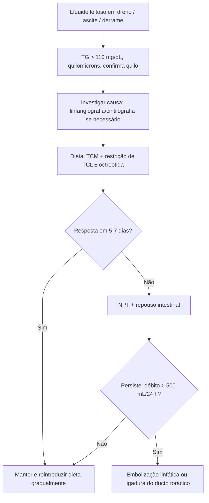

# Fístula Quilosa

> Resumo em palavras próprias do Whitebook (Condutas Cirúrgicas > Cirurgia Torácica), sem fisiopatologia detalhada, autoria e referências. Confira detalhes e doses na fonte: https://whitebook.pebmed.com.br/conteudo/?id=23704&categoryId=207&subcategoryId=215

**Definição:** vazamento de linfa rica em lipídios (aspecto leitoso e turvo) para cavidades (abdominal: ascite quilosa; torácica: quilotórax) ou externamente (fístula linfática: trajeto epitelizado entre o sistema linfático e a pele). Incidência provavelmente em alta (maior sobrevida oncológica, cirurgias cardiotorácicas e abdominais mais agressivas, transplantes); gravidade e prognóstico dependem da causa.

## Conceitos
- Mecanismos: exsudação transmural (ex.: linfangiectasia), obstrução com dilatação de linfáticos subserosos (ex.: invasão maligna), lesão direta (trauma/cirurgia), hiperprodução hepática de linfa por ↑ pressão venosa (pericardite constritiva, ICC), cirrose.
- Frequência: países desenvolvidos — neoplasia abdominal e cirrose; em desenvolvimento — tuberculose e filariose; adultos — linfoma, cirrose, TB; crianças — anomalias linfáticas congênitas (linfangiectasia primária, hipoplasia linfática, Klippel-Trénaunay, síndrome das unhas amarelas).
- Anatomia: cisterna do quilo anterior a L2, entre a cava inferior e a aorta; ducto torácico entra no tórax pelo hiato aórtico, fica no mediastino posterior (à direita da aorta, à esquerda da ázigos), cruza para a esquerda em T5 e desemboca na junção subclávia-jugular interna esquerdas. Quilo contém quilomícrons (AGL, TCL, vitaminas lipossolúveis), proteínas, imunoglobulinas, linfócitos, água e eletrólitos; triglicerídeos de cadeia média e curta vão direto ao sistema porta; o quilo é em geral bacteriostático.
- **Etiologias:** neoplásica (linfoma, carcinoide, tumores sólidos, sarcoma, linfangioleiomiomatose, LLC); congênita; adquirida (cirrose, TB, filariose, ascaridíase, *M. avium* na SIDA, pericardite constritiva, ICC, Whipple, volvo, má rotação, pancreatite, mesenterite, LES, sarcoidose, diálise peritoneal, nefrótica, hipertireoidismo, fibrose retroperitoneal, Behçet, Ménétrier); fármacos (sirolimo, bloqueadores de canal de cálcio); iatrogênica (cirurgia, radioterapia); trauma abdominal; síndrome do bebê sacudido; idiopática (excluir linfoma).

## Clínica
Distensão abdominal indolor progressiva, dor, dispneia, náusea/vômito, mal-estar, perda de peso, anorexia, esteatorreia, febre, sudorese noturna. No pós-operatório: surge em 5–9 dias, em geral com a reintrodução da dieta enteral; dreno com aspecto leitoso/turvo; melhora ao suspender a dieta. Complicações: desidratação/distúrbios eletrolíticos, desnutrição com hipovitaminose, imunossupressão (hipogamaglobulinemia, perda de imunidade celular), sequestro de medicamentos pela linfa.
- **Fatores de risco (pós-operatório):** sexo feminino, idade avançada, experiência do cirurgião, hipoalbuminemia, cirurgias ginecológica/urológica/hepática/colorretal (colectomia direita)/pancreática/nefrectomia, HIPEC, linfadenectomia extensa (proporcional ao número de linfonodos), pancreatite crônica, perda sanguínea, nutrição enteral precoce (48 h) ou rica em lipídios (15 g) nos primeiros 4 dias, quimioterapia pré-operatória, manipulação vascular/para-aórtica, invasão retroperitoneal, ascite prévia.
- Exame: ascite, derrame pleural, edema de MMII, desnutrição/caquexia, linfadenomegalia.

## Diagnóstico
- Laboratório: distúrbios eletrolíticos, hipogamaglobulinemia, hipoalbuminemia, linfopenia; descartar infecção.
- **Líquido ascítico:** inodoro, leitoso e turvo; triglicerídeos > 110 mg/dL; celularidade > 500 (linfócitos); proteína 2,5–7 g/dL; gradiente de albumina soro-ascite < 1,1; colesterol baixo (ascite/soro < 1); citologia positiva se neoplasia; cultura para TB; amilase se pancreatite. Diferenciar de ascite pseudoquilosa (debris celulares; TG baixo, sem quilomícrons).
- **Quilotórax:** inodoro, leitoso, estéril; em geral exsudato; TG > 110 mg/dL; colesterol pleural/sérico < 1; quilomícrons; lipídeos totais 0,4–4 g/L; pH > 7; linfócitos; Sudan III. Pseudoquilotórax/zona cinzenta: TG 50–110 e colesterol pleural/sérico > 1 (ver lipoproteínas). Teste: refeição lipídica com corante lipofílico e toracocentese 30–60 min depois.
- **Imagem:** TC (linfa tem densidade de água; coleções e causa; pode-se opacificar o ducto com emulsão lipídica oral); **linfocintilografia** (função linfática, ~80 min após o traçador; opção se linfangiografia contraindicada; pouco usada); **linfangiografia com Lipiodol** (injeção em linfonodos inguinais; padrão-ouro para obstrução linfática; avalia patência, adenopatia, vazamento e fístula; localiza o vazamento em até 78%; pode ser terapêutica; complicações: embolia gordurosa, necrose tecidual, hipersensibilidade, linfedema transitório). Laparoscopia/toracoscopia para ascite de causa desconhecida (suspeita de malignidade/TB), com ingesta lipídica para visualizar o foco.
- **Gravidade (fístula pós-operatória):** A — débito ou duração < 7 dias; B — resolve em 7–14 dias com medidas; C — > 14 dias, exige cirurgia ou readmissão.

## Tratamento
Identificar a causa; sem consenso (evidência pobre); semanas a meses; acompanhar aspecto/débito dos drenos, clínica e imagens. Se há neoplasia, o tratamento oncológico pode fechar a fístula.
- **Conservador:** controlar o fluxo e promover cicatrização linfática.
  - *Dieta:* hiperproteica, com restrição de TCL e suplementação de **TCM** (absorção portal direta; 80–100 mL/dia, 4–5 colheres de sopa; caro, pode causar diarreia; **não usar em cirróticos** — risco de narcose/coma); repor vitaminas A, D, E, K; ácidos graxos essenciais 2–4% do VCT (40–80 kcal/dia numa dieta de 2.000 kcal; óleos de cártamo, canola, girassol, milho, oliva, amendoim); deficiência de AGE após ~5 dias de privação (eczema, cicatrização, trombocitopenia, crescimento). Sem resposta → repouso intestinal e **NPT** (pode conter lipídios).
  - *Protocolo:* jejum 24 h com débito basal; dieta sem lipídios por 24 h; depois hiperlipídica por mais 24 h; decidir manter dieta oral/enteral ou NPT exclusiva.
  - *Fármacos:* octreotida 0,1 mg SC a cada 8 h; somatostatina 3,5–10 µg/kg/h EV contínua (menos usada); etilefrina (relatos após esofagectomia).
- **Percutâneo:** paracentese/toracocentese de alívio; punção guiada de coleções; TIPS (relatos em cirróticos refratários); linfangiografia terapêutica/embolização (Lipiodol, cola/NBCA, coils) com sucesso relatado em 75–100%, por via transabdominal retroperitoneal, ducto torácico ou pela própria coleção.
- **Cirúrgico:** refratário após 5–7 dias de conservador ou débito persistente > 500 mL/24 h; intervenção precoce no quilotórax pós-esofagectomia. Método de escolha: **ligadura do ducto torácico** (toracotomia, vídeo ou abdominal alta), sucesso ~80%; se o ducto não for identificado, ligadura em massa dos tecidos entre ázigos e aorta. Alternativas: pleurodese, shunt pleuroperitoneal, pleurectomia. Se etiologia indefinida/suspeita neoplásica, biopsiar pleura/peritônio e linfonodos.

## Fluxograma (refeito, a partir do texto; o original não traz algoritmo)

