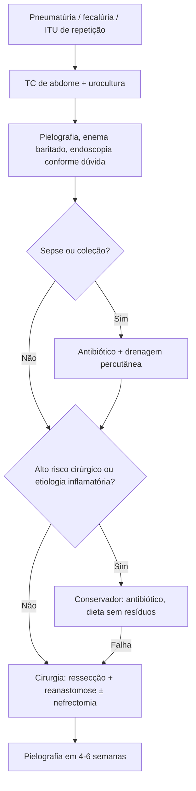

# Fístula Renoalimentar

> Resumo em palavras próprias do Whitebook (Condutas Cirúrgicas > Cirurgia Geral e do Aparelho Digestivo), sem fisiopatologia, autoria e referências. Confira detalhes e doses na fonte: https://whitebook.pebmed.com.br/conteudo/?id=45414&categoryId=207&subcategoryId=211

**Definição:** comunicação entre o trato urinário superior (rim, pelve, ureter) e o trato digestivo; as mais comuns são **renoduodenais e renocólicas**, por inflamação crônica, lesão iatrogênica ou neoplasia. Sinônimos: renodigestiva, renoenteral, nefroentérica.

## Etiologia
Abscessos renais, pielonefrite, procedimentos iatrogênicos (a maioria das colorrenais: nefrostomia percutânea, ablação por radiofrequência ou crioablação laparoscópica), trauma abdominal contuso/penetrante, neoplasias (cólon, rim, urotelial de bexiga), corpo estranho (dentadura, moeda, sonda), cálculo antigo com abscesso, pielonefrite xantogranulomatosa, tuberculose, DII, úlcera péptica, doença diverticular, infecções intra-abdominais ou retroperitoneais.

## Clínica
Varia com a gravidade e o sítio: pneumatúria, fecalúria, ITU de repetição, lombalgia ou dor abdominal, vômito. Gravidade: sepse. Risco: pacientes magros ou desnutridos submetidos a procedimento renal, sobretudo percutâneo.

## Diagnóstico
- **Laboratório:** sinais de sepse (leucocitose com desvio, PCR e lactato), distúrbios hidroeletrolíticos, ureia e creatinina se IRA, urocultura positiva.
- **Imagem:** urografia excretora; pielografia retrógrada (contraste para o intestino) ou anterógrada; enema baritado; **teste de Bourne** (centrifugar urina após enema baritado para achar bário); RX (gás no sistema coletor); **TC de abdome** (melhor exame: causa, coleções perirrenais, ar no coletor, defeito rim–alça, cálculos; monitora resposta); cintilografia renal (função do rim; isótopo oral ou venoso confirma a fístula).
- **Agentes orais:** corante oral identificado na urina.
- **Endoscópicos:** cistoscopia, ureteroscopia, nefroscopia percutânea, EDA, colonoscopia.
- **Diferencial:** fístula colovesical.

## Tratamento
- **Infectados:** estabilização, antibiótico de amplo espectro, drenagem percutânea de coleções.
- **Conservador** (alto risco cirúrgico, etiologia inflamatória ou fístula pós-ablação precoce): antibiótico, anti-inflamatório, dieta líquida sem resíduos, drenagem percutânea.
- **Cirurgia** (terapia de escolha): ressecção da porção afetada e reanastomose; fistulectomia com ressecção do segmento intestinal; nefrectomia parcial ou total se grande destruição do parênquima. Abordagens endoscópicas em casos selecionados, ainda sem validação isolada.

## Seguimento e prognóstico
Pielografia retrógrada 4–6 semanas após o reparo; fístula por cálculo: TC sem contraste em 6 meses ou se sintomas; outras causas benignas: urografia ou estudo funcional renal em 3–6 meses. **Complicações:** falha de sutura, obstrução urinária ou intestinal, abscesso, persistência/recorrência, sepse, óbito. Prognóstico depende da causa — benignas e precoces são favoráveis; neoplasias avançadas, reservado.

## Fluxograma (refeito, a partir do texto; o texto original não traz uma figura)

