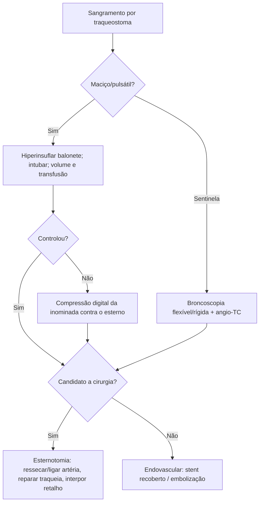

# Fístula Traqueoinominada

> Resumo em palavras próprias do Whitebook (Condutas Cirúrgicas > Cirurgia Torácica), sem autoria e referências. Confira detalhes e doses na fonte: https://whitebook.pebmed.com.br/conteudo/?id=50816&categoryId=207&subcategoryId=215

**Definição:** comunicação anormal entre a traqueia e a artéria inominada (tronco braquiocefálico), com hemorragia grave e risco de inundação da via aérea. Ocorre após traqueostomia ou traqueoplastia por erosão arterial inflamatória, tipicamente entre o 7º e o 9º anéis traqueais (pode ser mais alta conforme a anatomia). Pós-traqueostomia: erosão pela curvatura da cânula, pelo balonete ou pela ponta. Outras causas: aneurisma/pseudoaneurisma do tronco, neoplasias, pós-laringectomia.

**Fatores de risco:** traqueostomia baixa, ponta da cânula pressionando a parede anterior, hiperextensão ou cifose cervical, infecção ou deiscência após traqueoplastia, nova traqueoplastia em traqueia já operada, dissecção anterior extensa com exposição arterial, radioterapia cervical, esteroides, intubação prolongada, hipotensão.

## Clínica
Incidência 0,1–1% após traqueostomia e 0,7% em cirurgia traqueal; pico entre a 1ª e a 2ª semana. **Sangramento sentinela** (vermelho vivo, autolimitado, em 35–50% antes do evento fatal); sangramento ≤ 48–72 h costuma ser venoso ou por aspiração/broncopneumonia (diluído em saliva). **Hemorragia maciça pulsátil pelo estoma**, podendo ser a primeira manifestação; diminui com a hiperinsuflação do balonete (aumenta a suspeita). Cânulas modernas (curvatura > 90°, balonete de alto volume e baixa pressão) reduziram a incidência.

## Diagnóstico
Alta suspeição; valorizar todo sangramento. **Angio-TC:** pouco útil na urgência; planeja a cirurgia ou o tratamento endovascular (artéria inominada em contato íntimo/deslocada pela traqueia, pseudoaneurisma, ruptura, infiltração mediastinal). **Broncoscopia** (eleição): flexível diante de sangramento sentinela; se persistir dúvida, rígida com ventilação (área pulsátil na parede, necrose, coágulos).
- **Diferenciais:** sangramento venoso (jugular interna, tireoidianas inferiores) ou muscular, discrasia, traqueíte/broncopneumonia, granulação, úlcera traqueal superficial, lesão por aspiração.

## Tratamento
- **Imediato à beira-leito:** controle da via aérea (preferir intubação orotraqueal, às vezes com broncoscopia); reposição volêmica e transfusão com acesso calibroso; **tamponamento temporário:** hiperinsuflar o balonete (controla ~85%; cuidado para não romper), e se falhar, compressão digital da inominada pelo estoma (estender o estoma para baixo, dissecção romba da fáscia pré-traqueal, comprimir a artéria contra o esterno; controla 89%); levar de imediato ao bloco cirúrgico.
- **Endovascular** (alternativa em selecionados; ponte ou definitivo): múltiplas comorbidades, esternotomia/toracotomia prévias, radioterapia mediastinal; idealmente em estáveis, mas usado também para estabilização inicial; embolização, stent recoberto, balão temporário; menor morbimortalidade, mas dificuldade de posicionamento do stent, pouca disponibilidade, ressangramento, endoleak, erosão pela prótese com nova fístula; maior intervalo entre traqueostomia e fístula pode predizer melhor sobrevida.
- **Cirúrgico** (definitivo na maioria): se o balonete tampona, retirar a cânula sob visão com broncoscopia rígida (0°); se sangrar, avançar o broncoscópio além da fístula comprimindo a parede anterior e ventilar por ele; se não sangrar, passar tubo orotraqueal com balonete distal à fístula. Linha arterial radial esquerda e acesso central (femoral ou subclávia direita). Esternotomia mediana ± cervicotomia em colar; dissecar timo e veia inominada; isolar a artéria proximal e distalmente à fístula, ressecar o segmento comprometido e suturar os cotos (prolene 4-0, dois planos); desbridar a traqueia e reparar com PDS 4-0 separados; interpor retalho (esternocleidomastóideo, musculatura paratraqueal, timo ou omento). Arterioplastia: controversa (ressangramento 60–86%), considerar com estenose/oclusão importante da carótida esquerda (enxerto venoso de safena ou jugular com prolene 5-0; bypass inominada-inominada ou inominada-carótida comum); reparo primário após ressecção não é indicado (tensão); **não fazer bypass em sítio infectado**. Fístula após traqueoplastia com separação traqueal: corrigir sobre tubo orotraqueal e, depois, tubo T longo.
- **Pós-operatório:** broncoscopia para limpar sangue; intubação com tubo ID > 7,5 e balonete abaixo do reparo; PAS < 120 mmHg. **Complicações:** mediastinite, osteomielite esternal, déficit de pulso no membro superior, embolia gasosa, ressangramento, nova fístula, sequela neurológica (rara).

## Prognóstico
Mortalidade > 75% (até 69% já nas medidas iniciais; > 50% intraoperatória); sobrevida no 1º ano < 25% mesmo após reparo; depende de diagnóstico precoce, controle imediato, via aérea pérvia, cirurgia rápida e tipo de reparo; óbito geralmente por asfixia com sangue.

## Prevenção
Traqueostoma no 2º–3º anel; evitar cânulas rígidas ou muito anguladas; checar a posição da cânula com broncoscopia ao fim; pressão do balonete < 20 mmHg (mensurar com frequência); cânula do tamanho adequado (comprimento ajustável em obesos); evitar posições viciosas pelo peso do circuito e mobilização excessiva; USG cervical antes de traqueostomia percutânea (se pulsação acima da fúrcula). Em cirurgia traqueal: não dissecar a inominada sem necessidade, interpor tecido vascularizado, suturar o esterno-hióideo à traqueia além da artéria se traqueostomia for previsível, evitar material protético em contato com grandes vasos.

## Fluxograma (refeito; o original traz uma figura sem texto)

