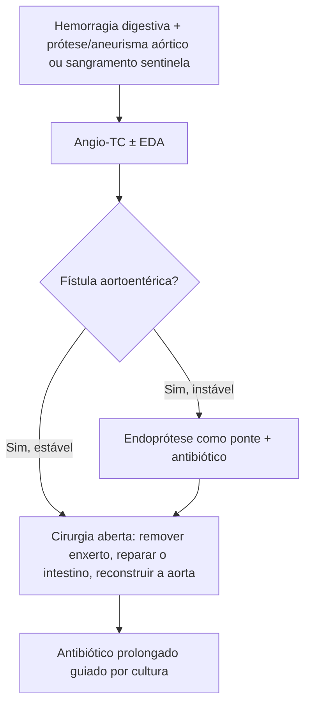

# Fístulas Aortoentéricas

> Resumo em palavras próprias do Whitebook (Condutas Cirúrgicas > Cirurgia Vascular), sem autoria e referências. Confira detalhes e doses na fonte: https://whitebook.pebmed.com.br/conteudo/?id=64317&categoryId=207&subcategoryId=238

**Definição:** comunicação anômala entre a aorta e o trato digestivo, com hemorragia digestiva grave, às vezes maciça e fatal. Rara.

## Classificação e etiologia
- **Primária:** sem prótese aórtica prévia; por aneurismas ateroscleróticos em expansão, aneurismas micóticos, tumores, radioterapia, vasculites/inflamação crônica.
- **Secundária:** após reconstrução aórtica ou EVAR/TEVAR; infecção de enxerto/endoprótese, pseudoaneurisma anastomótico, erosão mecânica de enxerto exposto (sem cobertura retroperitoneal). Pulsação contínua do enxerto e infecção crônica de baixa virulência são os principais gatilhos; germes: *S. epidermidis*, *S. aureus*, *E. coli*, *Enterococcus*, anaeróbios entéricos.

## Clínica
Suspeitar em toda hemorragia digestiva (sobretudo maciça). Tríade clássica — dor abdominal, sangramento digestivo e massa pulsátil — é incomum completa. Febre e sinais inflamatórios nas secundárias. Fatores: reconstrução ou endoprótese aórtica prévia, radioterapia, aneurisma conhecido, vasculite, sangramentos anteriores. **Sangramento sentinela** (premonitório): episódio autolimitado que antecede o catastrófico (cessa por vasoespasmo, coágulo ou hipotensão). Exame: massa pulsátil, palidez, cicatrizes abdominais/inguinais.

## Diagnóstico
- **Angio-TC:** de escolha (sangramento ativo, prótese, aneurisma, gás/coleção, pseudoaneurisma, trajeto da fístula).
- **EDA:** exclui outras causas e visualiza o duodeno (principal sítio); pode ver sangramento ou prótese exposta.
- **Angiografia:** invasiva, útil se planejar correção endovascular ou ponte.
- **Diferencial:** úlcera gástrica/duodenal, angiodisplasia, malformações, varizes esofágicas, isquemia mesentérica, neoplasias.

## Tratamento
- **Cirurgia aberta (padrão-ouro):** remover o enxerto (secundárias), desbridar tecido infectado, reparar o orifício intestinal e reconstruir a aorta com enxerto autólogo (ex.: veia femoral) ou sintético; com infecção, preferir reconstrução **extra-anatômica** (ex.: axilobifemoral).
- **Endovascular:** ponte para o tratamento definitivo, sobretudo em instáveis; controla o sangramento mas não o foco infeccioso (recorrência alta). Cobre-se o orifício com endoprótese e, estabilizado, faz-se o reparo aberto com desbridamento e retirada da endoprótese.
- **Antibioticoterapia** em praticamente todos: amplo espectro (Gram-negativos e anaeróbios), prolongada, oral após a alta, idealmente guiada por cultura do tecido desbridado.

## Prognóstico
Mortalidade próxima de 100% sem tratamento; diagnóstico precoce e centro especializado melhoram o resultado.

## Fluxograma (refeito, a partir do texto; o original não traz algoritmo)

