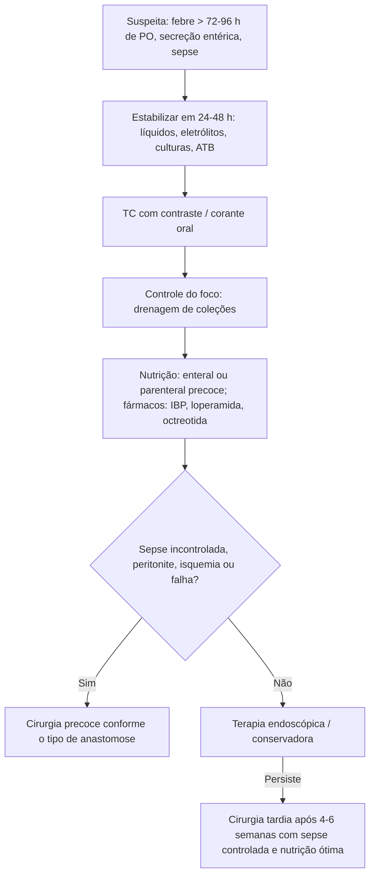

# Fístulas Digestivas

> Resumo em palavras próprias do Whitebook (Condutas Cirúrgicas > Cirurgia Geral e do Aparelho Digestivo), sem fisiopatologia, autoria e referências. Confira detalhes e doses na fonte: https://whitebook.pebmed.com.br/conteudo/?id=23705&categoryId=207&subcategoryId=211

**Definição:** comunicações anômalas entre órgãos do TGI e outra estrutura interna ou o meio externo (enteroatmosférica). O extravasamento de suco digestivo, água, eletrólitos e nutrientes causa dor, distúrbios hidreletrolíticos e ácido-básicos, desnutrição, abscessos, sepse e sangramento, além de dano psicológico.

## Classificação
- **Origem:** congênita ou adquirida. **Etiologia:** primária/espontânea (15–25%: DII, diverticulite, apendicite, isquemia mesentérica, úlcera perfurada, neoplasia) ou secundária (75–85%: iatrogenia, deiscência de anastomose, lesão vascular, corpo estranho, erosão por dreno, trauma, radioterapia).
- **Anatomia:** externa (pele) ou interna (órgãos adjacentes); proximal × distal; simples × complexa.
- **Débito:** baixo < 200 mL/dia; intermediário 200–500; alto > 500.
- **Tempo:** aguda (trajeto instável) × crônica (estável, epitelizado). Pós-operatória precoce (até o 4º dia): aspectos técnicos, em geral requer correção cirúrgica; tardia (> 4º dia): distúrbio de cicatrização, muitas vezes sem cirurgia.
- **Localização:** alta (acima do Treitz, maior débito) × baixa.

## Fatores de risco
Desnutrição/obesidade (IMC > 30), albumina < 3 g/dL, imunodeficiência, ASA > 3, sexo masculino, idade avançada, cirurgia de urgência, irradiação prévia, anastomose retal/anal, doença cardiovascular, tabagismo/etilismo, corticoide prolongado, Crohn, cirrose, IRC, AINE perioperatório, sepse abdominal. Técnicos: cirurgia longa, grande perda sanguínea, drenos, vasopressores, má vascularização, derivações proximais, hematoma na anastomose, lesão inadvertida de alça, inexperiência.

**Deiscência por tipo de anastomose (Girard 2014):**
- Biliar — risco: ductos finos, irradiação, anastomose perto da convergência; proteção: baixa pressão intraluminal.
- Pancreática — risco: idade, pâncreas mole/esteatótico, Wirsung < 2 mm; proteção: pâncreas duro, drenagem transanastomótica do Wirsung, análogos de somatostatina.
- Esofágica — risco: idade, sexo masculino, apneia do sono, IMC > 40, Y de Roux anticólico; proteção: experiência do cirurgião.
- Colorretal/coloanal — risco: tabagismo, sexo masculino, anastomose baixa; proteção: experiência, ileostomia de proteção, dreno pélvico aspirativo.

## Epidemiologia
Mortalidade 15–20%; internação longa e risco de reoperação; mais frequentes em anastomoses esofágicas e retais; junção duodenojejunal é difícil; fechamento espontâneo em 19–70% com bom manejo; sepse descontrolada e desnutrição são as principais causas de óbito.

## Quadro clínico
Queda do estado geral, anorexia, fadiga, delirium, taquicardia persistente, taquipneia, dor, **febre persistente após 72–96 h de pós-operatório**, evolução fora do esperado, mudança do aspecto dos drenos, sepse, desidratação, desnutrição, alteração da ferida (eritema, abscesso, secreção digestiva).
- **Sítio:** intratorácico — dor pleurítica, mediastinite, pneumotórax, derrame, arritmia, enfisema; intraperitoneal — dor, peritonite; infraperitoneal — dor perineal, disfunção urinária, pus anal, pneumatúria, fecalúria. Pós-cirúrgicas surgem em geral entre o 5º e o 10º dia; espontâneas são indolentes; internas são difíceis de suspeitar (febre e taquicardia em 50%).
- **Laboratório:** leucocitose com desvio, anemia, PCR persistentemente alta, análise bioquímica do dreno, IRA, hiponatremia, hipocalemia, hipocloremia, acidose metabólica (perdas de 50 a 3.000 mL/dia, maiores nas proximais).

## Diagnóstico
- **Corantes orais** (azul de metileno) para ver extravasamento pela ferida ou dreno.
- **Contraste no trajeto:** muitos falsos-negativos. **TC com contraste** (via e combinação conforme a suspeita; atenção à função renal): viabilidade das alças, foco séptico, qualidade da drenagem, acessibilidade.
- **Endoscopia:** pouca insuflação, endoscopista experiente e cirurgião disponível; mais risco nas agudas; permite stents e terapia a vácuo.

## Tratamento
Equipe multidisciplinar (cirurgião, intensivista, radiologista intervencionista, nutrólogo, enfermagem). Meta: controlar a sepse e criar condições de cicatrização. Opções: manejo clínico, endoscópico/intervencionista, cirurgia.
- **Cuidados gerais:** estabilizar em 24–48 h; medir débito e aspecto; repor líquidos considerando o débito, o terceiro espaço, vômito e diurese; perdas **isotônicas** (delgado, pancreática, biliar) × **hipotônicas** (colônica); repor Ca, Mg, P; bicarbonato em fístulas proximais de alto débito.
- **Nutrição:** desnutrição em 60–70%; começar cedo. *Oral:* fístulas assintomáticas, distais (íleo distal, cólon). *Enteral:* via preferencial se fístula proximal com acesso distal e intestino funcionante; contraindicada se alto débito sem controle farmacológico, pele sem proteção ou isquemia; riscos: diarreia, isquemia, aspiração. *Parenteral:* intolerância enteral, fístula jejunal, ileal de alto débito, sem acesso distal; riscos: pancreatite, esteatose, infecção de cateter. *Mista* mantém a mucosa e garante metas. *Fistuloclise:* cateter na fístula guiado por radiologia, controversa; exige estabilidade, ausência de infecção, intestino distal pérvio e absortivo; considerar glutamina. Perda de zinco, selênio e vitaminas.
- **Sepse:** hemocultura/culturas, antibiótico de amplo espectro ao primeiro sinal, cobrir resistentes se hospitalar, avaliar Candida Score; controlar foco (imagem, drenagem percutânea ou endoscópica, drenos funcionantes por tempo prolongado; muitas vezes o objetivo é converter fístula interna em externa controlada).
- **Fármacos:** IBP; **loperamida** 4 mg inicial, repetir 2 mg até 16 mg/dia VO; **difenoxilato + atropina (Lomotil)** 5 mg VO 3–4×/dia; **octreotida 0,1 mg SC 3×/dia por 5–8 dias** (suspender se o débito não cair; mais benefício em alto débito; efeitos: náusea, diarreia, esteatorreia, constipação, bradicardia, dor).
- **Pele:** bolsa coletora ajustada; em fístula duodenal, ácido láctico contínuo (4,7 g/1.000 mL SF 0,9%/dia) para inativar enzimas pancreáticas. Suporte psicológico (depressão).
- **Endoscopia por local:**
  - Esofagogástrica/esofagojejunal: pressão negativa interna, pig-tail duplo, stents recobertos por 6–8 semanas, clipes + cola (defeito < 1–2 cm), clipes Ovesco.
  - Biliar: stent por CPRE, drenagem biliar interna/externa.
  - Colorretal/coloanal: drenagem perineal/digestiva, EndoSponge, pig-tail com exteriorização anal, drenagem transglútea.
  - Ileocolônica: drenagem percutânea só para sintomáticos com poucos abscessos > 3 cm e acesso fácil; melhora em 48 h, senão reoperar.
- **Cirurgia:**
  - **Indicações:** sepse grave não controlada, peritonite difusa ou pleurite, falha do conservador, isquemia da anastomose. *Precoce:* fístulas precoces, sepse incontrolada, fístulas esofágicas torácicas (mediastinite). *Tardia:* 4–6 semanas, após controlar sepse/inflamação e melhorar o estado nutricional.
  - **Gestos:** drenar fluidos sépticos, cultura, lavagem (7–10 L de SF), drenagem eficaz, ressecar necrose (enterectomia), ressecar o trajeto e fechar o orifício, bypass/exclusão, garantir via de nutrição, tentar fechar a cavidade.
  - **Por anastomose:** *geral* — fechamento primário (precoce, tecido viável), cateter guiando fistulização (Foley, Pezzer), patch omental, gastrostomia de descompressão; reforço; reconfecção (mecânica/isquemia). *Esofágica* — tubo T com irrigação (defeitos pequenos, controversa), esofagostomia, jejunostomia terminal (isquemia ou deiscência > 50%), esofagocoloplastia posterior. *Biliar* — drenagem ampla em laparotomia abreviada, drenagem externa, tubo T (necrose limitada), reconfecção. *Pancreática* — fechamento jejunal, dreno no Wirsung, pancreatectomia total se necrose extensa, converter em pancreatogastroanastomose. *Colorretal* — pequenas (baixo risco): fechar o defeito + estoma proximal + dreno; grandes: ressecar e fazer estoma duplo ou Hartmann; deiscência > 50%, isquemia, peritonite fecal ou paciente instável em vasopressor: reverter a anastomose com estoma terminal.

## Fatores de bom prognóstico
Etiologia cirúrgica (pós-apendicite/diverticulite), intestino adjacente sadio, débito baixo/intermediário, sem obstrução distal, sem corpo estranho, infecção controlada, trajeto sem epitelização, **trajeto > 2 cm, orifício < 1 cm**, sem comorbidades (DII, neoplasia), sem irradiação ou corticoide, boa nutrição.

## Complicações
Distúrbios hidreletrolíticos, desnutrição, complicações da parede, sepse persistente, recorrência, intestino curto, disabsorção, estenose, sangramento maciço, supercrescimento bacteriano, malignização, óbito.

## Fluxograma (refeito, a partir do texto; o texto original não traz uma figura)

