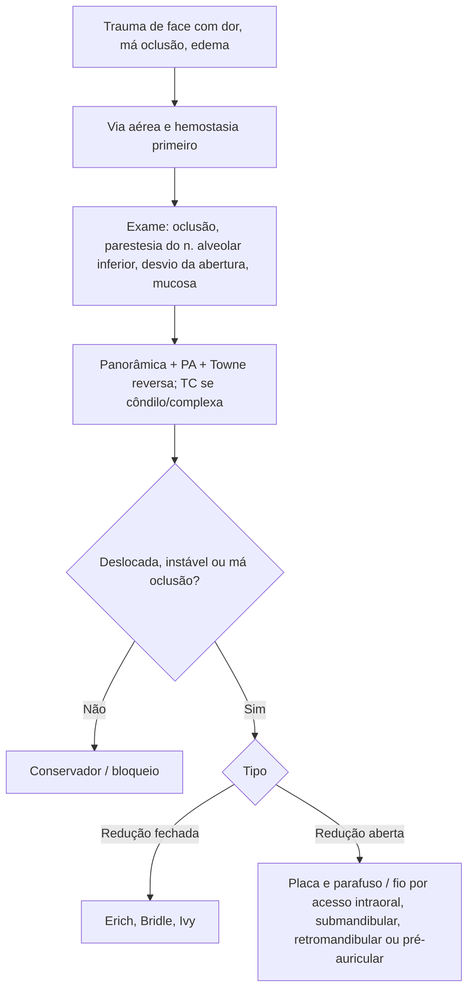

# Fratura Mandibular

> Resumo em palavras próprias do Whitebook (Condutas Cirúrgicas > Cirurgia Plástica), sem autoria e referências. Confira detalhes e doses na fonte: https://whitebook.pebmed.com.br/conteudo/?id=63404&categoryId=207&subcategoryId=947

**Introdução:** a mandíbula é um osso móvel ligado ao crânio pela articulação temporomandibular (ATM); é muito fraturada por ser proeminente e pouco apoiada. Como em qualquer fratura facial, avaliar antes a necessidade de proteger a **via aérea** ou obter **hemostasia**.

## Etiologia e epidemiologia
- Agressão, acidentes automobilísticos, quedas, esportes, arma de fogo, acidentes de trabalho, fraturas patológicas.
- Maior parte das fraturas maxilofaciais; mais em homens de 21–30 anos; álcool, nível socioeconômico e ambiente contribuem.
- Locais: corpo 29%, côndilo 26%, ângulo 25%, sínfise 17%, ramo 4%, coronoide 1%. Em acidentes de carro predomina o côndilo; de moto, a sínfise; em agressão, o ângulo. **Terceiro molar inferior dobra o risco de fratura do ângulo.** 43% têm lesão associada. Côndilo é o sítio mais comum em crianças.

## Classificação
Simples/fechada; composta/aberta (comunica com pele, mucosa ou ligamento periodontal); cominutiva; em galho verde; patológica; múltipla; impactada; atrófica (mandíbulas edêntulas); indireta; complicada/complexa (lesão importante de partes moles).
- A ação muscular define o deslocamento: os músculos do ramo (masseter, temporal, pterigóideo medial) puxam o segmento proximal para cima e medial; sínfise é puxada para baixo e para trás por digástrico, gênio-hióideo e genioglosso. Fraturas de ângulo/corpo são **favoráveis ou desfavoráveis** (vertical e horizontal); as desfavoráveis tendem a deslocar, as favoráveis a estabilizar.
- **Côndilo (tipos):** I colo com deslocamento leve (ângulo cabeça–ramo 10–45°); II 45–90° com ruptura da cápsula medial; III fragmentos sem contato, cabeça deslocada medial e anterior, fora da cápsula; IV cabeça sobre ou anterior à eminência articular; V fraturas verticais/oblíquas da cabeça.

## Clínica
Dor, edema, hematomas intra ou extraorais, má oclusão, mobilidade dentária ou de fragmentos, assimetria facial, comprometimento da via aérea (edema do assoalho, hematoma, queda da língua).
- Mecanismo: socos → fraturas únicas e simples; acidentes → compostas e cominutivas; golpe localizado → fratura cominutiva única; força difusa → múltiplas; trauma no queixo → sínfise + fraturas condilares. Laceração sob o queixo alerta para fratura subcondilar ou de sínfise.
- Documentar disfunção prévia da ATM. **Parestesia no território do nervo alveolar inferior** é quase patognomônica de fratura distal ao forame mandibular. Dor pré-auricular sugere fratura condilar; **desvio da abertura para o lado da fratura**; trismo (espasmo, derrame, bloqueio do coronoide por arco zigomático). Má oclusão é altamente sugestiva; verificar lacerações mucosas e equimose de assoalho (corpo/sínfise).

## Diagnóstico
- **Radiografias:** panorâmica (triagem mais eficaz, inclui côndilos), oblíquas laterais, PA de mandíbula, Towne reversa, oclusal, periapicais, ATM; série mínima = panorâmica + PA + Towne invertida.
- **TC:** importante para diagnóstico e planejamento (padrão-ouro em alguns tipos); ideal para fraturas intracapsulares e de colo alto do côndilo; vistas oclusais ajudam na sínfise.

## Tratamento cirúrgico
- **Redução fechada:** barra de Erich, fio de Bridle, ligadura de Ivy.
- **Redução aberta:** osteossíntese com fio ou fixação com placa e parafuso; acessos intraoral, submandibular, retromandibular e pré-auricular.
- **Complicações:** infecção, pseudoartrose, má oclusão, complicações dentárias, anquilose da ATM, lesão nervosa.

## Fluxograma (refeito, a partir do texto; o original não traz algoritmo)

