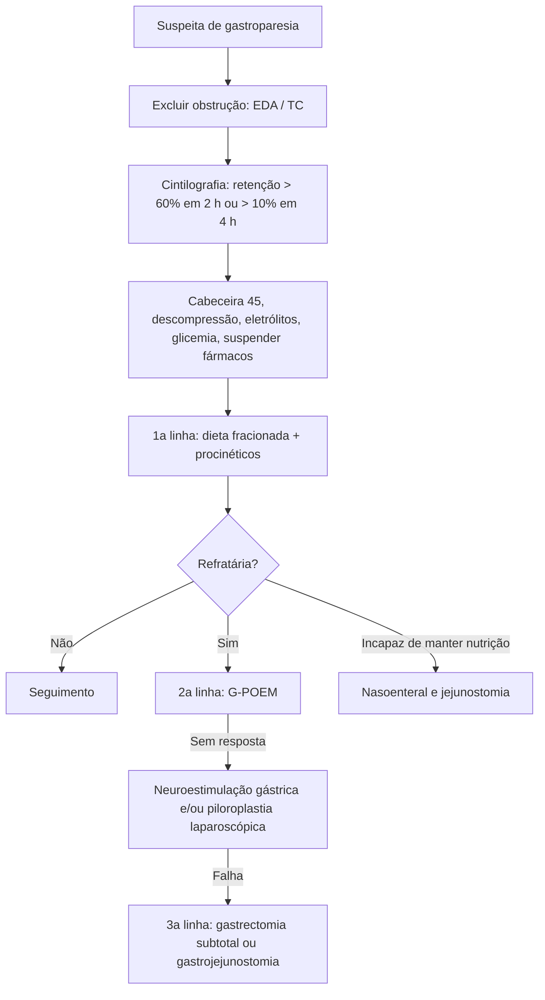

# Gastroparesia

> Resumo em palavras próprias do Whitebook (Condutas Cirúrgicas > Cirurgia Geral e do Aparelho Digestivo), sem fisiopatologia, autoria e referências. Confira detalhes e doses na fonte: https://whitebook.pebmed.com.br/conteudo/?id=22580&categoryId=207&subcategoryId=211

**Definição:** retardo do esvaziamento gástrico por comprometimento da motilidade, sem obstrução mecânica.

## Etiologia e epidemiologia
- **Causas:** idiopática (36%), diabética (29%), pós-operatória (13%), medicamentosa (10%).
- **Pós-cirúrgica:** cirurgias do TGI alto (gastrectomia, Whipple, fundoplicatura, bypass, piloroplastia), vagotomia (troncular/seletiva), fármacos (opioides, anticolinérgicos, análogos de GLP-1, canabinoides, antipsicóticos, BCC, IBP, álcool, tabaco), distúrbios eletrolíticos (K, Ca, Mg), infecções, úlcera gástrica, isquemia antropilórica, espasmo pilórico, ressecção duodenal (menos motilina).
- **Outras:** diabetes (complicação GI mais frequente), Parkinson/SNC, doenças neuromusculares, endocrinometabólicas, *H. pylori*, amiloidose, esclerodermia.
- Mais em mulheres (3,9:1) e diabéticos; ~50% dos DM1 e até 30% dos DM2 têm sintomas. Após Whipple é a complicação pós-operatória mais comum (até 2/3).

## Quadro clínico
Náuseas, vômitos, soluços/eructações, distensão alta, saciedade precoce, dor, plenitude pós-prandial, falha de progressão da dieta no pós-operatório, constipação. No pós-operatório pode surgir de forma abrupta, em geral transitória (semanas a meses).

## Diagnóstico
Base: clínica, exclusão de obstrução mecânica, evidência de esvaziamento lento (sobretudo crônica), revisão de fármacos.
- **Laboratório:** TSH/T3/T4 livre, cortisol se sinais de insuficiência adrenal, glicemia, eletrólitos; excluir infecção viral e doença autoimune.
- **Imagem:** distensão gástrica; contraste oral ajuda a excluir obstrução e tem efeito catártico.
- **Cintilografia de esvaziamento (padrão-ouro):** gastroparesia = esvaziamento de sólidos > 4 h. Suspender fármacos por ≥ 48 h; glicemia < 275 mg/dL; medidas na ingestão, 1, 2 e 4 h. Diagnóstico: retenção **> 60% em 2 h** ou **> 10% em 4 h**. Gravidade pela retenção em 4 h: leve 10–15%, moderada 15–35%, grave > 35%.
- **EDA:** afasta neoplasia (síndrome pilórica). **Manometria gastroduodenal:** distingue miopatia (amiloidose, esclerodermia) de neuropatia (DM, amiloide, autonômica idiopática). **Teste respiratório** com *Spirulina platensis* marcada com ¹³C (ambulatorial, sem radiação; tão acurado quanto a cintilografia). **Cápsula de motilidade wireless**: ainda em estudo.
- **Diferenciais:** depressão, ansiedade, estenose pilórica/antral, síndrome da artéria mesentérica superior, anorexia/bulimia, vômito psicogênico, psicotrópicos, ruminação, dispepsia funcional, vômitos cíclicos, hiperêmese canabinoide, *H. pylori*.
- **GCSI:** questionário de 9 itens em 3 subdomínios (náusea/vômito, plenitude, distensão), notas 0–5, média; sintomas das últimas 2 semanas. Em decisões como G-POEM, GCSI > 2 sugere sintomas moderados-graves, mas a indicação não deve depender só dele.

## Tratamento
**Manejo inicial:** cabeceira a 45°; descompressão por SNG em sifonagem (débito aceitável ~400 mL/24 h) ou abrir a gastrostomia; reposição hidroeletrolítica; glicemia < 200 mg/dL; suspender opioides, BCC, tricíclicos e agonistas dopaminérgicos.

**Fármacos:**
- **Antagonistas D2** (metoclopramida, bromoprida, domperidona): efeitos — QT longo, sintomas extrapiramidais; ECG basal; preferir domperidona em idosos. Domperidona é a de melhor eficácia (RCT positivo).
- **Agonistas de motilina:** lactobionato de eritromicina **250 mg EV 8/8 h ou 3 mg/kg 8/8 h**; azitromicina off-label 250 mg EV dose única; mais evidência na diabética; QT, taquifilaxia (> 4 semanas), esclerose venosa.
- **Prucaloprida** (5-HT4) **4 mg VO/dia por 4 semanas**: evidência fraca, casos refratários.
- **Fosaprepitanto** (NK1) **125 mg VO/dia por 4 semanas**: não reduziu náusea/vômito, mas melhorou o escore global.
- **Antieméticos:** ondansetrona (melhora náusea/vômito sem acelerar esvaziamento), difenidramina. Mirtazapina e buspirona: evidência limitada, adjuvantes. Haloperidol: não recomendado pela ACG. Neostigmina/piridostigmina: uso pontual.

**Nutrição:** preferir via oral; 1,5–2 L de líquidos claros/dia; 4–5 refeições pequenas, pobres em gordura e fibra (risco de bezoar); glicemia < 180 mg/dL (hiperglicemia retarda o esvaziamento). Se quadro > 5–7 dias: nutrição enteral pós-pilórica ou parenteral. Nasoenteral se perda de peso > 10% em 3–6 meses ou internações recorrentes.

**Refratária** (retenção > 20% em 4 h, sintomas moderados-graves, GCSI > 2, falha de dieta e fármacos, obstrução excluída):
- **G-POEM** (miotomia pilórica endoscópica): não é preciso testar botox/stent antes; 9× superior ao placebo, melhor em diabéticos; eventos leves em 14%, perfuração rara.
- **Toxina botulínica** intrapilórica: não recomendada (RCTs negativos), apenas ponte temporária.
- **Stent transpilórico:** temporário (migração), melhor em predomínio de náusea/vômito, ajuda a selecionar candidatos a piloromiotomia.
- **Jejunostomia:** quando a via oral não mantém o estado nutricional (testar antes com sonda nasoentérica). **Gastrostomia:** só alívio sintomático da descompressão.
- **Neuroestimulação gástrica:** implante laparoscópico no antro; resultados controversos.
- **Piloroplastia (Heineke-Mikulicz)/piloromiotomia laparoscópica:** indicações como o G-POEM; útil se há outra cirurgia concomitante ou G-POEM falhou; sem diferença estatística vs G-POEM em metanálise.
- **Gastrectomia subtotal/bypass:** último recurso, excepcional.
- **Algoritmo de refratária:** 1ª linha dieta + fármacos; 2ª linha G-POEM (sem resposta: GNS e/ou piloroplastia laparoscópica); 3ª linha gastrectomia subtotal laparoscópica ou gastrojejunostomia.

## Complicações
Desnutrição, desidratação, hipoglicemia, bezoar, internação prolongada, esofagite de refluxo, broncoaspiração (Mendelson), infecções de repetição, pior qualidade de vida.

## Fluxograma (refeito, a partir do texto)

