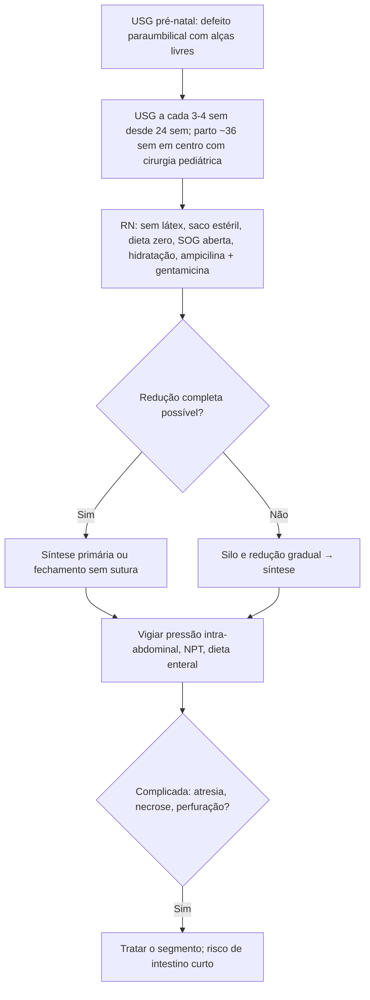

# Gastrosquise

> Resumo em palavras próprias do Whitebook (Condutas Cirúrgicas > Cirurgia Pediátrica), sem fisiopatologia detalhada, autoria e referências. Confira detalhes e doses na fonte: https://whitebook.pebmed.com.br/conteudo/?id=63597&categoryId=207&subcategoryId=826

**Definição:** extrusão de órgãos abdominais por defeito de espessura total da parede, **paraumbilical (quase sempre à direita)** e **sem cobertura membranosa**. Sinônimos: laparosquise, evisceração fetal paraumbilical. O intestino fica em contato com o líquido amniótico, com espessamento, edema, reação fibrinosa e dismotilidade.

## Epidemiologia
- Defeito de parede abdominal mais comum; ~1:5.000 nascidos vivos (até 7:10.000 em mães < 20 anos); incidência crescente; sem predileção por sexo; CIUR e prematuridade (até 65%); raramente genética; só 10% com malformações extraintestinais.
- Risco materno: idade < 20 anos, primípara, baixo nível socioeconômico, drogas ilícitas, AAS e ibuprofeno, outros teratógenos.
- Anomalias intestinais associadas (estenose, atresia, perfuração) por isquemia mesentérica (defeito pequeno), tração do mesentério ou volvo intrauterino.

## Classificação
- **Simples:** vísceras prolapsadas sem complicação intestinal.
- **Complexa:** com atresia, estenose, perfuração, necrose, volvo, *closing* ou *vanishing gastroschisis*; pior morbidade, mais dias de NPT e de dieta plena, internação longa e risco de intestino curto.

## Clínica e diagnóstico
- Defeito de 2–4 cm à direita do umbigo, com alças (delgado, grosso, estômago; menos: trompas, ovários, testículos, bexiga, fígado) espessadas e sem membrana.
- **Pré-natal:** USG até a 20ª semana (alças livres flutuando); alfafetoproteína elevada. Pós-natal: clínico na sala de parto.
- **Diferencial:** onfalocele (principal), hérnia do cordão, pentalogia de Cantrell, extrofia de bexiga e de cloaca.
- **Acompanhamento pré-natal:** crescimento fetal e líquido amniótico por USG a cada 3–4 semanas desde a 24ª; parto vaginal não é contraindicado (cesárea se exposição hepática ou lesão extensa); parto espontâneo por volta da 36ª semana.

## Tratamento
**Medidas iniciais:** evitar látex; estabilizar a via aérea; dieta zero e sonda orogástrica aberta; acesso venoso em membro superior; hidratação com alta taxa hídrica (maior perda insensível); aquecer, monitorar temperatura e pH; envoltório estéril (saco até o tórax) com posicionamento que preserve o fluxo mesentérico; antibiótico: **ampicilina + gentamicina** (doses por IG e idade):
- Ampicilina: IG ≤ 34 sem — ≤ 7 dias 50 mg/kg/dose EV 12/12 h; 8–28 dias 75 mg/kg/dose 12/12 h; IG > 34 sem — 50 mg/kg/dose 8/8 h.
- Gentamicina (os cabeçalhos de IG se perderam na extração; conferir na fonte): faixa inicial — ≤ 14 dias 5 mg/kg a cada 48 h, ≥ 15 dias 5 mg/kg a cada 36 h; 30–34 sem — ≤ 14 dias 5 mg/kg a cada 36 h, > 14 dias 5 mg/kg a cada 24 ou 36 h; ≥ 35 sem — ≤ 7 dias 4 mg/kg a cada 24 h, > 7 dias 5 mg/kg EV a cada 24 h.

**Técnicas de fechamento:**
- **Sem sutura (*sutureless*):** redução completa e curativo, cicatrização por segunda intenção preservando o umbigo.
- **Síntese primária:** redução completa e sutura por planos num tempo.
- **Estagiado:** quando não é possível reduzir tudo, silo transparente fixado à parede, redução gradual e posterior síntese.
**Pós-operatório:** possível ventilação prolongada (compressão da cava); vigiar a pressão intra-abdominal (diurese, FC, PA); suspeitar de complicação do fechamento primário com anúria/oligúria, trombocitopenia, má perfusão periférica e necessidade de vasoativos.

## Prognóstico
Sobrevida > 90% nos casos simples em centros especializados; a morbidade vem da lesão intestinal, NPT prolongada, sepse, colestase e insuficiência intestinal; mortalidade ligada a fechamento sob tensão, malformações e prematuridade.

## Fluxograma (refeito, a partir do texto; o original traz figuras)

