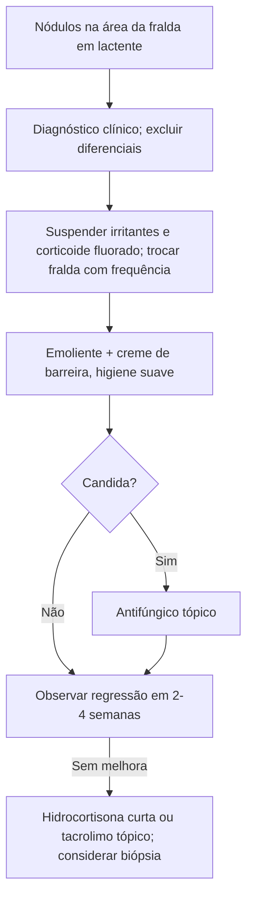

# Granuloma Glúteo Infantil

> Resumo em palavras próprias do Whitebook (Condutas Cirúrgicas > Cirurgia Pediátrica), sem fisiopatologia detalhada, autoria e referências. Confira detalhes e doses na fonte: https://whitebook.pebmed.com.br/conteudo/?id=48956&categoryId=207&subcategoryId=826

**Definição:** dermatose rara, nodular, inflamatória e crônica; resposta cutânea localizada a inflamação prolongada na área da fralda, em geral sobre dermatite irritativa prévia (ou após sua resolução).

## Causas e epidemiologia
- Mecanismo incerto: irritação crônica por urina e fezes (umidade, maceração, aumento do pH por urease), infecção secundária, **candidíase**, e uso prévio de **corticoide fluorado** (altera o colágeno e estimula inflamação). Outros fatores: oclusão pela fralda, lenços umedecidos, plásticos, detergentes, talco com amido, benzocaína, resorcinol.
- Rara; sem predileção por sexo; quase só < 2 anos (principalmente 2–9 meses); mais com fraldas de pano; hoje incomum. Casos crescentes em adultos e idosos que usam fraldas.

## Clínica
- **Anamnese:** nódulos agrupados nas áreas de contato da fralda, dermatite prévia, sem sintomas sistêmicos. **Risco:** fralda de pano, irritantes, dermatite seborreica ou por *Candida*, corticoide halogenado, incontinência/diarreia crônica (intestino curto, DII, Hirschsprung, espinha bífida), uro/colostomia, adultos acamados.
- **Exame:** pápulas ou nódulos firmes ovais/redondos, eritematosos, violáceos ou acastanhados; únicos ou múltiplos, de **5 mm a 4 cm**, às vezes confluentes em placas; eixo maior paralelo às linhas de clivagem; geralmente assintomáticos (às vezes dolorosos); superfície lisa, liquenificada, erodida, ulcerada ou friável.
- **Local:** regiões convexas da fralda (vulva, nádegas inferiores, escroto, perianal), podendo atingir coxas, abdome inferior, pescoço e axilas; poupa as dobras (a menos que haja piora por corticoide fluorado). Em idosos, depende da posição (sentado: lábio maior e escroto; acamado: perianal circular); nódulos pequenos em "paralelepípedo".

## Diagnóstico
Clínico. Histologia inespecífica (paraqueratose, hiperqueratose, acantose, infiltrado misto dérmico, vasos dilatados e proliferados, extravasamento de hemácias com hemossiderina; PAS e Grocott negativos), útil para excluir outros.
**Diferencial:** histiocitose de Langerhans, dermatite seborreica, candidíase, dermatite erosiva de Jacquet, dermatite irritativa, pápulas pseudoverrucosas perianais, prurigo nodular, Kaposi, xantogranuloma juvenil, mastocitose, linfoma cutâneo, infiltração leucêmica, fibromatose congênita, fibrossarcoma, nódulo escabiótico, sífilis congênita, granuloma de corpo estranho, granuloma piogênico.

## Evolução e tratamento
- As lesões duram 3–6 semanas e regridem em 2–4 após eliminar o fator; podem deixar máculas hipercrômicas e cicatrizes atróficas (intervenção precoce evita). O periostomal costuma ser refratário.
- **Principal tratamento:** suspender os fatores causais; **emolientes** e cremes de barreira (óxido de zinco, petrolato) como primeira linha.
- **Fraldas:** trocar a cada urina/evacuação, alta absorção e ventiladas, evitar as de pano. **Higiene:** limpeza delicada, produtos suaves ou compressas com soro fisiológico, remover cremes com óleo de amêndoas/mineral, evitar atrito, manter seco. Solução de Bürow (manipulada) como secativa/calmante.
- Evitar irritantes e corticoides halogenados. Se necessário: antifúngico tópico (cetoconazol, nistatina) com risco de *Candida*; corticoide não fluorado de baixa potência (hidrocortisona) por curto período; tacrolimo tópico em uso prolongado (estudo).

## Fluxograma (refeito, a partir do texto; o original não traz algoritmo)

