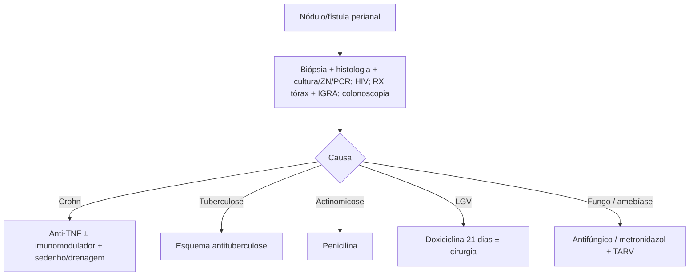

# Granulomas Perianais

> Resumo em palavras próprias do Whitebook (Condutas Cirúrgicas > Cirurgia em Coloproctologia), sem fisiopatologia, autoria e referências. Confira detalhes e doses na fonte: https://whitebook.pebmed.com.br/conteudo/?id=44552&categoryId=207&subcategoryId=213

**Definição:** nódulos de macrófagos epitelioides, células inflamatórias e matriz, circundados por linfócitos e fibrose, na região perianal/períneo. Muitas doenças infecciosas ou inflamatórias os produzem; **doença de Crohn e tuberculose** são as mais comuns.

## Clínica
- De nodulação assintomática ou fístula simples a lesões complexas com múltiplas fístulas; dor, sangramento e secreção purulenta.
- **Crohn perianal:** abscessos, fissuras ou fístulas, únicos ou múltiplos, simples ou complexos.
- **Tuberculose perianal:** em geral doença fistulosa complexa que não melhora após cirurgia; ~10% têm TB pulmonar ativa; pode haver história pulmonar, emagrecimento, inapetência, febre, sudorese noturna, tosse seca.
- Outras causas: fungos, linfogranuloma venéreo (*Chlamydia trachomatis*). **Marcadores de gravidade:** incontinência fecal, estenose, fístula retovaginal.

## Diagnóstico
- Laboratório não dá o diagnóstico, só a gravidade; sorologias (principalmente HIV). Cultura superficial de ferida é inútil (colonização).
- **Investigar TB:** radiografia de tórax, prova tuberculínica ou IGRA (falso-negativos possíveis).
- **Colonoscopia/retossigmoidoscopia** com biópsia (atividade de Crohn no cólon/íleo). **Histopatologia** em todo espécime; diferenciar TB, clamídia, fungos e Crohn é difícil: cultura do tecido, Ziehl-Neelsen, PCR e IHQ; diagnóstico geralmente vem da combinação com clínica e epidemiologia.
- **Etiologias:** Crohn, TB, actinomicose, linfogranuloma venéreo, basidiobolomicose, amebíase, corpo estranho, esquistossomose, granuloma piogênico, síndrome de Hermansky-Pudlak.

## Tratamento
- Conforme a causa: **Crohn** — imunossupressor/imunobiológico (anti-TNF de 1ª escolha) + cirurgia; **tuberculose** — esquema antituberculose (clínico); **actinomicose** — penicilina; **fungos** — antifúngico específico; **linfogranuloma venéreo** — tetraciclina (em geral doxiciclina por 21 dias), às vezes com cirurgia; **amebíase** perianal (sobretudo HIV) — antirretroviral + metronidazol oral.
- **Cirurgia:** fístula — exploração dos trajetos e sedenho; abscesso — drenagem; lesões atípicas ou duvidosas — biópsia sempre; linfogranuloma com destruição extensa/fístula retovaginal — reconstrução do períneo e/ou ostomia.

## Fluxograma (refeito, a partir do texto; o original traz um “abordagem completa” em figura)

