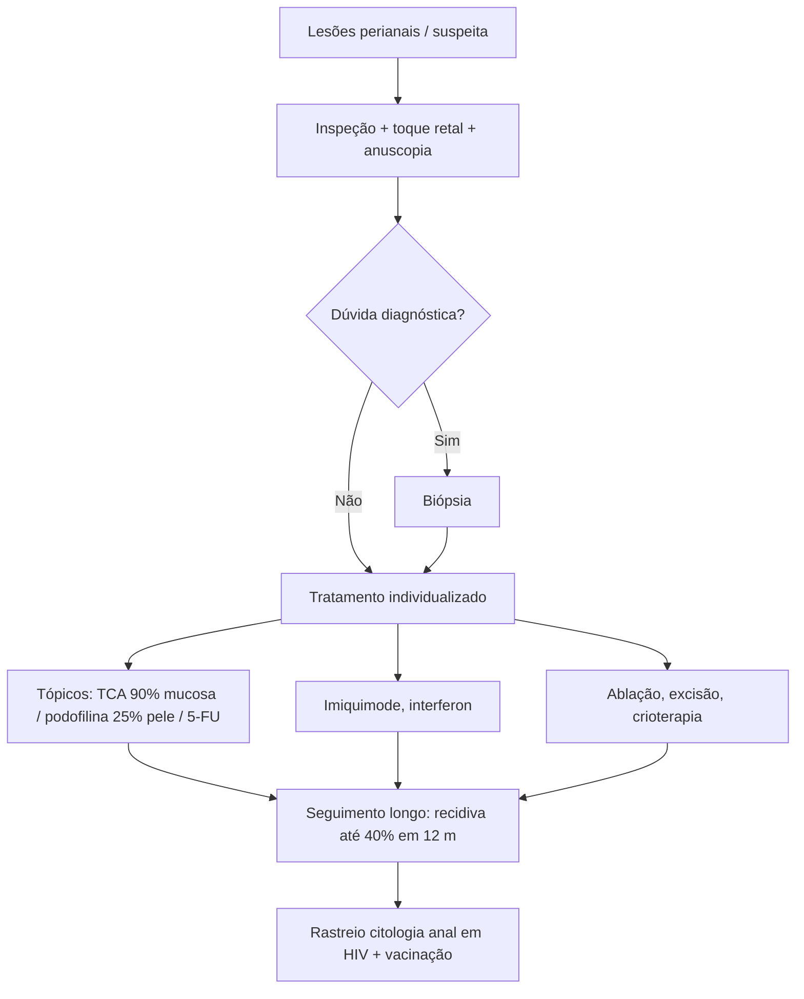

# HPV Anorretal

> Resumo em palavras próprias do Whitebook (Condutas Cirúrgicas > Cirurgia em Coloproctologia), sem fisiopatologia, autoria e referências. Confira detalhes e doses na fonte: https://whitebook.pebmed.com.br/conteudo/?id=62660&categoryId=207&subcategoryId=213

**Definição:** infecção pelo papilomavírus humano (HPV) na região anogenital, a IST anorretal mais comum; pode ficar latente ou aparecer como verrugas (condilomas), papilomas ou displasias. Sinônimos: papilomavirose anorretal, HPV anal/perianal.

## Epidemiologia e fatores de risco
- Transmissão sexual (contato genital/anal), raramente por fômites; transmissão vertical não excluída.
- Doença anal mais diagnosticada em pessoas com HIV (mais frequente com CD4 < 500).
- Tipos oncogênicos (alto risco): 16 e 18; não oncogênicos: 6 e 11. Pode haver mais de um subtipo no mesmo paciente.
- Subtipos oncogênicos associam-se a câncer de colo uterino, ânus, vagina, vulva, pênis e orofaringe; HPV está em > 90% dos carcinomas espinocelulares anais.
- Maioria assintomática; só cerca de 10% desenvolvem lesões. Pico entre 20 e 24 anos.
- **Risco:** outras ISTs (HIV, sífilis), início sexual precoce, anticoncepcional oral, múltiplos parceiros, baixo nível socioeconômico, tabagismo.

## Clínica
- Lesões perianais de tamanhos variados, muitas vezes pouco sintomáticas; prurido, dor e secreção se houver infecção secundária. Frequentemente atribuídas a hemorroidas, por isso sempre fazer exame anorretal.
- Exame: inspeção anal, toque retal e anuscopia (margem anal, canal, mucosa retal).
- Formas: condilomas acuminados (elevados, múltiplos, coalescentes), condiloma gigante (tumor de Buschke-Löwenstein), papulose bowenoide, carcinoma espinocelular.

## Diagnóstico
- Aspecto clínico; biópsia cirúrgica se dúvida.
- Lesões subclínicas: citologia oncótica do canal anal e anuscopia de alta resolução com biópsia.
- **Diferenciais:** hemorroidas, dermatite perianal, fissuras, sífilis perianal.

## Tratamento
Individualizar conforme número, tamanho, morfologia e localização das lesões, condição do paciente, custo e tolerância.
- **Tópicos** (consultório, pelo coloproctologista): ácido tricloroacético 90% (cauterização química da mucosa anal; evitar na pele por ardência); podofilina 25% em vaselina sólida (pele perianal; não usar em mucosa; contraindicada na gestação); 5-fluorouracila (eficaz, mas irrita; evitar na gestação).
- **Imunomoduladores:** imiquimode, resiquimode, interferon (isolados ou associados).
- **Cirúrgicos:** ablação elétrica, excisão, fulguração, crioterapia.
- **Seguimento:** recidiva alta (até 40% em 12 meses); acompanhar a longo prazo; imunossuprimidos têm risco de carcinoma espinocelular.

## Prevenção
- Só a abstinência preveniria totalmente; preservativo reduz, mas não elimina (contato sem penetração também transmite).
- Rastreamento com citologia do canal anal em populações de risco, sobretudo HIV.
- Vacina quadrivalente (6, 11, 16, 18) e nonavalente (mais 5 tipos de alto risco) disponíveis no Brasil; a quadrivalente reduziu neoplasia intraepitelial anal em homens que fazem sexo com homens. Vacinar mesmo com HPV prévio.

## Fluxograma (refeito, a partir do texto; o original não traz algoritmo)

