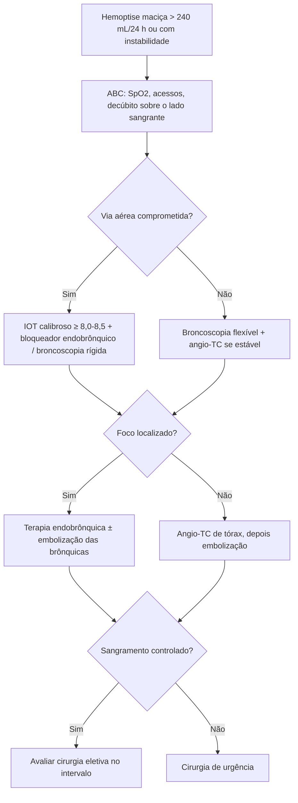

# Hemoptise Ameaçadora à Vida

> Resumo em palavras próprias do Whitebook (Condutas Cirúrgicas > Cirurgia Torácica), sem fisiopatologia detalhada, autoria e referências. Confira detalhes e doses na fonte: https://whitebook.pebmed.com.br/conteudo/?id=53392&categoryId=207&subcategoryId=215

**Definição:** hemoptise não maciça = perda de 5 a 240 mL em 24 h; **maciça = > 240 mL/24 h**. Sinônimos: hemoptise grave, potencialmente fatal, com risco de vida, hemorragia pulmonar ameaçadora à vida.

## Origem do sangramento
A circulação brônquica (~1% do fluxo pulmonar, nutre vias aéreas, linfonodos, vasa vasorum e pleura) é a fonte de ~90% dos casos graves; a circulação pulmonar responde por ~5% e artérias sistêmicas não brônquicas por ~5%. Inflamação crônica, hipóxia, trombose ou fístulas estimulam neoangiogênese com vasos frágeis sob pressão sistêmica.

## Etiologia
- **Infecciosas/inflamatórias:** pneumonia, bronquite, abscesso, TB (ativa ou sequela), aspergiloma/aspergilose invasiva, broncolitíase, fibrose cística, parasitoses (estrongiloidíase, *Paragonimus*).
- **Neoplásicas:** tumores brônquicos benignos, malignos primários ou metastáticos, invasão tumoral, tumores mediastinais.
- **Imunes:** pneumonite lúpica, granulomatose com poliangiite, Goodpasture, hemossiderose idiopática, púrpura de Henoch-Schönlein.
- **Cardiovasculares:** estenose mitral, IC esquerda grave, hipertensão pulmonar, MAV pulmonar, cardiopatias congênitas, endocardite direita, aneurisma de artéria pulmonar, síndrome de VCS.
- **Iatrogênicas:** broncoscopia, IOT, Swan-Ganz, punção transtorácica. **Fármacos:** anticoagulantes (excesso), trombolíticos, antiagregantes; drogas ilícitas.
- **Embólicas:** TEP, embolia séptica. **Hematológicas:** coagulopatia, trombocitopenia. Corpo estranho. Trauma torácico/cervical. Fístulas broncovasculares. MAV.
- **Outras:** amiloidose, sarcoidose, linfangioleiomiomatose, esclerose tuberosa, endometriose (hemoptise catamenial), Rendu-Osler-Weber, pós-transplante, cigarro eletrônico; criptogênica.

## Epidemiologia
Ocorre em ~10% das pneumopatias crônicas; mais em homens > 60 anos; hemoptise maciça < 5% dos casos; causa maligna < 3%; as infecciosas predominam; 90% são autolimitadas. Maciça: mortalidade 50–85%, sobretudo por **asfixia** e não por choque hemorrágico; no tratamento apenas conservador, óbito em 50–100%.

## Clínica
Cianose, taquipneia, dispneia, tosse repetida, sangue vermelho espumoso com secreção ou coágulos, rebaixamento de consciência, choque, sangue na cavidade oral.

## Diagnóstico
- Duas metas: topografia (onde sangra) e etiologia, muitas vezes simultâneas. Na ameaça à vida, **estabilizar e controlar o sangramento primeiro**; a investigação etiológica pode ser posterior.
- Exames-chave: TC, hemograma + coagulograma, broncoscopia (em dificuldade de via aérea, a endoscopia tem prioridade). Em pacientes estáveis (inclusive após IOT), **angio-TC de tórax** é a imagem preferencial: localiza, define etiologia e mapeia a anatomia vascular para embolização. A broncoscopia mantém a via aérea, remove coágulos, localiza e controla.
- **História:** início, duração, frequência e volume; primeiro episódio ou recorrência; medicamentos; comorbidades; antimicrobianos; corpo estranho; trauma ou procedimento; contato com TB; neoplasias; tabagismo.
- **Laboratório:** hemograma, coagulograma, gasometria, tipagem/prova cruzada; hepatograma, função renal e eletrólitos, autoimunidade se selecionado; escarro (BAAR + GeneXpert, cultura para micobactéria, pesquisa direta e cultura para fungo, bacterioscopia e cultura).
- **Broncoscopia:** em geral flexível; nem toda hemoptise a exige, mas **toda hemoptise maciça sim**, idealmente precoce (sangramento ativo ou até 48 h depois). Durante o sangramento localiza em > 60%. Achados: sangramento ativo, coágulo segmentar, lesões endobrônquicas, alterações de mucosa, bronquiectasia/distorção.
- **Imagem:** RX (limitado, à beira do leito, ≥ 2 incidências; vê infecção, corpo estranho, sequelas, atelectasia); TC com contraste EV (só se estável; maior sensibilidade para etiologia e localização — hemorragia alveolar, bronquiectasia, tumor, aspergiloma, sequelas, malformações, aneurismas; orienta broncoscopia).
- **Diferencial:** hematêmese, sangramento de vias aéreas superiores, Munchausen.

## Tratamento inicial
- Monitorar SpO₂ e pressão, pré-oxigenar se hipoxemia; considerar **ácido tranexâmico** como adjuvante (os ensaios com TXA nebulizado excluíram hemoptise ameaçadora à vida — sem evidência para uso primário nessa situação; em hemoptise não ameaçadora pode ajudar e reduzir procedimentos).
- IOT quando necessária com **tubo calibroso (≥ 8,0–8,5 mm)** para permitir broncoscopia; isolamento preferencial = tubo de lúmen único + bloqueador endobrônquico guiado por broncoscopia.
- Posição: decúbito lateral/oblíquo com o **lado sangrante para baixo**; lado indefinido → cabeceira a 30–45° e aspiração à mão.
- Controle da via aérea: tubo insuflado no brônquio não acometido; bloqueador endobrônquico (flexível ou rígida); intubação brônquica com rígido no lado do sangramento.
- Acessos adequados, reposição volêmica e hemoderivados conforme estado; evitar excesso de fluidos (pode piorar o sangramento).

## Tratamento endoscópico
No centro cirúrgico, endoscopia ou UTI; decúbito oblíquo ou Trendelenburg, de preferência sob anestesia geral. Iniciar pela flexível; rígida disponível nos casos graves (melhor aspiração e controle de via aérea, ventila, remove coágulos e corpo estranho; alcance proximal).
- Aspirar coágulos com cautela e localizar o foco. Medidas: impactar o broncoscópio no óstio com aspiração contínua por alguns minutos; salina gelada (4 °C) em alíquotas de 50–100 mL (máx. 500 mL); epinefrina 1:20.000 intraluminal (± salina gelada); eletrocautério, plasma de argônio ou laser em lesão visível; crioterapia (~ −70 °C, nitrogênio líquido); obstrução mecânica (intubação seletiva, bloqueador específico ou Fogarty 4–5F, hemostáticos tópicos como celulose oxidada e gelatina com trombina). Dispositivos: antibiótico associado e retirada em 48–72 h (evitar pneumonia pós-obstrutiva).
- **Complicações:** ressangramento, trauma de vias aéreas, perfurações/fístulas, atelectasia, hipoxemia, arritmias, parada cardiorrespiratória.

## Tratamento endovascular (embolização)
Após estabilização e controle de via aérea; angio-TC prévia sempre que possível. **Procedimento de escolha na hemoptise maciça e recidivante**, com alta resolutividade (sequela de TB, aspergiloma, bronquiectasias). Reduz a pressão de perfusão sistêmica nas brônquicas. Por radiologista intervencionista, com angiografia seletiva da origem das brônquicas.
- **Achados:** brônquica > 2 mm, tortuosidade, shunts sistêmico-pulmonares, aneurismas, blush, hipervascularização. Sangramento ativo visível em apenas 3,6–10,8%.
- Embolização seletiva com micropartículas, micromolas ou líquidos. Se persistir: buscar artérias sistêmicas aberrantes e ramos transpleurais; se ainda refratário: afastar aneurisma de artéria pulmonar e malformações.
- **Complicações:** dor torácica transitória (principal), disfagia, febre/tosse, IRA, alergia ao contraste, infarto de parênquima, migração do material (periférico/cerebral), **isquemia medular anterior** (a mais temida; artéria de Adamkiewicz), recorrência (recanalização, colaterais, embolização insuficiente).

## Tratamento cirúrgico
Definitivo, reservado a selecionados (alta morbidade e risco). Idealmente **no intervalo entre sangramentos**, não na fase aguda. Avaliar viabilidade, reserva pulmonar e comorbidades. **Mortalidade 37–42% na emergência × 7–18% se programada** após controle.
- **Indicações:** sequela de TB, bronquiectasias, abscesso refratário, aspergiloma, pneumonia necrotizante, tumor ressecável sangrante, malformação ressecável.
- **Riscos/contraindicações:** condições clínicas ou oncológicas proibitivas; sangramento intraoperatório persistente que inunda a árvore; desconhecer condições pulmonares prévias; incerteza quanto à extensão tolerável da ressecção.

## Linhas gerais
Estabilizar (ABC) → via aérea comprometida: broncoscopia → sangramento localizado: terapia endobrônquica e/ou endovascular → não localizado: TC com contraste e depois endovascular → controlado: avaliar cirurgia eletiva → não controlado: cirurgia de urgência.

## Piores prognósticos
Maior taxa de perda, aspiração contralateral radiográfica, instabilidade, etiologia neoplásica, impossibilidade cirúrgica (função comprometida, metástase, sangramento bilateral, foco não localizado), necessidade de ventilação seletiva e de transfusão.

## Fluxograma (refeito, a partir do texto; o original não traz algoritmo)

