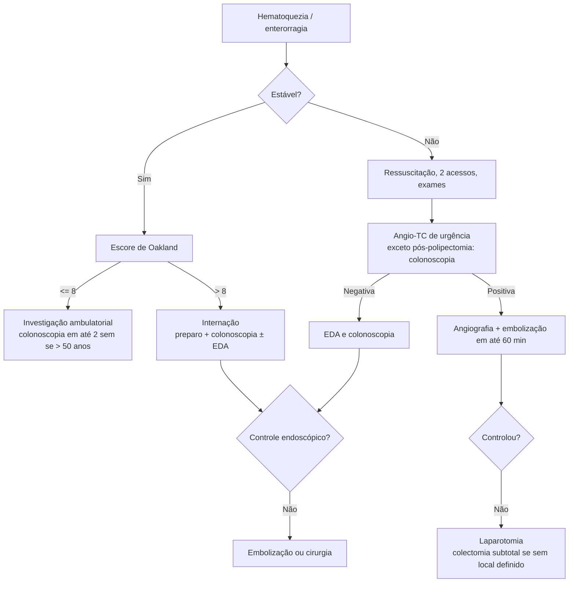

# Hemorragia Digestiva Baixa

> Resumo em palavras próprias do Whitebook (Condutas Cirúrgicas > Cirurgia Geral e do Aparelho Digestivo), sem fisiopatologia, autoria e referências. Confira detalhes e doses na fonte: https://whitebook.pebmed.com.br/conteudo/?id=23245&categoryId=207&subcategoryId=211

**Definição:** sangramento originado a partir da válvula ileocecal. Entre o ângulo de Treitz e a válvula: hemorragia digestiva média.

## Etiologia e epidemiologia
- **Frequentes:** doença diverticular (30%), orificiais (20%), neoplasias (20%); colites, angiectasias e pós-polipectomia somam < 20%. **Incomuns:** Dieulafoy, varizes, colite isquêmica, medicamentosa, proctite.
- Incidência ~25/100.000/ano; ~5× menos prevalente que a HDA; ~100.000 internações/ano nos EUA. **85%** cessam sozinhas em até 48 h; ~**38%** ressangram em 1 ano; mortalidade **3,9%**.

## Clínica
- Hematoquezia/enterorragia; sangue vivo ou coágulos sugerem origem anorretal; melena é mais de HDA/média, mas pode ocorrer com trânsito lento.
- **Anamnese:** características do sangramento; comorbidades; sintomas associados (mudança de hábito e perda de peso → neoplasia; diarreia e dor → DII/colite isquêmica; dor anal → fissura/trombose hemorroidária); fatores de risco (história familiar de câncer, DII, polipose; sangramento prévio; AINE, anticoagulantes, antiagregantes; coagulopatia; radioterapia pélvica). Sempre que possível, rastrear câncer colorretal antes de anticoagulação crônica.
- **Exame:** instabilidade (hipotensão postural, taquicardia, pulsos finos, sudorese, síncope); abdome (dor, peritonismo, massas); inspeção anal e toque retal; sopro de estenose aórtica sugere angiectasias (síndrome de Heyde, por cisalhamento do fator de von Willebrand); cuidado com hipervolemia iatrogênica (hipertensos, diabéticos, obesos, ICC); procurar estigmas de hepatopatia (HDA varicosa copiosa pode simular HDB); **anuscopia** (hemorroidas respondem por até 20% das HDB agudas; permite ligadura).
- **Pior prognóstico:** instabilidade, sangramento persistente, várias comorbidades, idade > 60, sangramento em internado, anticoagulante ou antiagregante, TP > 1,2× controle, hipoalbuminemia, Ht inicial < 35%, creatinina > 1,7 mg/dL.

## Diagnóstico
- **Labs:** hemograma e plaquetas, TGO, TGP, GGT, FA, TAP/INR, PTTa, ureia, creatinina, lactato.
- **Angio-TC:** escolha se persistir instável apesar de fluidos, vasoativos e hemoderivados; sensibilidade **79–95%**, especificidade **95–100%** se sangramento ativo (> 0,3–1,0 mL/min); orienta tratamento endovascular.
- **Colonoscopia:** escolha em estáveis (ou estabilizados); diagnóstica e terapêutica (hemostasia em sangramento ativo ou estigmas; segura com INR ≤ 2,5 e plaquetas > 50.000). A colonoscopia de urgência (< 24 h) não reduz mortalidade em 30 dias, cirurgia ou transfusão em comparação à eletiva com bom preparo, mas encurta a internação em ~24 h. Preparo completo na maioria; pode ser omitido ou retrógrado (clister) só com suspeita distal bem localizada ou causa iatrogênica de local conhecido; com retite actínica ou uso de plasma de argônio, preparo completo (gases explosivos).
  - **Doença diverticular:** ligadura elástica (cólon direito; cap; marcar o local com clipe/tatuagem); hemoclipes em cólon esquerdo (aplicação direta no vaso visível; técnica indireta/zíper para óstio estreito).
  - **Iatrogênica (pólipo, EMR, ESD):** clipes TTS ou coagulação térmica; pó hemostático de resgate.
  - **Vasculares (retite actínica, angiectasias):** plasma de argônio.
  - **Malignas:** hemospray ou laser Nd:YAG como ponte para cirurgia, radioterapia ou embolização.
- **EDA primeiro** se hematoquezia com instabilidade ou anemia grave: fonte alta em **15%** dos casos suspeitos de baixa.
- **Cintilografia** com hemácias marcadas (≥ 0,1 mL/min): pouco disponível na urgência. **Angiografia** (≥ 0,5–1 mL/min; começar pela AMS): instáveis sem condição de colonoscopia; embolização seletiva, definitiva ou ponte.
- **Diferenciais:** doença diverticular, câncer, pólipos, DII, angiodisplasia, hemorroidas, Dieulafoy, fissura, colites infecciosa/isquêmica, úlceras por AINE, retite actínica.

## Estratificação e seguimento
- Escores Oakland e SHA2PE auxiliam o julgamento clínico (não o substituem).
- **Ambulatorial:** estável, sangramento autolimitado, **Oakland ≤ 8**; colonoscopia em até 2 semanas se > 50 anos.
- **Internar:** sangramento maciço, instável, anemia grave, transfusão, **Oakland > 8**. Evitar AINE em quem sangrou por diverticulose ou angiectasia.

## Tratamento
1. **Estáveis:** calcular Oakland. Se > 8: internar, colonoscopia ± EDA assim que possível após preparo adequado (metanálises sem benefício da colonoscopia nas primeiras 24 h em mortalidade, ressangramento, transfusão, cirurgia).
2. **Instáveis:** estabilização (dois acessos calibrosos, coleta de exames, protocolo de choque hemorrágico); angio-TC urgente para localizar extravasamento; se negativa, EDA e colonoscopia (exceção: provável sangramento pós-polipectomia → colonoscopia de urgência primeiro). **Angio-TC positiva → angiografia com embolização em até 60 minutos.**
3. **Laparotomia:** último recurso, quando endoscopia e radiologia falham ou não estão disponíveis; endoscopia perioperatória ajuda a localizar; sangramento maciço sem origem definida → colectomia subtotal. Indicação cirúrgica caiu de 22,6% (1988–97) para 0,2% (2015).
4. **Transfusão:** concentrado de hemácias se Hb **< 7 g/dL** (meta 7–9); cardiopata: se **< 8** (meta > 10); plaquetas > 50.000/mm³.
5. **Varfarina com sangramento grande:** complexo protrombínico + vitamina K; HBPM assim que houver hemostasia em alto risco trombótico.
6. **AAS:** prevenção primária → considerar suspender definitivamente; secundária → retomar em 1–7 dias com hemostasia. **AAS + inibidor de P2Y12:** manter AAS e suspender P2Y12 quando possível.
7. **DOACs:** suspender até a hemostasia; se persistir ou houver instabilidade, idarucizumabe (dabigatrana) ou andexanet (rivaroxabana/apixabana); complexo protrombínico de 4 fatores é mais disponível, mais barato e possivelmente mais seguro, mas com menos dados comparativos.
- **Telemedicina:** atendimento sempre presencial em pronto-socorro.

## Fluxograma (refeito, a partir do texto)

