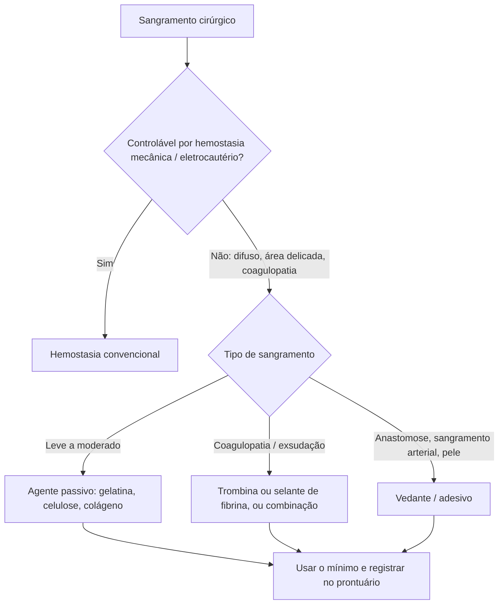

# Hemostáticos em Cirurgia

> Resumo em palavras próprias do Whitebook (Condutas Cirúrgicas > Cirurgia Geral e do Aparelho Digestivo), sem fisiopatologia, autoria e referências. Confira detalhes e doses na fonte: https://whitebook.pebmed.com.br/conteudo/?id=39180&categoryId=207&subcategoryId=211

**Definição:** métodos adjuvantes de controle de sangramento, de ação local, que complementam a hemostasia mecânica em áreas de difícil acesso ou com risco de lesão térmica.

## Indicações
- Sangramento pequeno a moderado de capilares e pequenas vênulas; reforço de anastomoses vasculares e de órgãos ocos.
- Locais: superfície peritoneal, pleural ou hepática; superfície de corte de fígado, baço e rim; bordas ósseas e canal medular; sangramento perto de nervos ou de estruturas vitais (risco do eletrocautério); orifícios de agulha em vasos ou enxertos; estruturas nasais; alvéolo dentário.
- Pacientes anticoagulados, com CIVD ou coagulopatia/disfunção plaquetária que continuam exsudando apesar de hemostasia adequada.
- **Benefícios:** menor perda sanguínea e transfusão, menos infecção e inflamação, menos tempo cirúrgico e de dreno, menor internação (inclusive UTI), cicatrização mais rápida e menor morbimortalidade.

## Classificação e agentes
| Categoria | Mecanismo | Exemplos |
|---|---|---|
| Físicos (mecânicos) | Oclusão/tamponamento | Cera óssea, polímeros absorvíveis |
| Passivos (matrizes) | Matriz para agregação plaquetária, expande e comprime | Gelatina, colágeno, celulose oxidada, polissacarídios |
| Biologicamente ativos | Atuam na cascata (dependem do fibrinogênio do paciente) | Trombina, selantes de fibrina |
| Combinações | Matriz + ativo | FloSeal (gelatina + trombina), TachoSil (colágeno + trombina) |
| Vedantes/adesivos | Aderência e vedação | Fibrina, albumina-glutaraldeído, PEG, cianoacrilato |

- **Físicos:** cera óssea (não absorvível, barata, pode prejudicar a osteogênese, causar granuloma ou infecção); Ostene (polímero absorvível em 48 h, hidrofílico). Usar o mínimo e não em áreas contaminadas.
- **Passivos:** gelatinas (Gelfoam etc.; pH neutro; degradação 4–6 semanas; podem ser usadas com trombina); celulose oxidada/regenerada (Surgicel etc.; pH ácido com efeito antimicrobiano; absorção ~2 semanas; pode interferir em agentes biológicos; bons resultados em pelve e hepatobiliar); colágeno microfibrilar (Avitene etc.; ativa plaquetas em 2–5 min; absorção 8–10 semanas); micropartículas de polissacarídios (Arista; desidratam o sangue; absorção 24–48 h; evitar em cavidades fechadas e neurocirurgia). Cuidados: usar o mínimo, risco de compressão por expansão, aderem mal em sangramento intenso, evitar em espaços confinados/ricos em terminações nervosas. Resíduos podem simular tumor ou abscesso na imagem (registrar o uso). Efeitos adversos: anafilaxia, infecção, corpo estranho, alteração da cicatrização, compressão.
- **Biológicos:** trombina (bovina, humana plasmática ou recombinante) converte fibrinogênio em fibrina, ativa plaquetas e causa vasoconstrição; usada em pó, spray ou seringa; associável à gelatina. **Selantes de fibrina** (Tisseel, Evicel, Crosseal, Quixil): dois componentes (fibrinogênio + fator XIII; trombina + cálcio) formam coágulo ao aplicar. Atuam no fim da cascata, úteis em alterações plaquetárias/coagulopatias, não precisam ser retirados antes de fechar, hemostasia em ~10 min, cobrem grandes superfícies; ácido tranexâmico é bom adjuvante em cirurgia cardíaca. Ineficazes na afibrinogenemia; evitar com CEC e cell saver (competem com a heparina). Riscos: anticorpos, alergia/anafilaxia (sobretudo com história para produtos de plasma ou deficiência de IgA), trombose e coagulopatia grave em hemodialisados imunizados contra bovino, hipotensão e coagulação se intravascular, transmissão de vírus (HIV, hepatite, parvovírus B19) e príon.
- **Combinações:** eficácia superior em cirurgia cardíaca e hepática.
- **Vedantes/adesivos:** sangramentos arteriais e anastomoses vasculares; reforço de outras anastomoses ou alternativa à sutura. Vedante de fibrina (Tissucol, Beriplast; eficazes sob anticoagulação; vasculares e torácicas); albumina-glutaraldeído (Bioglue, ArterX; forte adesividade, risco de necrose e pseudoaneurisma); PEG (Coseal, DuraSeal; neuro e cardíaca); cianoacrilato (Dermabond, Histoacryl; pele; ação em 30–60 s; bactericida).

## Complicações
Dor (reação exotérmica), atraso de cicatrização, ISC, anafilaxia, síndrome do choque tóxico (agentes mecânicos), reações imunológicas (bovinos), trombose vascular (trombina intravascular), transmissão viral/príon, toxicidade local, necrose, compressão (estenose, lesão nervosa), embolia (agentes mecânicos com cell saver/CEC), trombose na CEC, disfunção da trombina, hiperglicemia (> 50 g de esferas de polissacarídios).

## Fluxograma (refeito, a partir do texto; o texto original não traz uma figura)

