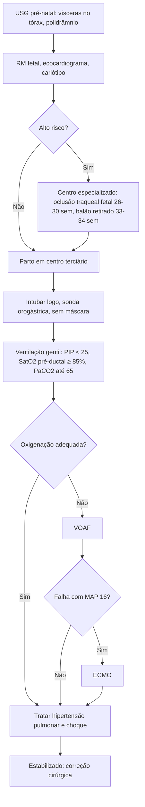

# Hérnia Diafragmática Congênita

> Resumo em palavras próprias do Whitebook (Condutas Cirúrgicas > Cirurgia Pediátrica), sem fisiopatologia detalhada, autoria e referências. Confira detalhes e doses na fonte: https://whitebook.pebmed.com.br/conteudo/?id=22504&categoryId=207&subcategoryId=826

**Definição:** defeito congênito do diafragma por persistência do canal pleuroperitoneal, com formação incompleta do músculo e passagem de vísceras abdominais para o tórax.

## Classificação
- **Posterolateral (Bochdalek):** 70–75% (85% à esquerda, 13% à direita, 2% bilateral).
- **Anterior (Morgagni):** 23–28%.
- **Central:** 2–7%.
- Saco herniário presente em 10–20% (quando a membrana já se formou, mas ainda não muscularizou).
- Principais achados patológicos: **hipoplasia pulmonar** e **remodelação vascular pulmonar anormal** (hipertensão pulmonar persistente), que determinam morbimortalidade.

## Epidemiologia
- 1–4 casos por 10.000 nascimentos (subestimado, pois há óbitos fetais/neonatais não captados); predominância masculina discreta (3M:2F); mais comum à esquerda.
- Isolada em 50–70%; os 30–50% "complexos" associam-se a anomalias estruturais (cardiovasculares, SNC, musculoesqueléticas), cromossômicas (trissomias 18, 13 e 21) ou monogênicas.
- Fatores ambientais: via dos retinoides; teratógenos (micofenolato de mofetila, alopurinol, lítio).
- Mortalidade ainda alta, sobretudo nos diagnosticados no pré-natal; morbidade a longo prazo comum.

## Diagnóstico pré-natal
- ~60% diagnosticados por USG de rotina (~24 semanas) ou na investigação de polidrâmnio.
- Sinais diretos: órgãos abdominais no tórax. Indiretos: polidrâmnio, eixo cardíaco anormal, desvio do mediastino.
- Esquerda: estômago cheio de líquido e delgado ao lado do coração; fígado herniado = massa homogênea contínua com o fígado abdominal. Direita é mais difícil (fígado e pulmão com ecogenicidade parecida).
- **RM fetal ultrarrápida:** anatomia, posição do fígado, volumes pulmonares, anomalias. **Ecocardiografia fetal:** afastar cardiopatia e hipoplasia de VE. **Cariótipo/microarranjos** para anormalidades cromossômicas.
- Permite aconselhamento, parto em centro terciário e seleção de fetos de alto risco para intervenção fetal.

## Terapia pré-natal
- Para HDC grave em centros especializados; objetivo: prevenir hipoplasia e estimular o crescimento pulmonar.
- **Oclusão traqueal fetal** por balão endoscópico (~26–30 semanas), retirado por volta de **33–34 semanas** (afeta a produção de surfactante).

## Clínica
- Do assintomático à insuficiência respiratória grave; início conforme hipoplasia e hipertensão pulmonar.
- **Ao nascer:** desconforto respiratório, cianose, intolerância alimentar, taquicardia; abdome escavado se herniação importante; murmúrio vesicular reduzido/ausente no lado afetado, ruídos hidroaéreos no tórax, bulhas abafadas e deslocadas.
- **Manifestações tardias:** obstrução intestinal, retardo de crescimento, estrangulamento/perfuração de víscera (estômago), pneumonias de repetição.

## Investigação pós-natal
- **Gasometria arterial** seriada; cariótipo; eletrólitos e glicose.
- **RX de tórax:** alças no tórax e desvio contralateral do mediastino (contraste por sonda nasogástrica possível após intubação).
- **Ecocardiograma** (até 20% de cardiopatia, sobretudo hipoplasia de VE); **USG renal** (anomalias geniturinárias 6–8%); **USG transcraniana** (tubo neural, hidrocefalia).
- **Oximetria pré-ductal (mão direita) e pós-ductal (pés):** avalia shunt direita-esquerda e hipertensão pulmonar.
- **Diferencial:** malformação adenomatoide cística, sequestro pulmonar, cistos mediastinais, tumores neurogênicos.

## Tratamento
É uma **emergência fisiológica, não cirúrgica.** Ideal: parto planejado em centro com neonatologia e cirurgia pediátrica.
- **Via aérea:** evitar ventilação com máscara; intubar cedo (de preferência na sala de parto); carina mais alta, então ajustar o tubo (~0,5 cm) para evitar intubação seletiva; sonda orogástrica para esvaziar o estômago.
- **Ventilação gentil:** convencional quando possível; PIP < **25 cmH2O**; PEEP **3–5**; FR **40–60**; saturação pré-ductal ≥ **85%** (alvo geral 80–95%; reduzir FiO2 se > 95%); tolerar PaCO2 até **65 mmHg** com pH ≥ **7,25** se perfusão/oxigenação adequadas; FiO2 inicial ~0,5 e titular.
- Sem ventilação adequada com PIP 30 e FR 60 → **VOAF** (pressão média 14–16 cmH2O, ΔP 30–40). Incapacidade de oxigenar com pressão média de 16 em VOAF → discutir **ECMO**.
- **Surfactante:** só se prematuridade ou protocolo de pesquisa. **Óxido nítrico inalatório:** benefício breve; uso rotineiro não recomendado (possível pior prognóstico).
- **Critérios de ECMO citados** (cabeçalho ausente no texto extraído; conferir na fonte): PaO2 pré-ductal < 75–80% ou pós-ductal < 30 mmHg; PIP > 30; pressão média de via aérea > 15; hipotensão apesar de volume e vasoativos; acidose persistente.
- **Hemodinâmica:** metas de FC/PA normais, diurese > 1 mL/kg/h, lactato normalizado; dopamina e epinefrina; **vasopressina** no choque refratário a catecolaminas; considerar **insuficiência adrenal** (hidrocortisona em dose de estresse).
- **Cirurgia (após estabilização):** subcostal (mais comum), linha média, toracotomia, ou laparoscopia/toracoscopia; reduzir o conteúdo e fechar o defeito sem tensão (tela se grande); se não for possível fechar o abdome, fechamento temporário (silo, vácuo, só pele) e fáscia em segundo tempo.

## Complicações e prognóstico
- DRGE, hipoplasia pulmonar, hipertensão pulmonar persistente, atraso neuropsicomotor e de linguagem, hipotonia, deformidade torácica, escoliose.
- Determinantes: prematuridade, tamanho do defeito, hipoplasia/HP, anomalias associadas. Sobrevida global **60–70%**, melhor em centros de referência.

## Fluxograma (refeito, a partir do texto; o original traz figuras e esquemas)

