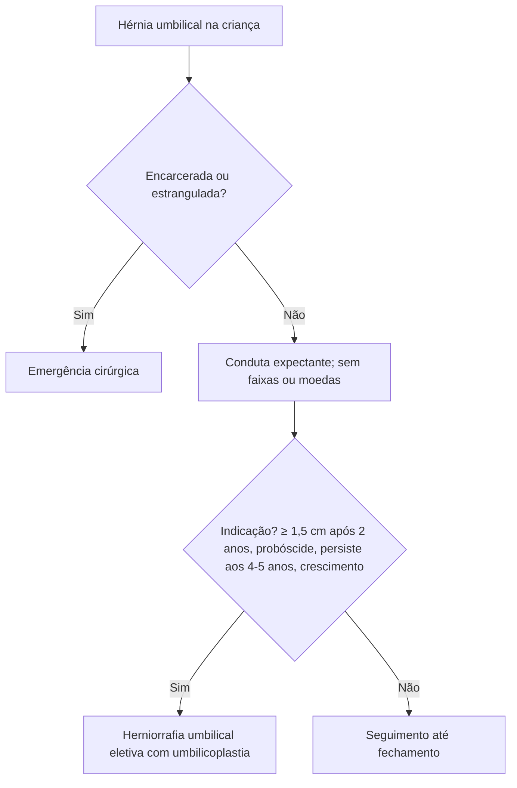

# Hérnia Umbilical em Pediatria

> Resumo em palavras próprias do Whitebook (Condutas Cirúrgicas > Cirurgia Pediátrica), sem fisiopatologia detalhada, autoria e referências. Confira detalhes e doses na fonte: https://whitebook.pebmed.com.br/conteudo/?id=49955&categoryId=207&subcategoryId=826

**Definição:** defeito de fechamento do anel umbilical (fibromuscular) com protrusão de conteúdo intra-abdominal.

## Fatores associados e epidemiologia
Aumento da pressão abdominal (ascite, tumores), predisposição familiar, trissomias 13, 18 e 21, Beckwith-Wiedemann, Marfan, mucopolissacaridoses, mielomeningocele, hipotireoidismo, infecção neonatal do umbigo, desnutrição e prematuridade. Sem predileção de sexo; mais comum em negros; mais frequente em prematuros (até **84%** em < 1.000 g); a maioria regride até os **7 anos**; a forma de pinçar/cortar o cordão não causa a hérnia.

## Clínica
Em geral assintomática: abaulamento redutível que aumenta com choro, tosse ou esforço (pode haver borborigmo). Tamanho do saco não é proporcional ao orifício; defeito amplo com pele redundante forma a "probóscide". Complicações raras (**0,07–0,3%**): encarceramento, estrangulamento, perfuração com evisceração, dor. Encarcerada: abaulamento doloroso irredutível; estrangulada: endurecida, com hiperemia, dor, distensão, náuseas e vômitos.
**Exame:** inspeção durante choro/tosse; palpar o anel (a extensão do defeito prediz melhor o fechamento espontâneo que o tamanho da hérnia).

## Diagnóstico e diferencial
Clínico, sem exames (imagem só se houver suspeita de encarceramento ou estrangulamento). Diferencial: onfalocele, hérnia de cordão, hérnia supraumbilical, granuloma e pólipo umbilical.

## Conduta
Ambulatorial; **expectante** (fecha na maioria até 2 anos; pode fechar até 7–8 anos), acompanhável pelo pediatra. **Contraindicado** usar faixas, moedas ou ataduras sobre o umbigo (limitam a musculatura, irritam e maceram a pele); orientar a família.
**Indicações cirúrgicas:** hérnia ≥ **1,5 cm** em criança > 2 anos; aspecto de "tromba de elefante" após 2 anos; defeito não fechado aos **4–5 anos**; aumento do tamanho após 1–2 anos; estrangulamento ou encarceramento (emergência).
**Cirurgia:** incisão umbilical, redução/ressecção do saco, fechamento do defeito aponeurótico e plastia da cicatriz umbilical. Laparoscopia é possível mas pouco usada (material, anestesia maior, custo-benefício). Complicações: infecção, hematoma/seroma, recidiva. Prognóstico excelente.

## Fluxograma (refeito, a partir do texto; o original não traz algoritmo)

