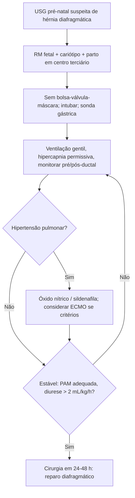

# Hérnia de Bochdalek

> Resumo em palavras próprias do Whitebook (Condutas Cirúrgicas > Cirurgia Geral e do Aparelho Digestivo), sem fisiopatologia, autoria e referências. Confira detalhes e doses na fonte: https://whitebook.pebmed.com.br/conteudo/?id=38901&categoryId=207&subcategoryId=211

**Definição:** hérnia diafragmática congênita posterolateral por falha no fechamento dos canais pleuroperitoneais (o direito costuma fechar antes do esquerdo). Representa **70%** das hérnias diafragmáticas congênitas; apresentação mais comum no período neonatal; saco herniário em ~20%.

## Repercussões
Vísceras (fígado, baço, estômago, intestinos, rins) no tórax comprometem o pulmão e sua vasculatura: hipoplasia pulmonar, hipertensão pulmonar (↑ resistência), persistência da circulação fetal, insuficiência cardíaca direita, hipoxemia, hipercarbia, acidose, deficiência de surfactante. Quanto maior o conteúdo herniado, pior; a gravidade depende da hipoplasia, da hipertensão pulmonar persistente, de shunts D→E e da função ventricular.

## Epidemiologia e associações
1,5–5,7/10.000 nascidos vivos; sexos iguais; 80–85% à esquerda (bilaterais raras e geralmente fatais). Associada a quinino, talidomida, deficiência de vitamina A, nitrofeno; outras anomalias em 28–50% dos nascidos vivos (cardíacas, tubo neural, linha média, geniturinárias); trissomias 13, 18, 21, deleções 1q, 8p, 15q; familiar < 2% (Cornelia de Lange, Fryns, Pallister-Killian); isolada ou sindrômica. Cerca de 10% se apresentam na infância/adulto à esquerda e 0,17% à direita. O diafragma está pronto com 8 semanas; o intestino médio retorna ao abdome em 9–10 semanas.

## Diagnóstico
- **Pré-natal** (46–97% pela USG de rotina): polidrâmnio, desvio do mediastino, hidropisia, ausência de bolha gástrica no abdome; complementar com RM fetal, aconselhamento genético e cariótipo. Pior prognóstico: herniação de estômago e fígado, polidrâmnio, anomalias associadas.
- **Pós-natal:** desconforto respiratório e cianose nas primeiras horas (formas tardias possíveis); abdome escafoide, tórax em tonel, murmúrio reduzido, desvio das bulhas, ruídos hidroaéreos no tórax; diferença entre oximetria pré e pós-ductal sugere shunt D→E. RX de tórax/abdome (sonda gástrica no tórax), ecocardiograma, estudos cromossômicos. Tardiamente: sintomas respiratórios, dificuldade alimentar, obstrução, isquemia por volvo.
- **Diferenciais:** malformação adenomatoide cística, cisto broncogênico, eventração, teratoma cístico, hérnia de Morgagni.

## Manejo inicial
- Sala de parto: **evitar ventilação com bolsa-válvula-máscara** (piora a distensão do TGI); intubação e ventilação mecânica se comprometimento grave; sonda nasogástrica/orogástrica precoce para descompressão (alguns usam bloqueio neuromuscular).
- Acesso arterial (umbilical ou radial) para gasometrias, sonda vesical, cateter na veia umbilical (volume, vasoativos). Meta PaO₂ > 50 mmHg; monitorar saturação pré e pós-ductal; manter glicemia e calcemia.
- **Tratamento clínico (hipoplasia e hipertensão pulmonar persistente):** ventilação com **hipercapnia permissiva**; alta frequência/baixa pressão se hipercarbia/hipoxemia resistente ou PEEP elevado > 30 cmH₂O (controverso); surfactante em 24 h nos de pior prognóstico; óxido nítrico inalatório (melhor após surfactante) ou sildenafila.
- **ECMO** se falha de VM de alta frequência e óxido nítrico: critérios — maior idade gestacional, peso > 2.000 g, sem grande hemorragia intracraniana, VM < 10–14 dias, sem anomalia letal ou cardíaca inoperável, pH < 7,15, índice de oxigenação (IO) > 40. Indicações: saturação pré-ductal > 85% inatingível, PaO₂ pós-ductal 30 mmHg, pH pós-ductal < 7,25, lactato > 5 mmol/L. IO = PAM das vias aéreas × FiO₂ × 100 / PaO₂: < 0,06 sobrevida 98%; > 0,175 sobrevida 0% (conforme o texto).

## Cirurgia
- Tratamento definitivo; hoje **não é emergência** se a estabilização é adequada (PAM adequada à idade gestacional, diurese > 2 mL/kg/h, sem hipertensão pulmonar). Exceção: desvio mediastinal com repercussão hemodinâmica ou suspeita de estrangulamento visceral.
- Reparo aberto intraútero não melhorou o prognóstico; foco atual: oclusão traqueal endoscópica fetal.
- Momento: sem consenso, geralmente 24–48 h após a estabilização; com ECMO, pode-se adiar até o fim.
- Drenagem pleural só se pneumotórax.
- **Técnica:** incisão subcostal ou toracotomia; redução das vísceras; reparo primário do diafragma em um plano; defeitos grandes: tela sintética ou retalho muscular (alguns fazem fundoplicatura profilática); corrigir má rotação (Ladd); fechamento tardio da parede abdominal para evitar síndrome compartimental; toracoscopia/laparoscopia em neonatos com baixa necessidade ventilatória ou apresentação tardia.
- **Complicações:** recorrência da hipertensão pulmonar e da hérnia, hidrotórax, quilotórax, obstrução por aderências ou volvo.
- **Prognóstico:** sobrevida 69–90% conforme o serviço; risco de recorrência precoce e tardia; seguimento inclui doença do refluxo (o texto extraído termina nesse ponto; confira outras sequelas na fonte).

## Fluxograma (refeito, a partir do texto; o texto original não traz uma figura)

