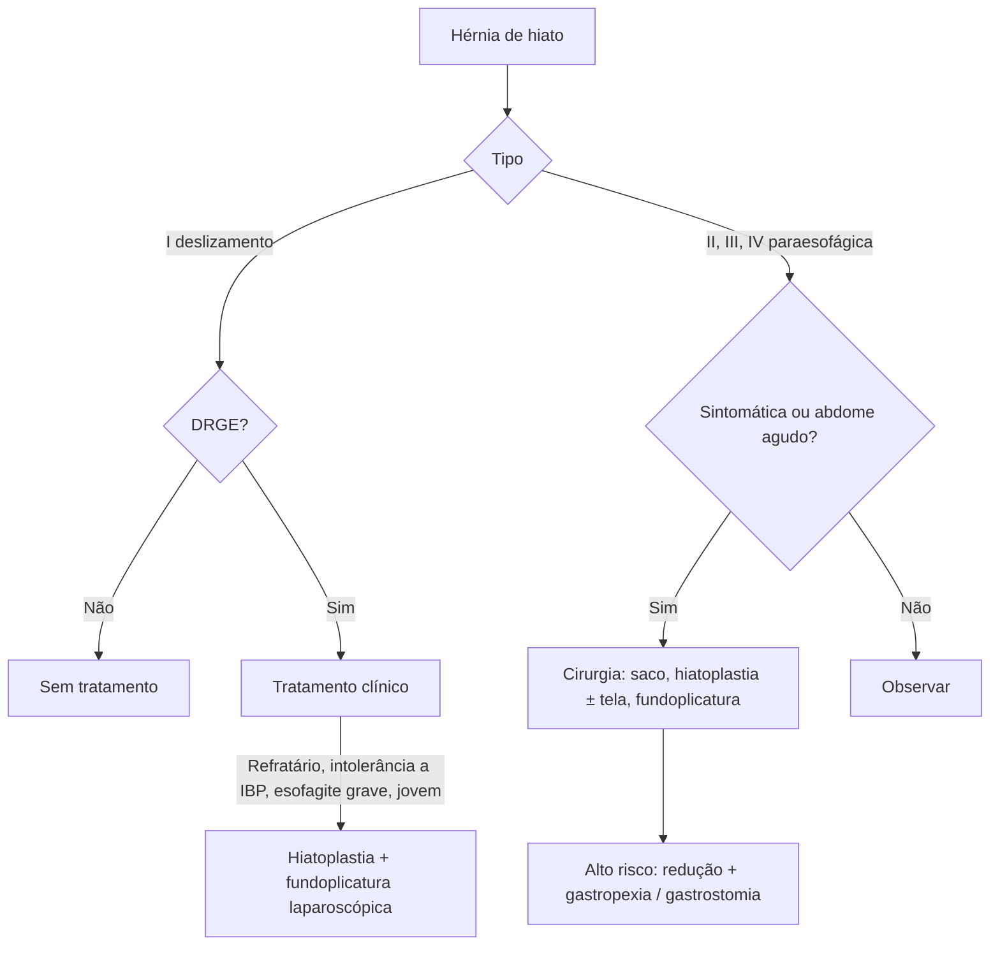

# Hérnia de Hiato

> Resumo em palavras próprias do Whitebook (Condutas Cirúrgicas > Cirurgia Geral e do Aparelho Digestivo), sem fisiopatologia, autoria e referências. Confira detalhes e doses na fonte: https://whitebook.pebmed.com.br/conteudo/?id=22581&categoryId=207&subcategoryId=211

**Definição:** protrusão de elementos abdominais (exceto o esôfago) pelo hiato esofágico do diafragma para o tórax. Sinônimo: hérnia hiatal.

## Epidemiologia
4ª–6ª década, sem predileção por sexo; ~50% descobertas em EDA por outra queixa; adquirida > congênita; estômago é o órgão que mais hernia; 85–95% são por deslizamento; menos da metade se associa à DRGE.

## Classificação
- **Tipo I (deslizamento, ~95%):** a JEG sobe acima do diafragma, estômago mantém o alinhamento e o fundo fica abaixo da JEG.
- **Tipo II (rolamento):** puramente paraesofágica; JEG em posição normal, parte do fundo hernia ao lado do esôfago.
- **Tipo III:** combinação de I e II (mais comum entre as paraesofágicas).
- **Tipo IV:** herniação de outros órgãos (omento, cólon, baço, pâncreas, delgado).
- **Hérnia gigante:** definição variável — tipos III/IV com mais de 2/3 ou 30% do estômago no tórax. **Recorrente:** qualquer hérnia vista em contraste ou EDA no pós-operatório, ou > 2 cm.
- Paraesofágicas (5%): complicação de cirurgia antirrefluxo, esofagectomia ou gastrectomia parcial.

## Quadro clínico
- Pequenas: assintomáticas; grandes: pirose, regurgitação, disfagia. Complicações são raras e ligadas ao refluxo.
- **Paraesofágicas:** assintomáticas ou vagas; dor epigástrica/subesternal (simula angina), disfagia por compressão, plenitude pós-prandial, náusea, vômito, anemia ferropriva por erosões lineares (Cameron), menos DRGE que no tipo I; volvo gástrico, dor pós-prandial, sangramento (úlcera, gastrite na bolsa), compressão respiratória.
- **Fatores de risco:** deslizamento — idade, obesidade, gestação, tumores abdominais, ascite, hiperêmese, vômitos, tosse crônica, tabagismo; paraesofágica — cirurgia prévia de refluxo, esofagectomia, gastrectomia parcial, trauma, deformidades esqueléticas (escoliose, cifose, pectus), defeitos congênitos (causa mais comum em crianças). Risco de sintomas agudos que exijam cirurgia de urgência em paraesofágica: < 12% (< 2%/ano).

## Diagnóstico
Em geral incidental. DRGE sem sinais de alarme: tratamento clínico empírico sem exames.
- **RX de tórax:** opacidade de partes moles ± nível hidroaéreo, **nível hidroaéreo retrocardíaco (patognomônico)**, alças no tórax.
- **Esofagograma/seriografia:** mais sensível; avalia JEG, fundo, tamanho e redutibilidade; em urgência (volvo/estrangulamento) pode-se usar contraste oral/TC.
- **EDA:** indicada se refratário ao tratamento empírico, idade > 50, sintomas atípicos, sinais de alarme (sangramento, perda de peso, anemia, disfagia), antes de cirurgia antirrefluxo. Tipo I: JEG > 2 cm acima do pinçamento diafragmático e hiato dilatado na retroversão; II–IV: fundo acima do diafragma e compressão extrínseca; úlceras de Cameron nas dobras da hérnia. Cuidado: JEG móvel, metaplasia dificulta localizar, insuflação excessiva superestima a hérnia.
- **Manometria:** planejamento da DRGE; distância entre o crus do diafragma e o EEI > 2 cm define a hérnia; avalia peristalse e ponto de inversão respiratória.
- **Diferenciais:** esofagite, distúrbios de motilidade, dispepsia funcional, doença coronariana.
- **Complicações:** esofagite erosiva, Barrett, adenocarcinoma, pneumonia aspirativa, volvo, obstrução, perfuração, restrição ventilatória, HDA/anemia.

## Tratamento
- **Clínico** para todos os sintomáticos com DRGE.
- **Cirurgia:**
  - Deslizamento com DRGE e sintomas persistentes (regurgitação) apesar do tratamento, intolerância/má adesão a IBP, esofagite refratária ou grave, necessidade de tratamento clínico prolongado (< 50–55 anos), preferência do paciente.
  - Todas as paraesofágicas sintomáticas (refluxo grave, anemia, disfagia, dificuldade de esvaziamento) ou com abdome agudo. Deslizamento sem refluxo e paraesofágica assintomática: sem cirurgia de rotina.
  - **Padrão:** fundoplicatura de Nissen (360°) laparoscópica; Toupet (270°) também é eficaz; se motilidade esofágica comprometida, evitar 360°. Via transabdominal ou transtorácica, aberta ou minimamente invasiva (laparoscópica/robótica = padrão-ouro).
  - **Etapas:** tratar o saco herniário; fechar o defeito hiatal (sutura primária ou tela se houver tensão; incisão de relaxamento no pilar direito); fundoplicatura total ou parcial (se DRGE); gastropexia anterior (não rotina). Mobilizar ≥ 3 cm de esôfago intra-abdominal. Maior morbimortalidade: > 70 anos, urgência, comorbidades. Tela é defendida por alguns em hérnias grandes.
  - **Alto risco:** redução laparoscópica ou endoscópica com gastropexia por sutura ou gastrostomia percutânea (seguro, maior recidiva).
- **Pós-operatório:** prevenir e tratar agressivamente náusea e vômito (recidiva precoce); descomprimir distensão gástrica (SNG/gastrostomia); disfagia é comum — progressão gradual da dieta; esofagograma só se disfagia grave ou suspeita de perfuração. **Recorrência:** obesidade, hérnia grande (> 5,6 cm²), aumento precoce da pressão abdominal. **Disfagia pós-hiatoplastia:** hiato apertado, válvula com corpo gástrico, migração da válvula para o tórax. **Reoperação:** disfagia persistente ou perda > 9 kg, sintomas sem resolução, complicações, recorrência.

## Fluxograma (refeito, a partir do texto; o texto original traz figuras ilustrativas)

