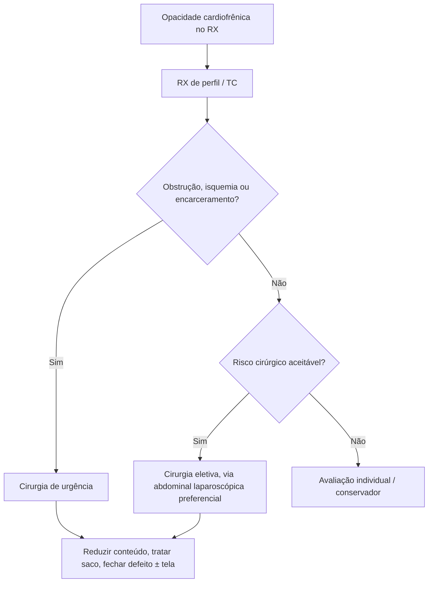

# Hérnia de Morgagni

> Resumo em palavras próprias do Whitebook (Condutas Cirúrgicas > Cirurgia Geral e do Aparelho Digestivo), sem fisiopatologia, autoria e referências. Confira detalhes e doses na fonte: https://whitebook.pebmed.com.br/conteudo/?id=38902&categoryId=207&subcategoryId=211

**Definição:** defeito diafragmático anterior e congênito, por falha de fusão das fibras esternais e costais do diafragma, que permite protrusão de conteúdo abdominal. Corresponde ao defeito anteromedial (forame de Larrey), mais comum à direita.

## Aspectos principais
- Conteúdo: cólon (54–72%) ou omento (65%); também delgado, estômago e fígado. Saco herniário em 10–20%. Associada a má rotação.
- Quanto maior o conteúdo herniado, maior o comprometimento pulmonar (hipoplasia, hipertensão pulmonar etc.).
- **Epidemiologia:** forma mais rara de hérnia diafragmática congênita (2–5%); ~90% à direita (o pericárdio dificulta o lado esquerdo); muitas ficam silenciosas até a vida adulta; discreta predominância feminina; associada a anomalias cardíacas (80%), pentalogia de Cantrell, má rotação, síndromes de Down, Noonan, Prader-Willi e Turner. Vísceras: cólon > fígado > delgado > estômago > omento > baço.

## Quadro clínico
Maioria assintomática, achado incidental. Sintomas: desconforto abdominal, plenitude, vômitos, náuseas, tosse, infecções respiratórias recorrentes. Pode ser descoberta por aumento da pressão abdominal (trauma, gestação, obesidade, derivação ventriculoperitoneal, pneumoperitônio de cirurgia minimamente invasiva). Casos extremos: encarceramento/estrangulamento com obstrução ou isquemia.

## Diagnóstico
- **RX de tórax** com incidência de perfil para confirmar a localização anterior: opacidade no ângulo cardiofrênico, níveis aéreos; enema baritado mostra o intestino. Esofagograma contrastado: mais usado em crianças.
- **TC (ou RM):** método de escolha; tamanho do defeito, conteúdo herniado, relação com o tórax; planejamento cirúrgico. RM raramente usada (dúvida ou contraindicação à TC).
- **Diferenciais:** cisto pleuropericárdico, mesotelioma pleural, gordura pericárdica, lipoma mediastinal, cisto/tumor diafragmático, timoma, tumores de parede torácica.

## Tratamento
- A maioria recomenda cirurgia mesmo em assintomáticos (risco de encarceramento, estrangulamento, perfuração); em apresentação aguda é obrigatória; conservador exige avaliação individual (alto risco).
- **Via abdominal** (preferida por muitos): melhor manipulação e fixação à parede anterior; laparotomia, laparoscopia ou robótica. **Via torácica:** aderências torácicas importantes, complicações pulmonares ou dificuldade de acesso abdominal; toracotomia ou toracoscopia.
- **Técnica:** reduzir o conteúdo, tratar o saco (controverso), fechar o defeito (com ou sem tela), fixar/reforçar. Ressecção do saco e tela não são obrigatórias sempre. A laparoscopia é a escolha na maioria dos centros (menor morbidade, recuperação rápida, boa visão).
- **Complicações:** derrame pleural, infecção de ferida, atelectasia, pneumonia, sepse.

## Fluxograma (refeito, a partir do texto; o texto original não traz uma figura)

