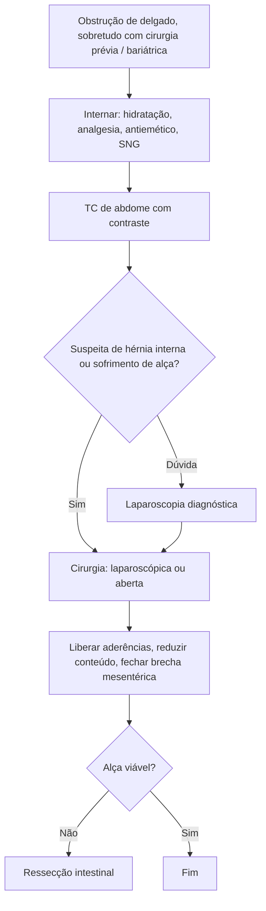

# Hérnias Internas

> Resumo em palavras próprias do Whitebook (Condutas Cirúrgicas > Cirurgia Geral e do Aparelho Digestivo), sem fisiopatologia, autoria e referências. Confira detalhes e doses na fonte: https://whitebook.pebmed.com.br/conteudo/?id=39159&categoryId=207&subcategoryId=211

**Definição:** protrusão de vísceras abdominais por abertura intraperitoneal ou fossa retroperitoneal, a partir de estrutura anatômica preexistente, anomalia de rotação, inserção peritoneal ou defeito adquirido (trauma, cirurgia). Sintomas geralmente inespecíficos; grande desafio na emergência.

## Etiologia
- Estruturas preexistentes (forames de Winslow e de Waldeyer); anomalias congênitas de rotação e inserções peritoneais; trauma (omento, mesentério, mesocólon); pós-operatórias (transmesocólica, mesentério de enteroenteroanastomose, espaço de Petersen entre a alça em Y de Roux e o mesocólon transverso, orifícios laparoscópicos como no ligamento falciforme ou fechamento peritoneal de hernioplastia); pós-inflamatória.

## Epidemiologia
- **0,6–6%** das obstruções do delgado; incidência subiu (~9%) com videocirurgia e cirurgia bariátrica; as pequenas causam sintomas recorrentes autolimitados e passam sem diagnóstico.
- Risco de estrangulamento/isquemia **> 60%**, mortalidade **20–50%**.

## Quadro clínico
- Podem ser assintomáticas; síndrome obstrutiva (dor vaga epigástrica ou periumbilical em cólica, náuseas, vômitos, distensão, parada de gases e fezes), com episódios intermitentes e alívio conforme a posição; dor constante e intensa na isquemia.
- História cirúrgica, perda ponderal importante (bariátrica), trauma penetrante prévio.
- Exame: distensão, peristalse de luta e depois aperistalse, hipertimpanismo, massa dolorosa (alças encarceradas), toque sem fezes; excluir hérnias de parede; irritação peritoneal e sepse são tardios.

## Diagnóstico
- **RX:** distensão localizada de delgado com níveis, alças saculadas e agrupadas, posição anormal, pneumoperitônio; seriografia mostra dilatação segmentar e estase na alça herniada. Não define a etiologia.
- **TC** (indispensável; reconstruções multiplanares): sítio, gravidade e causa; distribuição anormal dos vasos mesentéricos, edema, alças encapsuladas em posição anômala, estase, *mesenteric swirl*; sinais tardios de isquemia (espessamento, pneumatose, falta de realce, gás portal, pneumoperitônio).
- **Laparoscopia diagnóstica:** acurácia **> 90%**, corrige o diagnóstico pré-operatório em > 40%, permite tratar.
- **Classificação:** A paraduodenal (53%); B forame de Winslow (8%); C intersigmóidea (6%); D pericecal (13%); E transmesentérica/transmesocólica (8%); F retroanastomótica (5%); paravesical (7%, não é hérnia interna verdadeira).
- **Diferenciais:** brida, neoplasias, hérnias de parede complicadas, íleo adinâmico, apendicite, diverticulite, abscesso, volvo, íleo biliar, bezoar, invaginação, enterite actínica, estenose, fecaloma.

## Tratamento
- Todos com obstrução aguda são internados: hidratação, analgesia, antieméticos, SNG aberta.
- Em geral o tratamento é **cirúrgico** (dificuldade diagnóstica e maus resultados do não operatório), sobretudo se houver suspeita de sofrimento de alça ou perfuração. Estratégia: liberar aderências, reduzir o conteúdo, **fechar a brecha mesentérica**, ressecar se inviável. Via laparoscópica ou aberta conforme o cirurgião e a estabilidade. Conhecimento anatômico é essencial (risco vascular). Alguns casos resolvem sozinhos.

## Tipos específicos
- **Paraduodenal** (mais comum): homens 3:1; dor pós-prandial desde a infância; esquerda (75%, fossa de Landzert) e direita (25%, fossa de Waldeyer, com anomalia de rotação). Esquerda: massa ovoide com alças jejunais no QSE, rebaixando o cólon transverso; direita: alças lateralmente e abaixo do duodeno descendente, mais volumosas e fixas. **Evitar seccionar às cegas o saco** (vasos mesentéricos na parede).
- **Pericecal** (2ª): subtipos ileocólica, retrocecal, ileocecal, paracecal; dor em FID simulando apendicite; obstrui/estrangula com mortalidade **> 75%**; mais comum a herniação do íleo atrás do ceco para a goteira parietocólica direita.
- **Forame de Winslow:** delgado (60%), cólon ascendente (25–30%); risco: forame largo, mesentério longo, mesocólon ascendente persistente, lobo de Riedel; aumento súbito de pressão; vômitos por compressão gástrica, icterícia rara, alívio inclinando o tronco; RX semelhante à paraduodenal esquerda, sem cápsula.
- **Intersigmóidea:** íleo pela fossa entre segmentos do sigmoide; congênita ou adquirida; geralmente redutível, achado de laparotomia.
- **Transmesentérica/transmesocólica:** sem saco; infância (defeito congênito perto da ileocecal ou Treitz); adultos (iatrogênica). Muito associada a transplante hepático e bypass em Y de Roux retrocólico, sobretudo laparoscópico (espaço de Petersen). Transmesocólica é a mais comum; transmesentérica tem risco de volvo e estrangulamento > 30%. Predisponentes: fechamento inadequado das brechas e perda rápida de peso; mais comum após 1 mês. "Nó de Gordian": massa dolorosa. **Suspeita = cirurgia de emergência.**
- **Retroanastomótica:** alça atrás de defeito anastomótico (bypass, transplante); alça eferente em 75% (anastomose retrocólica) ou aferente (antecólica); 1º mês de pós-operatório; menor estrangulamento; contraste de TGI superior confirma; tratamento: fechar a brecha.
- **Transomental** (1–4%): defeitos em fenda no grande omento (até 10 cm); TC ou laparotomia.

## Prognóstico
Muito bom com diagnóstico e tratamento precoces; recidiva rara após fechamento. Com isquemia/perfuração, mortalidade de até 50%.

## Fluxograma (refeito, a partir do texto)

