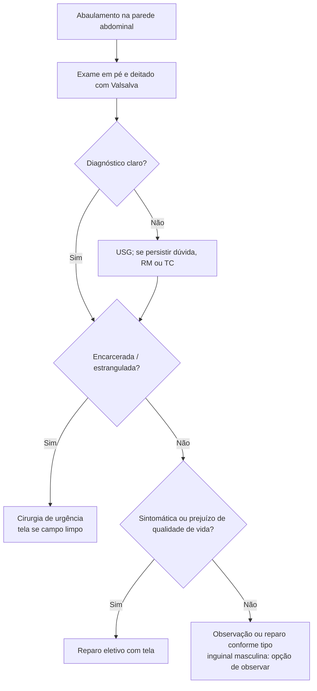

# Hérnias de Parede Abdominal

> Resumo em palavras próprias do Whitebook (Condutas Cirúrgicas > Cirurgia Geral e do Aparelho Digestivo), sem fisiopatologia, autoria e referências. Confira detalhes e doses na fonte: https://whitebook.pebmed.com.br/conteudo/?id=22582&categoryId=207&subcategoryId=211

**Definição:** saliência anormal de órgão ou tecido por defeito ou área de fraqueza da parede abdominal.

## Quadro clínico e exame
- Abaulamento, dor/desconforto que piora com Valsalva (tosse, esforço); urgência por encarceramento/estrangulamento (± obstrução); cirurgias prévias.
- Avaliar tamanho do saco, anel herniário, redutibilidade, sinais inflamatórios e pele. Exame em pé e deitado, com e sem Valsalva.
- Região inguinal: inspeção/palpação, tosse, dedo no canal inguinal pela invaginação do escroto. Protuberância que vai de lateral para medial sugere **indireta**; que vem do fundo para a superfície pelo assoalho sugere **direta** (distinção imprecisa, confirmada no intraoperatório sem prejuízo). Abaulamento **abaixo do ligamento inguinal**: femoral.
- **Encarceramento:** não reduz às manobras. **Estrangulamento:** dor local, sinais flogísticos, febre, queda do estado geral, obstrução (náusea, vômito, dor, distensão).

## Diagnóstico
- Clínico (sensibilidade **74,5%**, especificidade **96%**). Imagem se exame duvidoso, hérnia pequena ou obeso.
- **USG:** 1º exame na dúvida; com exame físico indefinido na hérnia inguinal, sensibilidade 33–77% e especificidade 81–100%; útil em epigástrica, Spiegel, crural (sobretudo em mulheres), incisional, lombar, umbilical.
- **TC:** hérnias lombares e incisionais grandes; planejamento em grandes hérnias ventrais com perda de domicílio (pneumoperitônio terapêutico, ressecção).
- **RM:** dúvida persistente após clínica e USG, superior à TC; para crural: especificidade 96,3%, sensibilidade 94,5%; identifica hérnia do esporte e osteítes.
- **Classificação:** ventral (epigástrica, umbilical, Spiegel, paraestomal, incisional), flanco (triângulos lombares), inguinofemoral; congênita ou adquirida.
- **Diferenciais:** hematoma, tumores de parede (desmoide, lipoma), diástase do reto, adenomegalia, dor musculoesquelética, hidrocele, varicocele, pubeíte/osteíte, aneurisma, testículo ectópico, abscesso de psoas, cisto sebáceo, tendinite do adutor, endometriose, bursite iliopectínea.

## Hérnia epigástrica
- Defeito na linha mediana entre cicatriz umbilical e xifoide, geralmente **< 1 cm**; 3–5% da população; ~10% das hérnias de parede; mais em homens de meia-idade; encarceramento é raro.
- Geralmente assintomática; dor com aumento de pressão ou alimentação, alívio em decúbito dorsal; difícil em obesos; Valsalva com palpação; diferenciar de diástase do reto (raramente dói, abaulamento alongado ao longo dos retos). Sempre encaminhar ao especialista.
- Tratamento: sintomáticas; assintomáticas conforme tipo e risco; sutura primária ou tela nos grandes defeitos.

## Hérnia incisional
- 10–15% das incisões, até 23% quando há infecção de ferida; mais em linha média e incisões superiores/verticais.
- **Fatores de risco:** infecção da ferida (principal), obesidade, tabagismo, imunossupressores/corticoide, tensão, desnutrição, má técnica, colagenoses, idade > 70, sexo masculino, DPOC, ascite, icterícia, anemia, cirurgia de emergência, tosse.
- **Diagnóstico:** cirurgia prévia, abaulamento na incisão, tamanho do defeito, saco, redutibilidade; imagem em grandes hérnias.
- **Tratamento:** sempre avaliação cirúrgica; indicações: sintomas, risco de encarceramento, queda de qualidade de vida, desejo do paciente. Situações em que se pode adiar: abdome superior, hérnias < 1 cm, hérnias > 7–8 cm que reduzem espontaneamente. Defeitos grandes com perda de domicílio têm morbidade alta e risco de síndrome compartimental: separação de componentes, retalhos miofasciais, pneumoperitônio progressivo, expansores de tecido, toxina botulínica.

## Hérnia inguinal
- **Anatomia (orifício miopectíneo):** medial — bainha do reto; lateral — psoas maior; inferior — linha pectínea; superior — arco aponeurótico do oblíquo interno e transverso. Triângulo de Hesselbach: borda lateral do reto, ligamento inguinal/pectíneo, vasos epigástricos inferiores.
- 75% das hérnias de parede; indiretas são 2/3; mais em homens e à direita; 1–3% estrangulam; em pediatria, indireta por persistência do conduto peritoneovaginal (60% dos RN meninos aos 2 meses, 40% aos 2 anos, 35% aos 16; 10% bilaterais); mulheres: a mais comum também é a indireta.
- **Tipos:** direta (assoalho, Hesselbach), indireta (lateral, pelo funículo; congênita; a mais comum), mista (*pantaloon*). Nyhus: 1 — indireta com anel normal; 2 — indireta com anel dilatado e parede posterior intacta; 3 — defeito da parede posterior (A direta; B direta + indireta; C femoral); 4 — recidivada (A direta; B indireta; C femoral; D combinada).
- **Fatores de risco:** hérnia ou reparo prévio, idade, tosse crônica, constipação, tabagismo, história familiar.
- **Diagnóstico:** abaulamento que aumenta com esforço; inspeção, palpação, Valsalva, **sinal da seda (Gross)**.
- **Tratamento:** encaminhar ao cirurgião (risco de encarceramento, sobretudo nos primeiros anos de vida). **Observação** em homens assintomáticos/pouco sintomáticos, muito idosos com comorbidades e gestantes (salvo muito sintomáticas): > 70% desenvolvem sintomas e operam em 2 anos (maior risco precoce: dor em esforço, constipação, prostatismo, casados, ASA 1/2). Qualidade de vida é melhor nos operados; o momento é definido pelo prejuízo à qualidade de vida, não pelo risco (encarceramento/estrangulamento 0,3–3%/ano).
- **Técnicas:** abertas com ou sem tensão (Lichtenstein — a mais comum, Halsted, Shouldice, Stoppa, Bassini, Lotheissen-McVay); endoscópicas TAPP (transabdominal pré-peritoneal) e TEP (totalmente extraperitoneal). Inclui saco, redução do conteúdo e correção do defeito. **Tela** em ambos os acessos, sobretudo nas recidivas; em urgência (encarceramento/estrangulamento) usar tela se campo limpo (sem perfuração, peritonite ou abscesso). Mulheres têm mais recidiva em reparo aberto (hérnia femoral): preferir pré-peritoneal laparoscópico (TAPP/TEP). Sem tela: recusa, indisponibilidade, urgência com ferida contaminada.
- **Complicações:** infecção, hematoma, seroma, recidiva, dor crônica, orquite, hidrocele, lesão do deferente ou vasos femorais, hipo/hiperestesia, atrofia testicular.
- **Dor inguinal crônica** (≥ 3 meses): lesão nervosa ou periostite púbica. Risco: jovens, dor pré-operatória, reoperação < 3 anos, dor pós-operatória precoce grave, hematoma/infecção, distúrbio sensitivo prévio, cirurgia aberta, sexo feminino, hérnia recidivada. Prevenção: identificar ilioinguinal, ílio-hipogástrico e ramo genital do genitofemoral no reparo aberto; nervo lesado: seccionar, ligar com fio absorvível e sepultar; fixar tela no ligamento reflexo de Colles ou inguinal, sem tocar o osso. Neurectomia profilática não indicada. Tratamento multidisciplinar: medicações, bloqueios e ablação, cirurgia seletiva (neurectomia, retirada de tela, grampos ou suturas).

## Hérnia femoral
- Limites: trato iliopúbico (superior), ligamento de Cooper (inferior), veia femoral (lateral), ligamento lacunar (medial). ~3% das hérnias inguinais; mais em mulheres (mas a mais comum nelas ainda é a inguinal indireta); direita; estrangulamento **15–20%**, com mais ressecção intestinal.
- Em gestante, o diferencial de tumor inguinocrural é varizes do ligamento redondo (USG Doppler).
- **Cirurgia sempre indicada ao diagnóstico**; técnica aberta de McVay; laparoscópica tem menos recorrência e dor; evitar seccionar o ligamento redondo no reparo aberto (risco de lesão do genital e ilioinguinal), opcional no laparoscópico.

## Hérnia lombar
- Mais à esquerda (2×), 50–70 anos, 2/3 homens; a maioria relacionada a cirurgia prévia (urológica); bilateral muito rara (congênita); mais no triângulo superior; conteúdo geralmente cólon.
- **Triângulo superior (Grynfeltt)** e **inferior (Petit)**; há também hérnias lombares difusas.
- Classificação: adquiridas primárias 50% (idosos, perda de peso, pressão aumentada), secundárias 30% (cirurgia, infecção, hematoma, trauma), congênitas 20%.
- Massa posterior que aumenta com tosse e esforço, redutível, some no decúbito. **Tratamento só cirúrgico**, precoce, laparoscópico ou aberto com tela.

## Hérnia paraestomal
Complicação tardia de todo estoma, possivelmente evitável; do problema estético ao estrangulamento. Cirurgia nas complicações agudas e sintomas crônicos que prejudicam a qualidade de vida: tela (mais comum) ou reparo primário com mudança do estoma; aberto ou laparoscópico (preferencial).

## Hérnia de Spiegel
Na aponeurose de Spiegel (entre a linha das espinhas ilíacas anterossuperiores e o umbigo), geralmente na linha semilunar. Diagnóstico por USG, TC ou laparoscopia. Cirurgia assim que diagnosticada (sutura primária ou tela, aberta ou laparoscópica); recorrência incomum.

## Hérnia umbilical
- Mulheres 3:1; encarceramento mais em homens (menor redutibilidade nas mulheres); risco de estrangulamento pela rigidez do anel; recidiva comum em obesos, doença intra-abdominal e idosos.
- Adquirida (adultos; pressão aumentada: obesidade, ascite, gravidez) ou congênita (fecha sozinha aos 3–4 anos).
- Clínica: muitas vezes assintomática; dor por Valsalva; dor súbita com náusea, vômito e sinais inflamatórios = estrangulamento. Diagnóstico clínico; imagem só em obesos ou hérnia pequena.
- Tratamento: congênita — expectante até 3–4 anos; adquirida — se sintomática, irredutível, crescente ou complicada; assintomática dispensa reparo imediato. Corrigir antes a causa do aumento da pressão (obesidade, ascite, HPB, massa). Cirurgia: saco, redução, fechamento; tela sub-fascial se difícil aproximar sem tensão; **defeitos > 3 cm sempre com tela**.

## Fluxograma (refeito, a partir do texto; o texto original não traz um algoritmo único)

