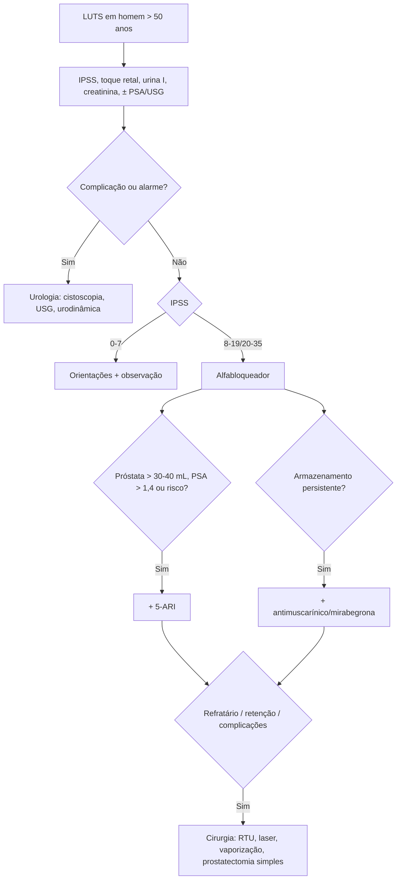

# Hiperplasia Prostática Benigna (HPB)

> Resumo em palavras próprias do Whitebook (Condutas Cirúrgicas > Cirurgia Urológica), sem fisiopatologia, autoria e referências. Confira detalhes e doses na fonte: https://whitebook.pebmed.com.br/conteudo/?id=22584&categoryId=207&subcategoryId=214

**Definição:** aumento benigno da próstata (proliferação estromatoglandular da zona de transição), comum após os 50 anos, com sintomas do trato urinário inferior (LUTS): hesitação, jato fraco, noctúria, esvaziamento incompleto. Câncer de próstata origina-se sobretudo na zona periférica. Causa mais comum de obstrução urinária baixa em homens. Prevalência histológica: 8% (31–40 anos), 40–50% (51–60), > 80% (> 80 anos). Não é fator de risco estabelecido para câncer de próstata.

## Clínica e exame
- **Armazenamento:** frequência diurna, noctúria, urgência, incontinência, sensação de esvaziamento incompleto. **Esvaziamento:** jato lento, intermitente, esforço. **Retenção urinária aguda** (risco: idade, sintomas, volume prostático). Correlação sintoma × tamanho é fraca.
- **IPSS (0–35):** 0–7 leve, 8–19 moderado, 20–35 grave (7 perguntas: esvaziamento incompleto, intervalo < 2 h, intermitência, jato fraco, esforço, urgência, noctúria; ± pergunta de qualidade de vida). Serve também para avaliar resposta ao tratamento.
- Toque retal: tônus do esfíncter, tamanho (cada polpa digital ≈ 15 g; subestima), consistência, nódulos, assimetria, endurecimento (descartar câncer); abdome: bexigoma; genitália.

## Diagnóstico
- **Rotina:** urina I (infecção, hematúria, glicosúria); ureia e creatinina.
- **PSA:** não é necessário para o diagnóstico; indica volume (inibidores de 5-α-redutase eficazes se próstata > 35 g, em geral PSA > 1,5 ng/mL); dosar antes de iniciar o inibidor (reduz ~50%; em rastreio considerar o dobro); relação linear com volume (~0,3 ng/mL por grama); PSA livre correlaciona-se mais com volume; PSA pode se elevar sem câncer e câncer pode ter PSA ≤ 4. Sugestivo de HPB: densidade < 0,15 e PSA livre/total > 22% (unidade como no original).
- **Imagem:** RX de abdome (cálculo vesical = causa da obstrução até prova contrária); **USG** (volume — transretal superior; trabeculação, dilatação do trato superior, RPM; obrigatória se cirurgia). **Cistoscopia** se hematúria, estenose de uretra ou neoplasia vesical prévia.
- **Específicos:** diário miccional de 3 dias (sintomas de armazenamento/noctúria); **RPM** (> 50 mL pode ser obstrução ou hipoatividade; pior prognóstico clínico; recomendação fraca); **urofluxometria** (antes de tratamento medicamentoso ou invasivo; sobretudo se falha prévia, volume < 150 mL, esvaziamento com Qmáx > 10, RPM > 300 mL, idade < 50 ou > 80).
- **Diferenciais:** hiper/hipoatividade do detrusor, poliúria noturna, bexiga neurogênica, ITU, corpo estranho, prostatites, neoplasias de bexiga/próstata, cálculo ureteral distal, estenose de uretra, diabetes descompensado, ICC, fármacos (diuréticos, tricíclicos, anticolinérgicos, anti-histamínicos de 1ª geração).
- **Complicações:** retenção aguda, litíase renal e vesical, hematúria, ITU, hidronefrose, IRA pós-renal, divertículo vesical.

## Tratamento clínico
- Tratar se AUA/IPSS ≥ 8 ou impacto na qualidade de vida. **Encaminhar ao urologista:** complicações do trato superior/inferior, neuropatia, sintomas após tratamento invasivo, idade < 45, exame prostático alterado, hematúria sem infecção, incontinência, sintomas graves, retenção aguda, ITU repetida, hematúria macroscópica, litíase vesical ou creatinina elevada, controle inadequado com fármacos.
- **Orientações:** urinar sentado, evitar líquidos antes de dormir/sair, reduzir cafeína, álcool e diuréticos, micção dupla, ordenhar a uretra, tratar constipação, rever medicamentos.
- **Alfabloqueadores** (1ª escolha em obstrução; efeito imediato; IPSS 8–35): doxazosina 2–4 mg/dia; terazosina 1 mg (até 5–10); tansulosina 0,4 mg; alfuzosina 10 mg; silodosina 8 mg. Efeitos: hipotensão ortostática, tontura, astenia, disfunção ejaculatória; avisar o oftalmologista (síndrome da íris flácida); tansulosina e alfuzosina: menos hipotensão, mais disfunção ejaculatória.
- **Inibidores de 5-α-redutase:** finasterida 5 mg, dutasterida 0,5 mg; alteram a progressão (menos retenção e cirurgia); próstata > 40 mL e/ou PSA > 1,4–1,6 com sintomas moderados a graves; início em 6–12 meses; efeitos: ↓ libido, ejaculação, DE, ginecomastia 1–2%; reduzem PSA em 50%; podem reduzir sangramento pré-RTU.
- **Antimuscarínicos** (tolterodina, oxibutinina, darifenacina, solifenacina, tróspio): sintomas de armazenamento sem RPM alto (cautela com resíduo > 250–300 mL); efeitos: boca seca, constipação, dificuldade miccional. **Mirabegrona 50 mg:** armazenamento proeminente, em geral com alfabloqueador; contraindicada se PA ≥ 180/110. **Tadalafila 5 mg:** sintomas moderados a graves, com ou sem DE; contraindicações: nitratos/estimuladores de guanilato ciclase, doença cardíaca que contraindique sexo, IAM < 90 dias, angina instável, ICC NYHA ≥ 2 em 6 meses, arritmia/hipo/hipertensão não controladas, AVE isquêmico < 6 meses.
- **Combinações:** alfabloqueador + 5-ARI (risco de progressão: idade > 70, próstata > 30 g/40 mL, Qmáx < 12, PSA > 1,4–1,6); alfabloqueador + antimuscarínico (armazenamento persistente, RPM < 150 mL); alfabloqueador + beta-3 (dados limitados).

## Tratamento cirúrgico
- **Indicações:** LUTS moderados a graves refratários com grande limitação; retenção aguda persistente; retenção com falha de retirada de cateter; insuficiência renal por HPB; obstrução urodinâmica evidente; ITU recorrente, hematúria grave, litíase vesical recorrente relacionadas à HPB; lobo mediano com efeito valvular; recusa de terapia clínica.
- **Pré-operatório:** PSA, creatinina, urina e urocultura (tratar infecção), imagem da próstata, RPM e fluxometria; estudo fluxo-pressão se dúvida; profilaxia antimicrobiana; anticoagulante (varfarina: ponte com heparina ou suspender conforme risco/benefício).
- **Procedimentos transuretrais:** RTU (mono/bipolar, laser hólmio/túlio, incisão), enucleação (bipolar, hólmio/túlio, GreenLight®), vaporização (bipolar “plasma button”, GreenLight®), ablação (aquablação em investigação, embolização da artéria prostática, vapor Rezum®), Urolift®.
  - **RTU:** padrão; melhora ~90%, reoperação 10%; 60–90 min; observação de 24 h; complicações: ejaculação retrógrada, sangramento, incontinência; evitar esforço até epitelizar. ~5% têm câncer no espécime; se clinicamente significativo, biópsia guiada 3 meses depois.
  - **Vaporização (GreenLight®):** menos sangramento; opção se não pode suspender antiagregante/anticoagulante.
  - **Urolift®:** implantes permanentes, volumes < 80 g e sem lobo médio obstrutivo; resultado inferior à RTU.
  - **Incisão transuretral:** próstata ≤ 30 g com prominência do sulco medial; alarga colo e uretra prostática sem remover tecido.
  - **Ablação transperineal a laser (EchoLaser) e Rezum/iTind:** próstatas < 80 mL, menor prejuízo ejaculatório (jovens).
  - **Escolha:** maioria → RTU; próstata grande → RTU, enucleação a laser, vaporização ou prostatectomia aberta; anticoagulado → GreenLight®; alto risco cirúrgico → GreenLight®, embolização, incisão, Urolift®.
- **Prostatectomia simples** (aberta supra/retropúbica ou laparoscópica/robótica): mais antiga; mais efetiva em sintomas e fluxo, com mais complicações (impotência, sangramento); para próstatas muito grandes, calculose vesical ou divertículo.
- **Telemedicina:** perguntar evolução, jato, plenitude; sinais de alerta para consulta presencial: hematúria, ITU repetida, retenção aguda (história de cateter/cistostomia de urgência), oligoanúria, sinais de infecção, intervenção urológica prévia, má resposta ou efeitos adversos.

## Fluxograma (refeito, a partir do texto; o original não traz algoritmo)

